# Mermaid 图表

当用户要求画图、把说明转成图表、解释 Mermaid 代码或修复渲染失败时使用本 Skill。用户查看日程或项目计划时，若多日排期、里程碑或待办状态适合用图表提升可读性，也可主动在文字摘要后附图；按日期和工期表达计划用 `gantt`，按待办状态分组用 `kanban`。简单日程不强行配图，图表只反映已查询或已确认的数据，不代表日历或项目数据已被修改。当前项目 Mermaid 版本为 12.1.0；只使用该版本支持的图型和官方语法。不要把不同图型的语法拼在一起，也不要发明看起来合理但解析器不支持的简写。

## 先按问题选图型

| 要表达的内容 | 优先图型 | 适用例子 |
| --- | --- | --- |
| 步骤、分支、组件关系、数据流 | `flowchart` | 操作流程、服务架构、请求路径 |
| 参与者之间按时间发生的消息 | `sequenceDiagram` | API 调用、前后端交互、事件顺序 |
| 类、字段、继承和依赖 | `classDiagram` | 面向对象结构、模块类型关系 |
| 状态及状态转换 | `stateDiagram-v2` | 任务生命周期、连接状态 |
| 实体、属性、基数关系 | `erDiagram` | 数据库表和业务实体关系 |
| 带日期和工期的项目计划 | `gantt` | 排期、里程碑、依赖任务 |
| 按时间顺序记录事件 | `timeline` | 故障过程、版本演进、历史节点 |
| 用户分阶段体验及情绪 | `journey` | 用户旅程、服务体验 |
| 比例或组成占比 | `pie` | 分类统计、阶段分布 |
| 数值序列与分类趋势 | `xychart-beta` | 柱状图、折线图 |
| 工作列和任务卡片 | `kanban` | 待办、进行中、已完成看板 |
| 带权重的来源到去向流量 | `sankey` | 流量分流、来源贡献 |
| 问题原因分类和根因分支 | `ishikawa-beta` | 鱼骨图、故障归因 |

优先使用最简单且语义准确的图。节点少时用 `flowchart`；只有确实需要时间轴、实体属性、比例或看板列时才用专用图型。不要为了“看起来专业”给简单答案配图；图表旁边只补充读图需要的说明。

## 节点配色与视觉层级

- 先用图型、节点形状和分组表达语义；只有颜色能帮助快速区分类别时才增加配色，不要给每个节点随机换色。
- 架构图、组件图和数据流图可按职责给同类节点统一颜色：例如入口/客户端、核心服务、存储或外部依赖分成少量类别。建议最多 3 类主色；同一类别始终同色，并用形状或子图补充区分容易混淆的类别。
- 默认映射可从入口/客户端、核心服务、存储或外部依赖这几类职责中选取，分别使用主、次、辅助色系；按图的实际分类取舍，不要为了凑满三色拆分节点。
- 颜色应编码稳定语义，不用于装饰：成功/失败、警告等状态色只留给对应状态；不要让同一颜色在同一张图里同时代表不同含义。类别较多时优先用子图、形状或图例，不继续增加颜色。
- 默认沿用当前渲染主题的配色，让 Web 与 IM 跟随用户主题和调色板；不要在普通图里写死十六进制颜色、页面 CSS 或大面积高饱和样式。若用户明确要求自定义分类配色，再使用该图型支持的 `classDef` / `class` 或样式语法，并确认文字对比度、深浅主题可读性；需要读者解码颜色时加简短图例。
- 不同图型的配色能力不同。不要为 `sequenceDiagram`、`journey`、`pie` 等图型强行套用 Flowchart 的 `classDef` 语法；不确定时保留主题默认样式并查对应图型语法。

## 通用输出约定

- Mermaid 内容放在独立的 ```` ```mermaid ```` 代码块中；代码块里只放图表语法，不混入解释句或 Markdown 列表。
- 节点 ID 使用简短、唯一的 ASCII 字母/数字/下划线标识；用户可见的中文放在方括号、引号或图型规定的标题位置。
- 只写表达关系所必需的节点和边。避免超长节点文案、重复连线和无依据的关系；图过大时按子流程拆图。
- 检查图型声明、关键字、嵌套缩进、成对括号/引号、边连接符和元数据格式。不要把 Gantt 的任务状态写法套到 Kanban 或 Flowchart。
- XY Chart 的中文标题、含空格的标题/轴标题必须加双引号；分类轴的文本标签也使用双引号。
- Timeline 的事件行遵循“时间段 : 事件”，`section` 单独一行；不要把日期放在事件冒号后面。
- 用户要求代码时给代码；用户要求图片时，遵循当前产品的 Mermaid 渲染/导出链路。没有实际渲染或发送回执时，只能说已提供代码，不能声称图已成功显示或发送。
- 修复失败图时先保留其表达意图，逐项核对 Mermaid 12.1 对应图型的语法；不要未经说明地改成另一种图型，也不要用“渲染兜底”掩盖解析错误。
- 架构图需要表现分层时，优先先按边界分组，再考虑节点配色；箭头表达依赖或流向，颜色表达类别，两者不要承担同一个含义。

## 常用写法

### 流程图与子图

适用于步骤、条件分支、服务组件关系和调用链。方向可用 `LR`（左到右）或 `TD`（上到下）。

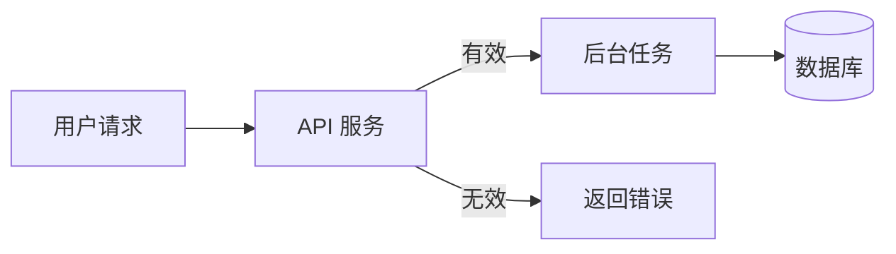

用 `subgraph` 表示逻辑分组。子图 ID 和标题之间留出清晰边界；方向声明单独放在子图内部。

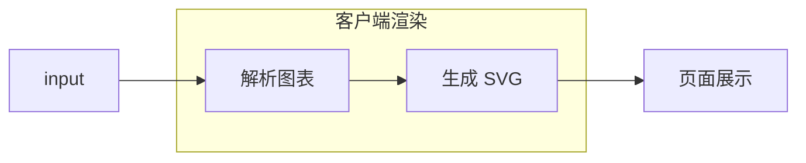

### 时序图

适用于参与者之间按时间发生的请求/响应。按发生顺序排列消息；只有存在真实分支时使用 `alt`、`else`、`end`。

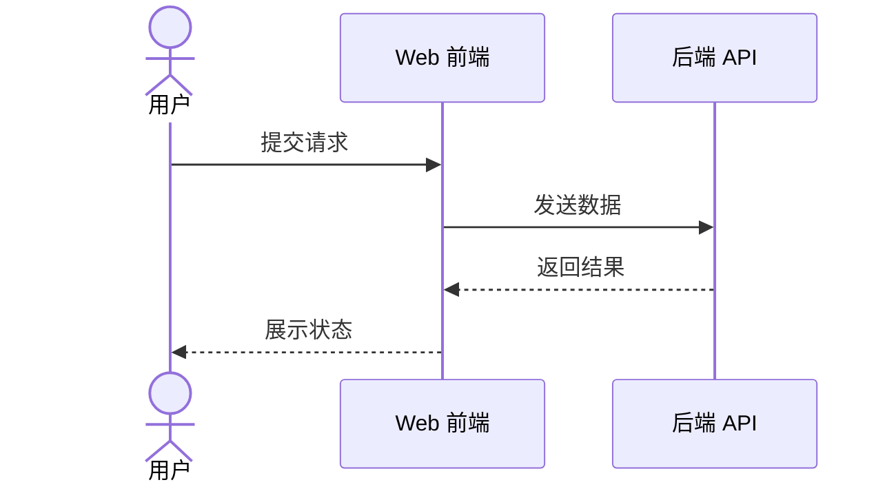

### 状态图

适用于有限状态和状态转换。状态转换写成 `当前状态 --> 下一状态`，不要用流程图边上的随意标签代替状态模型。

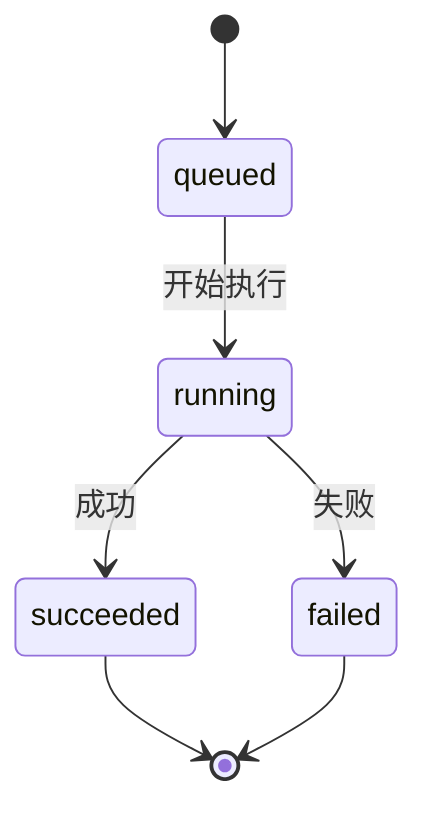

### 类图与实体关系图

类图适用于类型、成员和继承；ER 图适用于实体、属性和关系基数。不要把数据库字段堆进普通流程图。

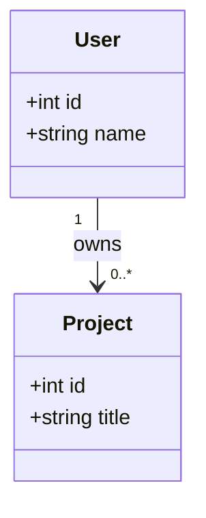

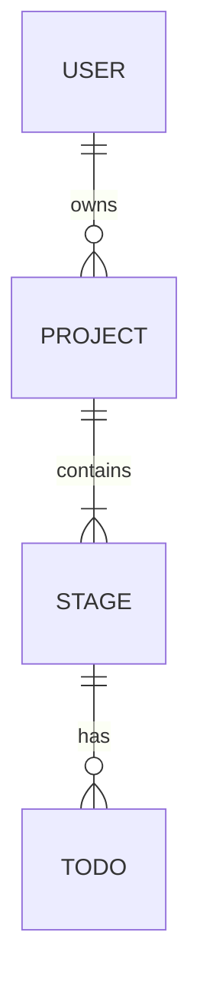

### 甘特图

适用于有开始日期、持续时间或依赖关系的计划。日期格式保持一致；Gantt 的状态修饰符属于任务行语法，不能移植到其他图型。

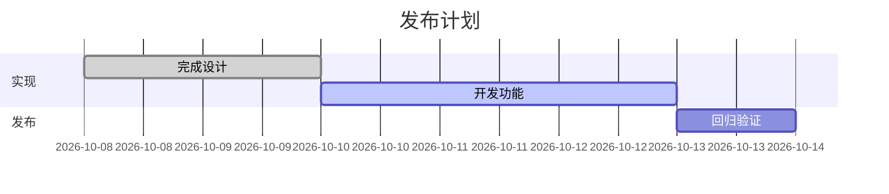

### 时间轴与 XY Chart

Timeline 的事件格式固定为“时间段 : 事件”，分组标题 `section` 单独成行；同一时间段可以追加多个事件。

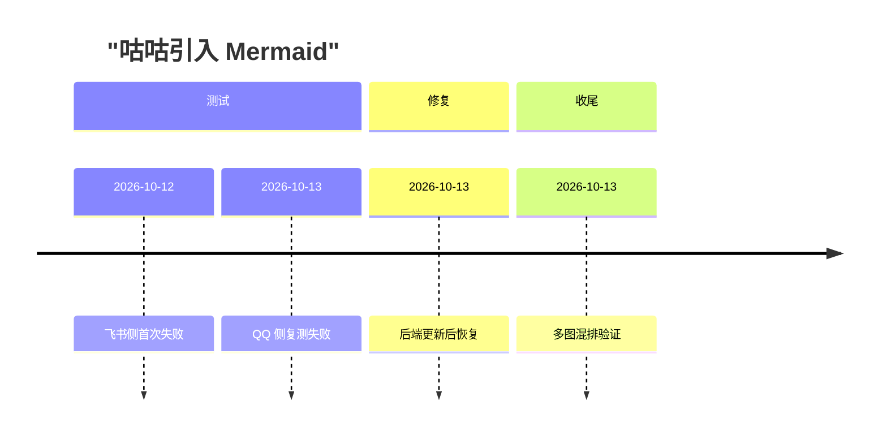

XY Chart 的中文标题与文本标签使用双引号，数值系列长度应与分类数量一致。

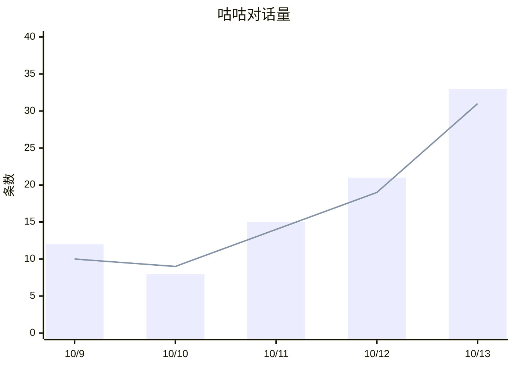

### 用户旅程、饼图和看板

Journey 的阶段和参与者应清晰；Pie 只用于表达占比。Kanban 列表示工作阶段，任务只写 `taskId[任务标题]`。状态应通过任务所在的列表达，不要追加 `{done}`、`{:done}`、`{active}` 等状态标签。Kanban 任务元数据只使用官方 `@{ ... }` 格式和支持字段。

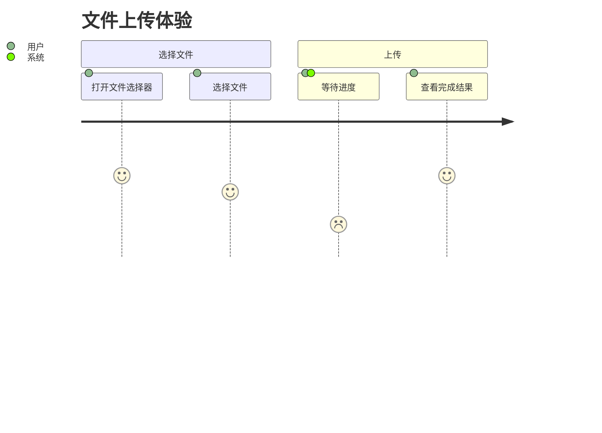

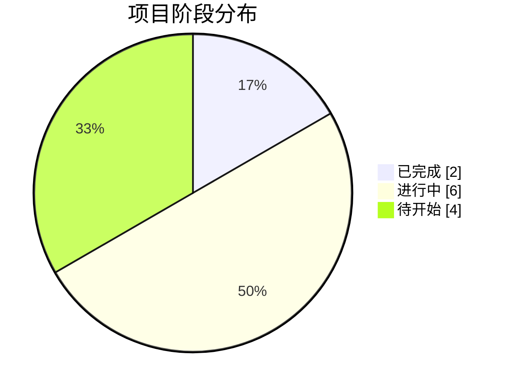

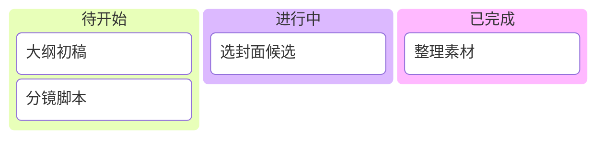

### Sankey 与鱼骨图

Sankey 的每行表示来源、目标、权重，声明使用 `sankey`；中文或包含逗号的来源/目标必须用双引号包裹。渲染器会在内部适配 Mermaid 12.1 的 Sankey ASCII 解析限制，并恢复图中的中文显示。鱼骨图在当前 Mermaid 版本使用 `ishikawa-beta` 声明；不要写 `fishbone`。

```mermaid
sankey
  "网页","直接渲染",30
  "QQ","直接渲染",20
  "QQ","返回代码块",5
```

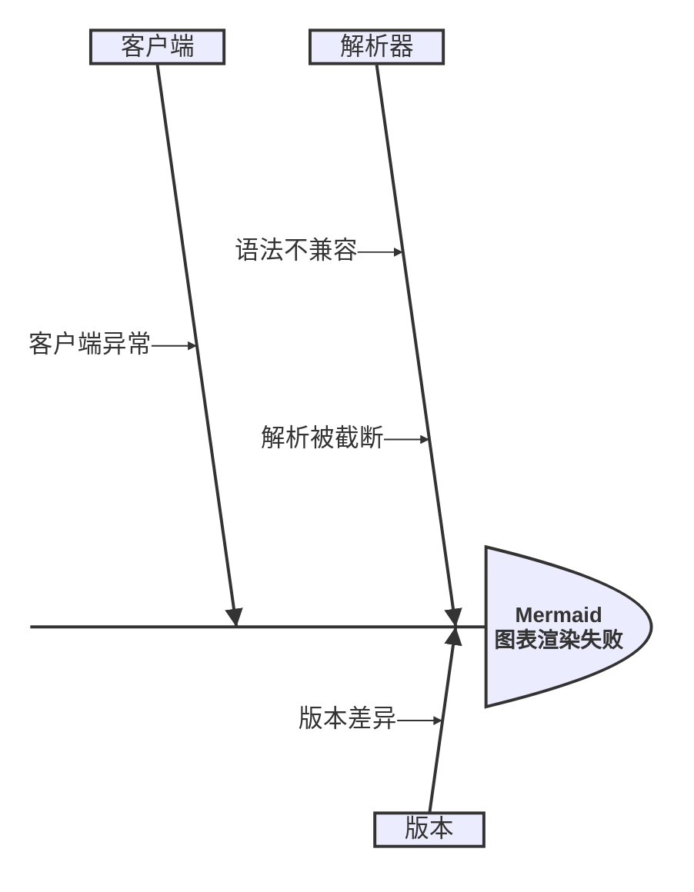

## 避免的错误

- 不要把自然语言描述直接当图表语法；先选图型，再按该图型的正式语法组织数据。
- 不要把不同 DSL 混用，例如把 Gantt 的 `:done` 修饰符或自创的 `{active}` / `{:done}` 附加到 Kanban 任务。
- 不要省略必需的缩进、唯一 ID 或字段分隔符；不要把 `subgraph`、`section` 等图型关键字当成普通节点随意使用。
- 不确定某种较新图型或语法是否由项目版本支持时，优先用本 Skill 中的常用图型；确需使用时先核对 Mermaid 12.1.0 官方文档，不要凭记忆猜语法。
