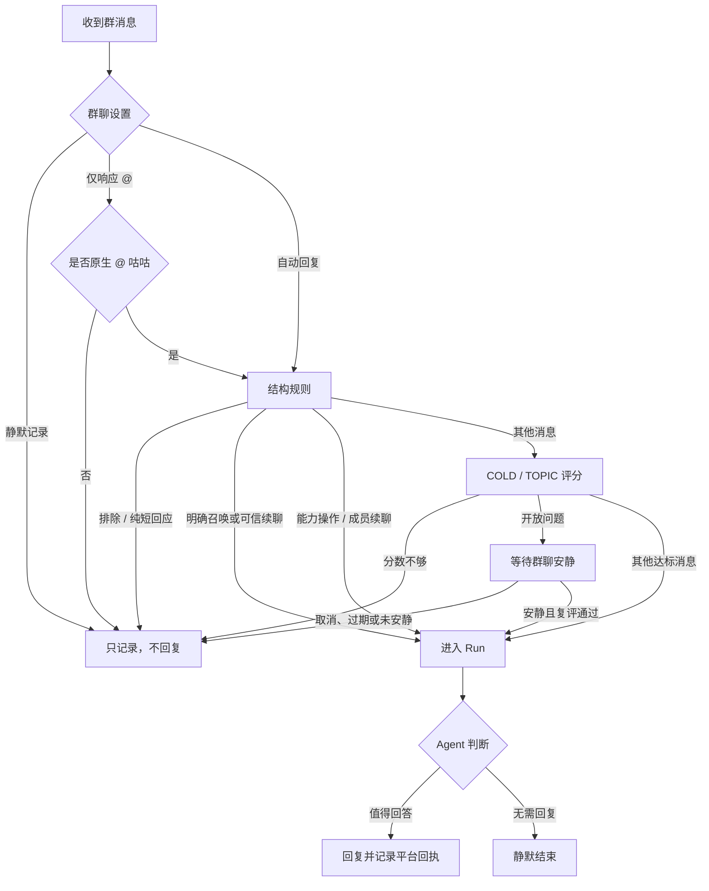

# 群聊自动回复算法

> 这份文档用简单流程说明咕咕何时进入 Run、何时回答。详细规则见 [注意力门控 PRD-IM-17](../prds/PRD-IM-17-群聊注意力门控.md) 和 [回复选择 PRD-IM-16](../prds/PRD-IM-16-群聊自动回复选择门.md)。注意力词根和句法规则目前主要针对中文优化。

## 先记住两件事

1. **准入：** 判断一条群消息值不值得启动 Run。
2. **回复：** Run 启动后，Agent 再判断是否真的要发言；不需要时可以调用 `choose_no_reply`。

分数过线只代表“可以考虑”，不代表一定回复。进入 Run 也不会获得额外工具权限。

## 处理流程

## 准入规则和公式

### 1. 先处理明确规则

群设置优先：静默记录模式不启动回复；仅 @ 模式只响应平台确认的原生 @。随后处理明确 @ 咕咕、可信续聊、明确发给他人的消息和纯短回应。

两条额外的快捷准入规则：

- **能力操作：** 消息里同时有操作动作、咕咕支持的能力对象，并且是在提出当前请求，就进入 Run。
- **成员续聊：** 咕咕成功回复某成员后，该成员 180 秒内的新消息（纯短回应除外）可以进入 Run。成员发言本身不延长时间。

$$
CAP(m)=V_{action}(m)\land O_{capability}(m)\land K_{request}(m)
$$

$$
MEMBER\_ACTIVE(m)=\mathbf{1}\left[\exists r:\;r.scope=m.scope\land r.sender=m.sender\land r.status=ACCEPTED\land 0<m.received\_at-r.accepted\_at<180000\;\mathrm{ms}\right]
$$

这里 `scope` 是同一平台、Bot 和群；`ACCEPTED` 表示平台接受了最终答复。快捷准入不改变工具权限。

### 2. 普通评分：COLD 和 TOPIC

没有有效话题锚点时是 **COLD**，只看当前消息。咕咕在群里成功发过消息且锚点未过期时是 **TOPIC**，还会看最近话题。

先对每个有效子句分别算召唤分和提问分，取最高值，不把两者相加：

$$
A(m)=\max_{u\in U(m)}\{A_{call}(u),A_{ask}(u)\},\qquad A(m)\in[0,1]
$$

**召唤分：** `N` 表示是否在叫咕咕，`V` 表示是否有请求动作，`K` 表示句子是否构成请求；陈述或转述时 `K=0`。

$$
A_{call}(u)=0.92\,N(u)V(u)K(u)
$$

`N` 表示是否在叫咕咕，`V` 表示是否有请求动作，`K` 表示句子是否构成请求（取 `0、0.8、0.9、1`；陈述和转述为 `0`）。

**提问分：** `Q=1` 是明确问题，`Q=0.85` 是较模糊的问题，`Q=0` 不是问题。长消息里的非定向问题会按出现位置降低分数；明确问咕咕不降位置分。`P` 是句末标点权重。

$$
A_{ask}(m)=0.90\max_{u\in U(m)}\left[Q(u)W(p_u,L)P(u)\right]
$$

$$
\alpha(L)=\operatorname{clamp}\left(\frac{L-200}{600},0,1\right),\qquad
W(p,L)=1-\alpha(L)\left[1-\left(0.55+0.45|2p-1|\right)\right]
$$

`L` 是可见消息的非空白字符数；`p` 是问句位于正文的位置，0 在开头、1 在结尾。以 `。` 结尾且没有明确发问结构或受话对象时 `P=0.65`，其余 `P=1`。单独加问号不会把陈述变成问题。

**话题分：** 以咕咕最近一条成功送达的群消息为锚点，取前后最多各 5 条群消息。所有群成员和其他 Bot 的消息都可提供话题线索，但不会刷新锚点的 600 秒有效期。

$$
W_{11}(b^*)=\{b_{-5},\ldots,b_{-1},b^*,b_{+1},\ldots,b_{+5}\}
$$

对当前消息 `m` 与窗口消息 `x`，`M` 是匹配到的非重叠字符数，`L_c` 是最长连续相同片段长度：

$$
C(m,x)=\frac{M(m,x)}{|m|},\qquad
P_{phrase}(m,x)=1-e^{-\max(0,L_c(m,x)-3)/4}
$$

$$
R_{CP}(m,x)=0.5C(m,x)+0.5P_{phrase}(m,x)
$$

`E` 比较两条消息中的局部短语。候选片段长 3–12 字，当前消息里的片段至少覆盖本句一半；允许 1–2 个字符的真实编辑，相同片段不算编辑匹配。没有合格片段时 `E=0`。

$$
E(m,x)=\max_{(a,b)\in H_{valid}(m,x)}\left(1-\frac{d(a,b)}{\max(|a|,|b|)}\right)
$$

取窗口里最高相关性，再按时间衰减：

$$
R_{topic}(m)=\max_{x\in W_{11}(b^*)}\{R_{CP}(m,x),E(m,x)\}
$$

$$
g(t)=\begin{cases}
\dfrac{2^{-t/360}-2^{-600/360}}{1-2^{-600/360}},&0\le t<600\\
0,&t\ge600
\end{cases},\qquad
T(m)=R_{topic}(m)g(t)^{0.25}
$$

`t` 是当前消息与锚点的秒数差。没有锚点或已超过 600 秒时 `T=0`。

### 3. 合并分数并判断是否准入

$$
S(m)=\begin{cases}
100A(m),&\text{COLD}\; (T=0)\\
100\left(A(m)+T(m)-A(m)T(m)\right),&\text{TOPIC}
\end{cases}
$$

| 模式 | 最低分数 |
|---|---:|
| QUIET | 85 |
| NATURAL | 65 |
| ACTIVE | 55 |

达到对应分数才通过普通评分。AUTONOMOUS 按原有行为处理，不使用这里的分数门槛或开放问题等待。

## 开放问题先等一等

在 scored 模式下，未明确问咕咕、且已达到分数门槛的开放问题会先等待：至少 60 秒；群里最近 30 秒没有咕咕以外的消息时，才考虑介入。最长等 180 秒；等待期间普通成员和其他 Bot 的消息都会重置安静计时。

若 `t₀` 是首个问题时间、`t_q` 是最新问题时间、`t_a` 是最近一条非咕咕消息时间，计划唤醒时间为：

$$
t_{due}=\min\left(t_0+180000,\;\max(t_0+60000,\;t_q+60000,\;t_a+30000)\right)
$$

到期后用最新群聊上下文重新评分。问题过期、被取消、没有安静下来或复评分未过线，都不会启动 Run。若启动，Agent 会查看等待期间的对话，再决定回答或静默；算法本身不尝试猜测群友是否已经回答。

## Run 后怎么决定回复

进入 Run 后，Agent 可以直接回答，也可以先用有权限的工具查证，再决定是否回复。若无需参与，调用 `choose_no_reply` 后本轮静默结束：不发送正文或工具过程消息，也不执行同批次的其他工具。没有正文时同样保持静默。工具权限与确认规则始终独立于注意力准入。

只有平台接受的最终答复会更新话题锚点和对应成员的 180 秒续聊时间；工具通知、失败发送和静默都不会更新。

## 代码入口

- 评分和硬路由：`backend/agent/im/auto_reply/attention_algorithm.py`、`runtime.py`
- 开放问题等待：`backend/agent/im/auto_reply/pending_ask.py`
- Run 内回复/静默选择：`backend/agent/im/auto_reply/decision.py`
- 详细规范：[PRD-IM-17](../prds/PRD-IM-17-群聊注意力门控.md)、[PRD-IM-16](../prds/PRD-IM-16-群聊自动回复选择门.md)
