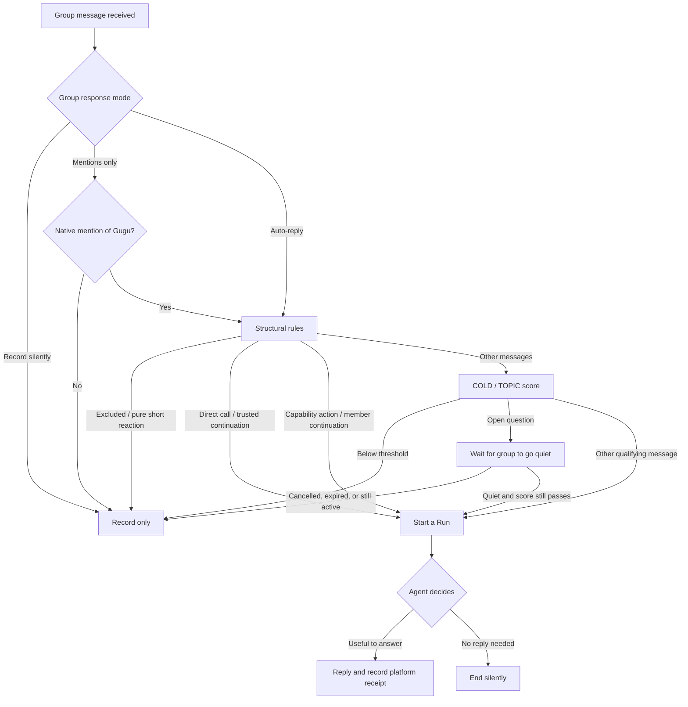

# Group Auto-Reply Algorithm

> This overview explains when Gugu starts an Agent Run and when it replies. For detailed rules, see [PRD-IM-17: Group Attention Gate](../../prds/PRD-IM-17-群聊注意力门控.md) and [PRD-IM-16: Group Reply Selection Gate](../../prds/PRD-IM-16-群聊自动回复选择门.md). The attention vocabulary and sentence rules are currently optimized mainly for Chinese.

## Two decisions

1. **Admission:** Is this group message worth starting an Agent Run for?
2. **Reply:** Once the Run starts, should the Agent actually speak? If not, it can call `choose_no_reply`.

Passing the score threshold only allows a Run; it does not guarantee a reply. Entering a Run does not grant additional tool permissions.

## Flow

## Admission rules and formulas

### 1. Apply explicit rules first

Group settings come first: silent-record mode does not start reply Runs; mentions-only mode responds only to a platform-confirmed native mention. Then handle direct mentions of Gugu, trusted continuations, messages explicitly directed elsewhere, and pure short reactions.

Two additional admission paths:

- **Capability action:** Start a Run when a message contains an action, a supported capability object, and a current request.
- **Member continuation:** For 180 seconds after Gugu's successfully delivered final reply to a member, that same member's new messages can start a Run, except pure short reactions. The member's messages do not extend the window.

$$
CAP(m)=V_{action}(m)\land O_{capability}(m)\land K_{request}(m)
$$

$$
MEMBER\_ACTIVE(m)=\mathbf{1}\left[\exists r:\;r.scope=m.scope\land r.sender=m.sender\land r.status=ACCEPTED\land 0<m.received\_at-r.accepted\_at<180000\;\mathrm{ms}\right]
$$

Here, `scope` means the same platform, bot, and group. `ACCEPTED` means the platform accepted the final reply. These admission paths do not change tool permissions.

### 2. Ordinary scoring: COLD and TOPIC

Without a valid topic anchor, the message is in **COLD** state and only the current message is scored. After Gugu has successfully sent a group message and while its anchor is valid, the message is in **TOPIC** state and recent conversation is also considered.

For each valid sentence, calculate the call and question scores separately and use the higher one:

$$
A(m)=\max_{u\in U(m)}\{A_{call}(u),A_{ask}(u)\},\qquad A(m)\in[0,1]
$$

**Call score:** `N` indicates whether the message addresses Gugu, `V` whether it contains a request action, and `K` whether the sentence is actually a request. Statements and reported speech have `K=0`.

$$
A_{call}(u)=0.92\,N(u)V(u)K(u)
$$

`N` and `V` are either 0 or 1. `K` is one of `0`, `0.8`, `0.9`, or `1`.

**Question score:** `Q=1` means a clear question, `Q=0.85` a vague question, and `Q=0` not a question. In long messages, non-directed questions are weighted by their position. Questions explicitly addressed to Gugu are not position-weighted. `P` is the punctuation weight.

$$
A_{ask}(m)=0.90\max_{u\in U(m)}\left[Q(u)W(p_u,L)P(u)\right]
$$

$$
\alpha(L)=\operatorname{clamp}\left(\frac{L-200}{600},0,1\right),\qquad
W(p,L)=1-\alpha(L)\left[1-\left(0.55+0.45|2p-1|\right)\right]
$$

`L` is the number of visible non-whitespace characters. `p` is the question's position in the message: 0 at the start and 1 at the end. For a sentence ending in the Chinese full stop `。`, `P=0.65` if it has no explicit question frame or addressee; otherwise `P=1`. A question mark alone does not turn a statement into a question.

**Topic score:** Use Gugu's latest successfully delivered group message as the anchor. The window contains up to five group messages before and after it. Messages from all members and other bots can provide topic evidence, but they do not extend the anchor's 600-second lifetime.

$$
W_{11}(b^*)=\{b_{-5},\ldots,b_{-1},b^*,b_{+1},\ldots,b_{+5}\}
$$

For the current message `m` and a window message `x`, `M` is the number of shared characters counted in non-overlapping blocks, and `L_c` is the longest shared contiguous span:

$$
C(m,x)=\frac{M(m,x)}{|m|},\qquad
P_{phrase}(m,x)=1-e^{-\max(0,L_c(m,x)-3)/4}
$$

$$
R_{CP}(m,x)=0.5C(m,x)+0.5P_{phrase}(m,x)
$$

`E` compares local phrases. Candidate phrases must be 3–12 characters long and cover at least half of the current sentence. It allows one or two real edits; identical phrases do not count as edit matches. If no candidate qualifies, `E=0`.

$$
E(m,x)=\max_{(a,b)\in H_{valid}(m,x)}\left(1-\frac{d(a,b)}{\max(|a|,|b|)}\right)
$$

Take the highest match in the window, then apply time decay:

$$
R_{topic}(m)=\max_{x\in W_{11}(b^*)}\{R_{CP}(m,x),E(m,x)\}
$$

$$
g(t)=\begin{cases}
\dfrac{2^{-t/360}-2^{-600/360}}{1-2^{-600/360}},&0\le t<600\\
0,&t\ge600
\end{cases},\qquad
T(m)=R_{topic}(m)g(t)^{0.25}
$$

`t` is the time since the anchor, in seconds. If there is no anchor or it is older than 600 seconds, `T=0`.

### 3. Combine scores and check the threshold

$$
S(m)=\begin{cases}
100A(m),&\text{COLD}\; (T=0)\\
100\left(A(m)+T(m)-A(m)T(m)\right),&\text{TOPIC}
\end{cases}
$$

| Mode | Minimum score |
|---|---:|
| QUIET | 85 |
| NATURAL | 65 |
| ACTIVE | 55 |

A message must meet its mode's threshold to pass ordinary scoring. AUTONOMOUS keeps its existing behavior and does not use these score thresholds or the open-question delay.

## Wait before answering an open question

In scored modes, an open question that meets the threshold but is not addressed to Gugu is held briefly. It must be at least 60 seconds old, and no one except Gugu may have sent a message for the last 30 seconds. The maximum wait is 180 seconds. Messages from members and other bots both reset the quiet timer.

Let `t₀` be the first question time, `t_q` the latest merged question time, and `t_a` the latest message time from someone other than Gugu. The planned wake-up time is:

$$
t_{due}=\min\left(t_0+180000,\;\max(t_0+60000,\;t_q+60000,\;t_a+30000)\right)
$$

At wake-up, score again using the latest group context. Expired or cancelled questions, questions that never reach a quiet period, or questions that fail the new threshold do not start a Run. If a Run starts, the Agent reviews the conversation from the waiting period and decides whether to answer or stay silent; the gate does not try to determine automatically whether another member answered.

## Decide whether to reply inside the Run

After a Run starts, the Agent can answer directly or use tools it is allowed to use before deciding. If no reply is needed, `choose_no_reply` ends the turn silently: no reply or tool-progress message is sent, and other tools returned in the same batch are not executed. A turn with no reply text also stays silent. Tool permissions and confirmation rules remain separate from attention admission.

Only a final reply accepted by the platform updates the topic anchor and that member's 180-second continuation window. Tool notices, failed sends, and silent turns do not update them.

## Code entry points

- Scoring and structural routing: `backend/agent/im/auto_reply/attention_algorithm.py`, `runtime.py`
- Open-question waiting: `backend/agent/im/auto_reply/pending_ask.py`
- In-Run reply/silence choice: `backend/agent/im/auto_reply/decision.py`
- Detailed specifications: [PRD-IM-17](../../prds/PRD-IM-17-群聊注意力门控.md), [PRD-IM-16](../../prds/PRD-IM-16-群聊自动回复选择门.md)
