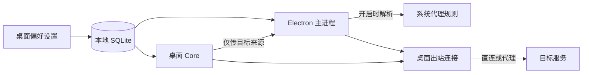

# 桌面端网络方案

「个人设置 → 偏好设置 → 网络 → 使用系统代理」按设备保存在本地 SQLite，默认关闭。关闭时，已接入的连接直连。开启时，由 Electron 解析当前系统代理规则，允许系统规则为特定目的地选择直连。本机 Core 通信、开发预览入口和回环模型始终直连。配置仅作用于桌面端。

## 职责与连接路径

| 出站入口 | 策略 |
| --- | --- |
| 模型对话、连接测试、模型列表和多模态检测 | 桌面模型传输统一选择出站路径。回环模型直接连接。 |
| 语音与 Embedding 配置检测、记忆向量请求 | 复用桌面策略。获准访问的回环服务直接连接。 |
| 联网搜索、网页读取、URL 图片、MCP | Core 通过宿主桥接查询代理。新 Run 在启动时读取开关，进行中的 Run 保留本次设置。 |
| Telegram | 后续 HTTP 请求读取当前设置，包括下一次长轮询。 |
| 远程登录、远程凭据、应用更新 | Electron 网络会话按当前设置选择直连或系统代理。 |
| 浏览器开发预览 | 使用隔离的本地偏好。开启后读取开发进程的代理环境变量，包括绕过规则。 |
| 沙箱 Shell、PTY 与 SMTP | 目前沿用各自的网络策略。 |

Node 传输先校验目标 URL 和 DNS 地址，再建立直连或 HTTP CONNECT 隧道。代理开关沿用现有本地地址授权和重定向校验。代理解析只传目标来源，省去请求头、正文、凭据和查询参数。日志记录脱敏后的错误与连接阶段。

当系统 DNS 只返回已识别的 Fake IP 时，桌面公网传输通过 Cloudflare DNS over HTTPS 查询真实 A 和 AAAA 地址。DNS 请求直连固定地址 `1.1.1.1`，并使用 `cloudflare-dns.com` 验证 TLS 证书。公网 DNS 只收到目标域名，解析结果继续走公网地址校验。

桌面公网连接和 DNS over HTTPS 显式使用运行时自带的根证书，避免 Electron 与独立 Node 因启动环境不同而选择不同的证书来源。证书链和主机名仍由 TLS 校验。

## 失败与支持范围

- 系统规则返回直连时直接建立连接。选中的代理不可达时返回网络错误，避免未经选择的直连重试。
- 当前 Node 出站采用系统解析结果的首条规则，支持直连与 HTTP(S) 代理。SOCKS、代理候选链和代理鉴权需要专项接入及验证。
- 桌面开关独立于沙箱联网授权。后续接入 Shell 时，应先完成宿主对沙箱出网的控制，再验证子进程环境、DNS 和授权生命周期。SMTP 接入需单独确定代理协议与鉴权行为。

## 验收

1. 新配置默认关闭，已有配置升级后按关闭处理。修改后重启，偏好和其他设置均可恢复。
2. 在可观测的代理环境中分别验证模型探测、正常对话和联网工具。关闭时代理无对应请求，开启时能看到相应连接。
3. 验证回环模型直连、系统绕过规则、代理失败与 Run 中途切换。对照原生桌面和开发预览各自的代理来源。
