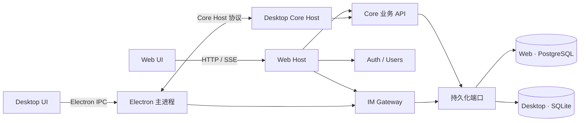
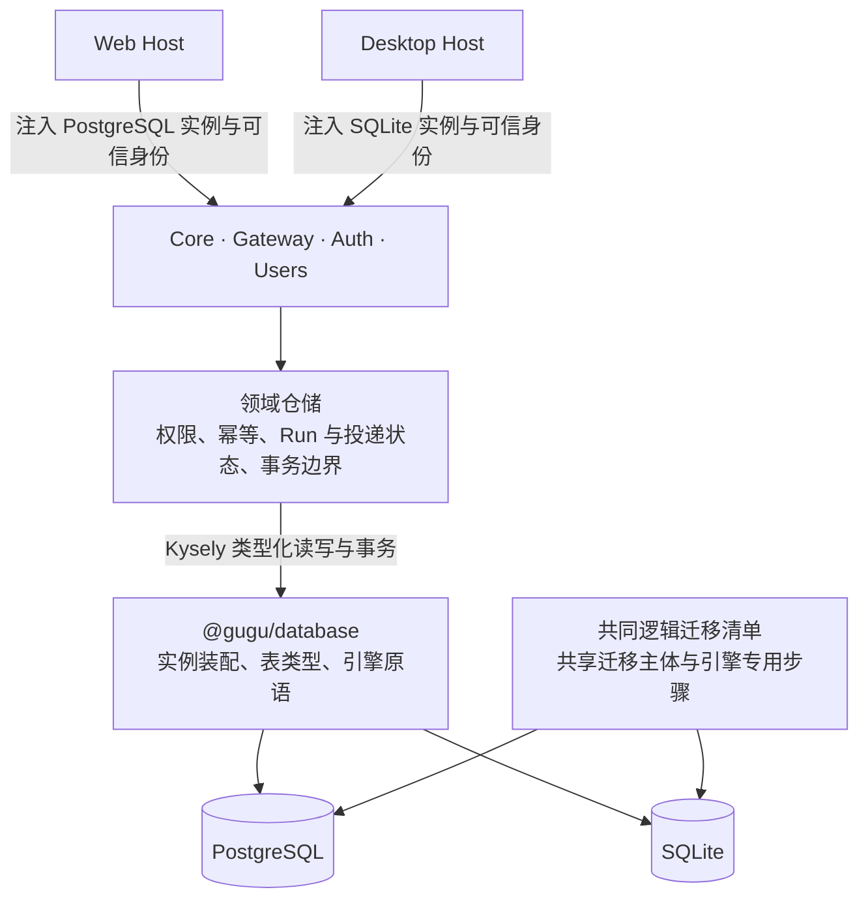

# Gugu 2.0 Monorepo 架构

本文描述当前 Node 实现和目标边界。目录以仓库为准，目标接口的接入进度见下文。旧 Python 后端用于历史行为参考和数据迁移。新功能与回归以 Node 路径为准。

## 目录与职责

| 目录 | 职责 |
| --- | --- |
| `apps/ui/` | Vue 工作台、Web 管理后台与 Desktop renderer。共享展示逻辑，通过各端适配器调用服务 |
| `apps/web-host/` | Fastify HTTP/SSE、可信身份、账号用例、PostgreSQL 与后台任务装配 |
| `apps/desktop/` | Electron 窗口、preload、IPC、Core Host 启停、原生文件和安全凭据适配 |
| `packages/core/` | 项目、文件、笔记、日程、会话等业务用例，以及 Agent Runtime |
| `packages/auth/` | 登录、会话状态校验和撤销流程，远程登录客户端与协议契约 |
| `packages/users/` | 资料字段校验与归一化，资料和头像服务契约 |
| `packages/database/` | 目标职责为 Kysely 装配、共享表类型、引擎原语和迁移 |
| `packages/gateway/` | IM 协议适配、消息归一化及两端可复用的收发逻辑 |
| `packages/desktop-contracts/` | Desktop 窗口与能力桥接契约 |
| `packages/fs/`、`packages/sandbox/` | 文件系统操作与沙箱执行基础能力 |
| `packages/charts/`、`packages/log/` | 图表渲染与结构化日志 |
| `packages/loopscope/`、`loopscope/` | Trace 接入与独立 Collector、存储和查看工具 |
| `backend/`、`compat/` | 历史实现及兼容相关代码 |
| `deploy/`、`docker/`、`nginx/`、`scripts/` | 部署与运维资产、仓库级维护脚本 |
| `agentskills/`、`docs/` | 工程约定、设计和运行说明 |

## 调用方式与依赖方向

同进程调用包的公开入口，跨进程使用明确的 HTTP、SSE 或 IPC 契约。Host 负责协议转换、身份来源、进程生命周期和端口装配。相同业务动作从 HTTP、IPC 或 Agent 工具发起时，应汇到同一个用例，使用相同的权限和状态转换规则。

新增跨包调用使用 `package.json#exports` 中的公开入口。Core 的内部重构应优先收敛宿主调用面，再清理现有 `#core-source/*` 深引用。UI 可导入面向客户端的 DTO、客户端和展示工具。数据库连接、凭据和本机路径解析通过相应 Host 持有的端口提供。

## 账号与业务归属

Auth 负责凭据验证、登录和会话撤销。Users 负责显示名、头像引用、时区等资料。Web Host 协调注册、停用和注销，Desktop 主进程管理远程账号会话与本机凭据。改密、找回密码及登录标识变更归认证流程。Core 使用可信 `ownerId` 限定资源归属，Web 从认证会话确定 owner，Desktop 由本地宿主确定。

当前已接入 `@gugu/auth` 的登录、会话校验和撤销，Desktop 已接入远程客户端。Users 已接入资料字段处理。独立改密 API 已接入设置页，资料读取、更新和头像上传已接入 Users 路由，其余账号用例仍在迁移中。详见 [账号架构与 API](account-api.md)。

## Agent、IM 与数据库

- **Agent Runtime** 管理上下文默认组装、工具执行、Run 生命周期、checkpoint 和恢复。IM、问候、定时、反思等场景只组装各自需要的差异。见 [Agent 目录约定](../../packages/core/src/agent/README.md) 和 [场景约定](../../packages/core/src/agent/scenes/README.md)。
- **IM Gateway** 管理平台连接与消息交付。Core 决定消息是否进入 Agent、绑定哪个会话和允许哪些工具。目标是 Web 与 Desktop 共用消息 API 和去重、领取、回执语义，现有宿主仍各有部分持久化和投递接线。
- **Database** 当前提供表类型、引擎迁移、SQLite 驱动和部分事务原语。两端使用 Database 工厂装配 Kysely。IM 收件仓储分别位于 Web Host IM Gateway 与 Core IM 模块。

### 数据库目标架构

Database 管理物理表和数据库约束。领域定义 IR、字段语义和业务事务。例如 Core 在一次事务内保存消息和登记 Run，Gateway 定义 IM 收件与确认，Auth 和 Users 保留各自的领域仓储。普通查询直接使用 Kysely。跨引擎差异通过薄适配处理，例如 PostgreSQL 行锁与 SQLite 写事务。

两端独立升级各自数据库。目标是每项共享变更登记一次，普通 DDL 用一份 Kysely 实现，确有差异的步骤在同一个逻辑迁移内按引擎提供。现有迁移继续负责历史基线。见 [Database 包](../../packages/database/README.md) 和 [实施计划](database-implementation.md)。

## 模型调用与可观测性

Desktop 与 Web Host 共用 Core Provider Runtime。现有运行时负责上下文渲染、协议适配、工具事件和流解析，宿主注入模型绑定与传输。

**目标中的 SaaS Model Gateway** 是独立推理与结算服务，拟位于 `apps/model-gateway/`。托管请求通过 HTTPS/SSE 访问该服务，桌面 BYOK 由本地宿主直连上游。托管权益、额度预留、账本与对账归 Model Gateway。推理正文默认只在转发时经过服务内存。现有 `packages/gateway` 对应 IM，继续服务消息通道。

LoopScope 独立采集和查看 Run trace。开发 trace 与普通运行日志采用不同的数据保留边界，生产日志不记录 Prompt、聊天正文或凭据。见 [LoopScope 观测约定](../../agentskills/loopscope/SKILL.md)。

## 开发与验收

- Workspace 成员和依赖以 [pnpm-workspace.yaml](../../pnpm-workspace.yaml) 与锁文件为准。各 Host 按其开发入口构建和监听共享包。
- 新增模块先明确数据所有者、公开入口、调用方向和事务边界。协议改动同步检查 Web、Desktop 和测试消费者。
- 对共享行为优先使用同一组契约测试，并在宿主入口覆盖权限、错误映射和数据迁移。两种数据库的并发语义需分别验收。
- 按 [仓库开发约定](../../AGENTS.md) 选择领域技能、测试和发布流程。
