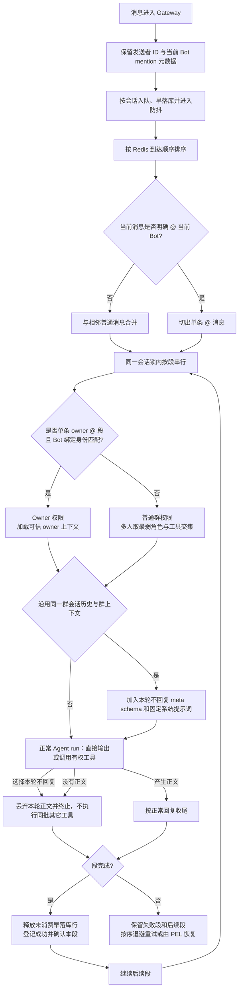
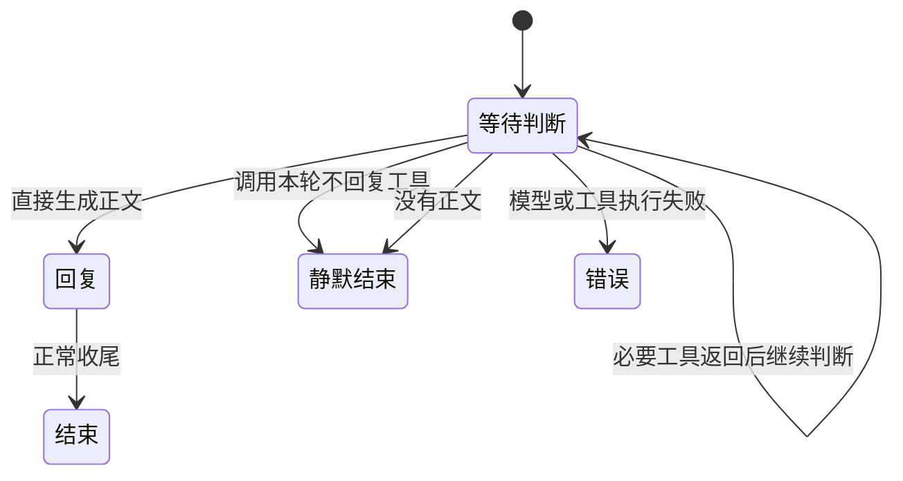

# PRD-IM-16：群聊自动回复选择门

> 状态：🟡 群聊回复选择门已实现；@ 消息独立入队并沿用群上下文的回归待验证
> 创建：2026-10-27
> 更新：2026-10-29（明确 @ 消息独立成 run 但继续使用群上下文，权限按发言人单独解析）
> 范围：QQ、飞书、Telegram 已接入的群聊自动回复
> 关联：[`PRD-IM-2：IM Loop 与 Gateway 解耦`](./【已完成】PRD-IM-2-im-loop与gateway解耦.md)、[`PRD-IM-3：群组与成员记忆`](./【已完成】PRD-IM-3-群组与成员记忆.md)、[`PRD-IM-15：Telegram Bot 群聊与消息接入`](./【已完成】PRD-IM-15-Telegram-Bot群聊与消息接入.md)

## 0. 方案状态

本 PRD 记录用户确认的**单 run 本轮不回复选择工具**，以及随后确认的群聊 owner @ 权限方案。run 保留正常生成回复和调用工具的能力；专用提示词要求模型默认静默、仅在确有价值时回应，并可在必要工具返回后再选择不回复。此前讨论的独立 decision 请求、消息水位、固定历史条数设置及 5 秒合批均不属于本方案。

| 阶段 | 状态 | 交付 |
|---|---|---|
| 0. 接入点与权限梳理 | ✅ | 复用 capability snapshot、动态工具、现有身份和群成员工具白名单 |
| 1. 不回复选择工具与提示词 | ✅ | 单 run 常驻 meta schema、固定 system 规则、批次服务端门禁 |
| 2. IM 出站与生命周期 | ✅ | 静默状态抑制正文和附件确认；群聊 collect、隐藏 IM 工具状态；静默跳过助手历史和空回复兜底 |
| 3. 隔离回归 | 🟡 | 回复选择门、@ 分段与权限主体有定向回归；@ 保留群上下文的回归待执行；真实平台验收待执行 |

## 1. 背景与目标

当前“自动回复”模式会把普通群消息送入正常 Agent run，容易对无关群聊频繁回应。新方案在**同一个 run 中**允许模型先理解消息、必要时调用工具，再判断是否值得回应；确定无需参与时调用不回复选择工具结束本轮。无需单独发起 decision 模型请求，也不新建决策水位系统。

目标：

- 普通群消息由当前 run 的模型结合正常上下文决定是否回应。
- 模型默认保持安静；仅在明确需要咕咕回应、或能为未解决的群体问题提供确定价值时回复。工具调用本身不锁定回复选择，模型仍可在工具返回后选择静默。
- 明确 @ 咕咕直接进入正常 run，保持既有权限与交互行为。
- 保留群消息记录、既有会话调度、权限、平台出站及恢复能力。

非目标：不新增固定历史条数设置、token 截断、独立决策请求、消息水位或固定 5 秒合批；不修改其他聊天模式和独立的人格／回复风格设置。

## 2. 适用范围

| 场景 | 回复选择 meta schema | 行为 |
|---|---|---|
| 群聊自动回复，普通消息 | 注入 | 默认静默；达到明确回复门槛时才回复，必要时可调用工具后再选择本轮不回复 |
| 群聊自动回复，明确 @ 咕咕 | 不注入 | 直接正常 run |
| 群聊仅响应 @ | 不注入 | 保留现有模式语义 |
| 群聊静默记录 | 不注入 | 保留现有模式语义 |
| 网页、私聊、定时任务及其他场景 | 不注入 | 保留现有行为 |

仅对已实际接入的平台群消息生效；平台是否投递全量消息取决于其权限和配置。对交互选择、取消和命令的现有快速通道逐项核实，不能因回复选择工具破坏交互或越权。

## 3. 架构与状态





回复选择是**服务端 run 内状态**，不由提示词、普通正文或客户端声明决定；状态不跨消息或会话继承。选择不回复后立即终止；不回复工具与其他工具同批时只执行静默选择并阻止其他调用。纯工具轮不会锁定为回复；已经输出正文后才关闭不回复工具，避免撤回已对外发送的内容。

## 4. 常驻 meta schema 与模型协议

- 增加内部零参数工具 `choose_no_reply()`，仅表达“本轮不回复”，不表示拒绝用户请求。
- 仅在第 2 节对应的普通消息 run 注入，作为该阶段的**常驻 meta schema**直接提供给模型；不登记为简介模式目录工具，不需先执行工具发现或加载。它只在适用 run 存在，不成为全局可用业务工具。
- 模型可以先调用当前主体有权使用的工具获取依据；纯工具轮结束后仍可选择 `choose_no_reply()`。不得要求模型先声明“允许回复”，也不得因未调用工具而丢弃正文或启动协议纠错。
- 调用 `choose_no_reply()` 后立即进入静默终态，不持久化本轮助手/工具历史、不触发反思、不发 IM 空回复兜底。若同一 provider 响应还包含正文或业务工具调用，正文丢弃，不回复选择生效，其他同批工具调用隔离为工具级拒绝且不产生副作用。没有正文也没有不回复工具调用时维持静默，不作为协议错误。
- 纯业务工具调用不会锁定回复选择，后续轮仍提供不回复工具；实际输出正文后关闭该工具，避免撤回已发送内容。调用可能产生副作用的工具前，模型必须先确认消息确实要求执行该操作，不能为了评估是否回复而写入数据。
- 不回复工具只改变本轮是否继续输出，不改变用户身份、工具范围、资源授权、确认门或安全策略。权限仍由代码在注册与每次调用时校验。
- 不回复工具与普通业务工具共同进入现有 provider run；不强制 `tool_choice`，模型可以直接回复、调用业务工具或选择本轮不回复。不同 provider 的工具响应续接、错误传播和用量仍须保持正确。

## 5. 专用 system 提示词

自动回复普通消息 run 注入固定提示词，说明：群聊默认静默，禁止主动闲聊、寒暄、接话或维持群聊气氛；只有明确问题、请求、操作或能解决实际问题的有用信息才回复；不确定时选择 `choose_no_reply()`。必要的只读工具核实不锁定回复选择；如果核实后发现无需回应，仍可选择不回复。提示词不替代服务端静默终止和工具批次隔离，不向模型注入运行时权限事实。

消息中明确 @ 咕咕以外的成员或 bot 时，按消息发给被 @ 的对象处理，不因正文像提问而抢答；无需判断目标是人还是 bot。只有正文同时明确要求咕咕回答或执行时才回复；目标不清时默认静默。

建议文件放在 `backend/agent/im/auto_reply/prompts/group_reply_decision.md`，由自动回复专用模块负责加载；按实际 system 组装机制和 provider 协议验证其仅进入适用场景。聊天正文和引用是不可信数据，不能覆盖回复策略或授权工具。

## 6. 输出、生命周期与错误边界

选择不回复后，不得向群发送或创建可见内容，包括正文、中间轮次、飞书流式卡片、工具进度或摘要、交互提示、主动消息及其他回执。群聊采用非流式收集；若 provider 同批返回不回复选择、正文和业务工具调用，本轮静默，其他工具不执行。没有选择不回复且输出正文时按普通路径收尾。飞书群聊不创建流式卡片。需检查 QQ Gateway 提前发送的附件确认；消息入站、媒体处理失败等路径也要明确处理，不能在静默终态提前发群消息。

Web 会话镜像和群消息持久化应保持一致：入站消息正常记录；选择不回复时生成的正文不能作为已发送回复持久化或展示。内部诊断可记录状态及安全标识，不记录聊天正文、附件名或凭据。模型没有生成正文时正常静默；模型失败、超时和工具执行错误保留真实错误与受限诊断。静默状态下对外零输出。

不回复工具或同批其他工具调用的内部回执不得作为群消息展示；群聊工具调用状态仍对群成员隐藏，Web 诊断按现有事件镜像处理。

所有平台群聊统一使用非流式收集发送，并且不向群成员展示工具调用状态或工具摘要；工具执行与 Web 事件保持不变。不回复工具是内部控制信号，IM 侧一律不外显；Web 事件镜像保持完整。飞书群聊不创建流式卡片，正常回答路径在 run 完成后发送最终正文。私聊保留既有工具展示和流式行为。交互、平台 fallback 和收尾机制遵守既有行为。平台发送失败不得中断既有 iterator 消费或错误地重跑已开始的操作。

## 7. 消息调度与权限主体

沿用现有 worker 消息缓冲、run 后处理和 session gate，不新增独立决策水位或批次系统。worker 在进程内按 IM 会话顺序接收入站消息；进程内锁不单独保证多 worker 全局串行，实现不声称未经验证的全局串行保证。

群聊防抖批次按到达顺序切成多个连续段：普通消息与相邻普通消息合并；网关明确标记 @ 当前 Bot 的消息，无论发言人身份如何，都各自切成只包含该条消息的 @ 段。各段在同一群会话上下文中按队列顺序串行执行，不能并行或让后续段越过失败段。@ 只决定批次边界，不改变群会话、历史和群共享上下文；每条消息的权限再由 actor 按发言人独立解析。每个段独立注册入站收据、复用其早落库消息行，并在成功后单独释放未消费行和确认消息。失败段与后续段保留并按原顺序退避重试；进程退出时仍由 Redis PEL 和执行收据恢复。不能因普通处理异常而确认丢弃未完成消息。

owner @ 特权必须同时满足：群聊；网关提供的当前 Bot 精确 mention 元数据；没有指向其他 Bot 的 mention；发言人的平台 ID 在当前 Bot 绑定记录中解析为 owner；当前处理段仅有这条消息。文字中的“@咕咕”、缺失 mention 元数据、普通 owner 发言、成员 @ 咕咕、混合批次和多消息段都不能取得 owner 权限。QQ/飞书/Telegram 等平台应统一保留每条消息的精确 mention 元数据，不能用聚合 group_mentioned 代替。

owner 的普通群消息降为该 Bot 配置的群成员工具白名单，并使用成员身份策略；只有合格 owner @ 单条段保留 owner 权限。owner @ 与成员 @ 都继续使用同一群的会话历史、群共享记忆和群上下文；上下文可见性与权限主体分别控制，不能因权限不同而创建私有会话或隔离群历史。当前 @ 消息作为本轮输入正常持久化。该权限边界必须由 actor、工具白名单和 dispatch 代码执行，不能只依靠提示词。

普通消息段仍按既有规则处理：合并批次有多位发言人时取最弱角色与工具白名单交集，并按发言人标注正文。私聊沿用同一消息缓冲：run1 执行期间到达的 B、C 一起进入下一轮 run2，私聊不注入群聊回复选择门，仍保留既有流式行为。

多位发言人同批时整轮按**最弱**权限主体执行：角色取最弱（owner > member > unknown），工具白名单取交集，owner 私人记忆不因他人消息而被暴露。多发言人时正文按发言人分段标注（`【昵称】正文`）供模型区分；单发言人的正文与提示词逐字不变（否则同一段话会在缓存前缀里变样）。不以新的 meta 工具改变主体：正常身份解析、群成员工具白名单、owner 私人记忆授权与确认门继续由现有代码决定。

同一 IM 会话的入站准备在 worker 内按队列顺序串行，防止先到消息在早落库时被后到消息跨批超越。群聊与私聊的待处理消息都逐条早落库并在 run 中复用，消息段保留每条消息的内容、引用、精确 mention 元数据与早落库行；缺少发言人 ID 按 unknown 参与权限合并。早落库部分失败时逐条补齐；不启动 run 的命令等快速路径在确认队列消息前释放未消费的早落库行。每个段的恢复锚点只覆盖该段消息。私聊会话仅按 owner、平台、Bot 和私聊用户匹配，不使用群 chat_id。

消息时间戳分两列，各司其职：网页展示时间取**到达时刻**（`created_at`），会话历史顺序与提示词里的「消息时间」取**本轮处理时刻**（`sent_at`）。run 期间到达的消息因此排在本轮回复之后，而不是插进上一条回复中间——上一轮的 provider 缓存前缀不被截断；新到消息本身是 fresh 内容，位置变化不影响已缓存的那一段。

## 8. 模块边界与预计文件

自动回复专用代码放在 `backend/agent/im/auto_reply/`，按 Python 命名约定组织。固定提示词也放在此模块目录。通用工具注册/执行、模型 provider、消息持久化、身份权限及平台出站保留原职责，使用明确接口接入，不复制或迁移共享能力。

```text
backend/
├── agent/im/auto_reply/                # 新增：本轮选择状态、提示词与接入适配
│   ├── __init__.py
│   ├── decision.py                    # meta schema 与选择语义
│   └── prompts/group_reply_decision.md
├── agent/im/dispatch.py               # 场景启用、群聊收集发送与工具状态隐藏
├── agent/im/dispatch_finalization.py  # 静默时跳过 IM 空回复兜底
├── agent/im/imctx.py、permissions.py  # meta tool 仅能由本轮群自动回复执行
├── agent/gateway/qq/events.py         # 自动回复群消息不提前发送附件确认
├── agent/im/actor.py、permissions.py  # owner @ 主体识别、群成员降权与工具白名单
├── agent/im/context_policy.py、context_loader.py # 按权限加载上下文，不改变群会话边界
├── app/services/im_identity.py        # QQ Bot 绑定 owner 身份及群成员白名单
├── agent/im/inbound_batch.py          # @ 消息分段及逐段执行/恢复
├── worker.py                          # 防抖、会话锁、租约、消息确认与失败退避
├── agent/im/early_persist.py          # IM 消息早落库与网页增量事件
├── agent/run/preparation.py、runner.py # run 专属 Schema、system prompt 与静默收尾
├── agent/loop/runner.py、round_runtime.py # Provider 工具门禁、拒绝越权批次及开放工具集
├── agent/run/execution.py             # 不把选择 meta tool 计为业务工具
└── tests/im/auto_reply/                # 不回复选择工具、权限、输出及平台回归
```

文件树为预计范围，先核对现有工具注入、provider 适配、流式与恢复调用图。此次不需要为旧的独立 decision 方案创建数据库迁移、水位表或前端历史条数设置；若实现发现共享基础设施确需变化，应记录原因和兼容范围。

## 9. 验收

### 回复与静默选择

- [ ] 自动回复普通群消息有固定 system 提示词和常驻不回复 meta schema；简介模式下仍直接可用。
- [ ] 默认直接生成正文可正常回复；纯工具轮后仍可选择静默；工具按本轮权限主体执行。
- [ ] 调用不回复工具后 run 立即静默终止；它与正文/业务工具同批时正文不发送、其它工具不执行。
- [ ] 没有正文也没有不回复工具调用时正常静默；错误、取消等终态仍按现有生命周期处理。
- [ ] 明确 @、其他群模式、网页、私聊和定时任务不注入该 schema；@ 保持正常回复路径。
- [ ] 回复选择状态仅属于本轮；纯工具轮不锁定选择，模型输出正文后不能再选择静默。

### 输出与兼容

- [ ] 群聊不展示工具调用状态；拒绝终态不产生任何群可见输出；正常回复、私聊流式、中间回复、发送失败回退和运行收尾保持有效。
- [ ] 模型失败、超时和工具执行错误有独立错误终态，不计作主动静默；可见错误经过脱敏，日志不含聊天正文、附件名或凭据。
- [ ] 群聊普通 owner 消息使用 Bot 配置的成员白名单；owner 明确 @ 当前 Bot 时仅该条消息取得 owner 权限，成员 @、文字伪装 @、其他 Bot mention、混合段均不能升级。
- [ ] @ 当前 Bot 的消息无论发言人角色都独立成段，前后普通消息不能合并越过；各段沿用同一群上下文串行执行，失败后按段收据恢复。
- [ ] @ 只分隔 run，不隔离群历史、群共享记忆或群上下文；权限由 actor 按每条消息的发言人独立解析，成员不能取得 owner 工具权限。
- [ ] 普通多发言人合并不提升权限（取最弱主体与工具白名单交集）；跨用户、跨群、跨 Bot 隔离保持有效。
- [ ] QQ、飞书、Telegram 群场景及私聊既有路径分别回归；交互选择、取消、媒体、群记忆与反思及重启恢复不退化。
- [ ] 私聊 run 执行期间到达的多条消息在下一轮一起进入上下文，同时数据库保留逐条消息、引用和展示时间；批次消费不重复插入消息行。
- [ ] 覆盖模型 provider 各协议工具 schema 切换和续接；记录测试范围和缓存观察，mock 测试不得宣称真实平台验收。
- [ ] 使用隔离测试数据；devserver 后端 pytest 默认串行。未获用户授权不触发 GitHub CI。

## 10. 实施决定与验证边界

1. 不回复工具作为 run 私有动态 Schema 进入 capability snapshot，与当前权限主体的业务工具同时提供；纯工具轮后仍可选择静默。
2. 调用不回复工具或无正文正常结束时不持久化本轮助手/工具历史，不触发反思，也不发送普通 IM 空回复兜底；模型用量和缓存锚点仍正常记录。不回复工具与其他调用同批时只允许静默选择生效。
3. QQ Gateway 的群附件确认仅对明确 @ 消息保留；自动回复普通群消息不会提前发确认。QQ、飞书和 Telegram 群统一 collect，IM 工具状态关闭，飞书群不创建流式卡片。
4. 群防抖批次中，相邻普通消息合并；所有明确 @ 当前 Bot 的消息独立成段。段按顺序执行并独立确认；失败段及后续段不越过并保留恢复。
5. 只有身份确认的 owner @ 段保留 owner 权限；普通群 owner 降为 Bot 配置的群成员工具白名单。所有段沿用群历史和群上下文，权限与上下文分别判定。
6. 回复选择门、分段和身份上下文的定向测试范围见测试记录；真实 QQ/飞书/Telegram 验收仍待部署验证。
