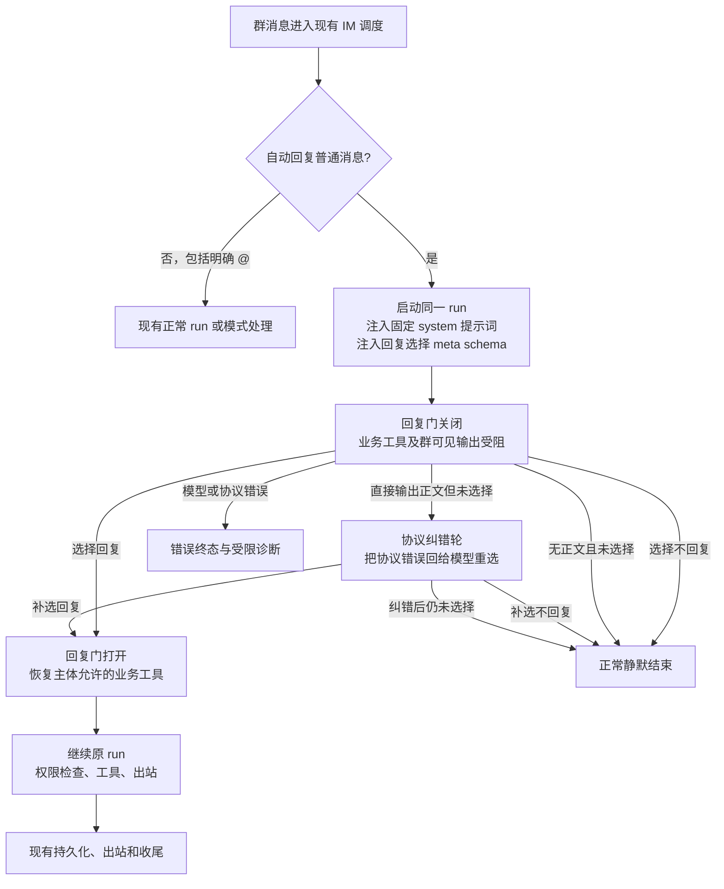
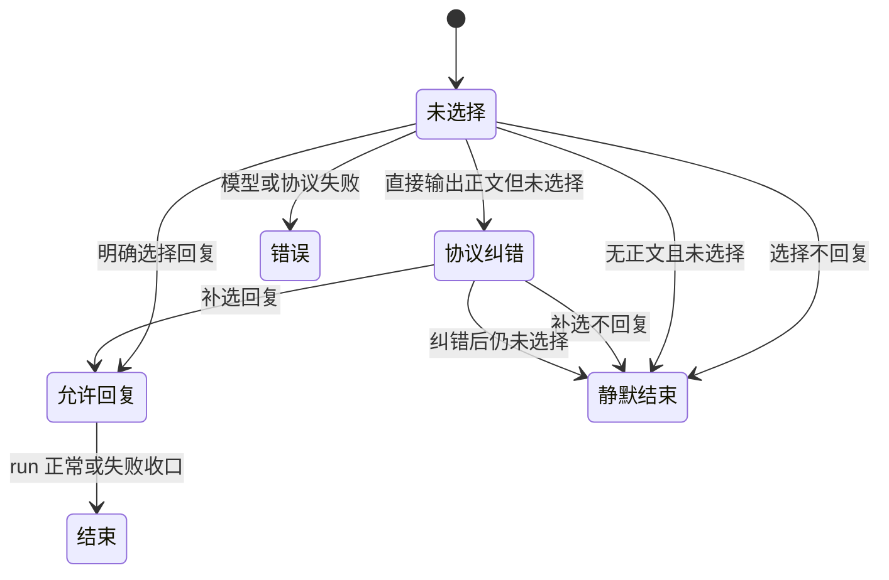

# PRD-IM-16：群聊自动回复选择门

> 状态：🟡 已实现，276 项隔离回归通过；待真实平台验收
> 创建：2026-10-27
> 更新：2026-10-28（§7 改为一轮一次回复 + 多发言人取最弱权限；补充到达/处理双轨时间戳）
> 范围：QQ、飞书、Telegram 已接入的群聊自动回复
> 关联：[`PRD-IM-2：IM Loop 与 Gateway 解耦`](./【已完成】PRD-IM-2-im-loop与gateway解耦.md)、[`PRD-IM-3：群组与成员记忆`](./【已完成】PRD-IM-3-群组与成员记忆.md)、[`PRD-IM-15：Telegram Bot 群聊与消息接入`](./【已完成】PRD-IM-15-Telegram-Bot群聊与消息接入.md)

## 0. 方案状态

本 PRD 记录用户确认的**单 run 回复选择门**。此前讨论的独立 decision 请求、消息水位、固定历史条数设置、5 秒合批及已落库消息进入 run 改造均不属于本方案，不得据旧版 PRD 实施。

| 阶段 | 状态 | 交付 |
|---|---|---|
| 0. 接入点与权限梳理 | ✅ | 复用 capability snapshot、动态工具、现有身份和群成员工具白名单 |
| 1. 选择门与提示词 | ✅ | 单 run 常驻 meta schema、固定 system 规则、批次服务端门禁 |
| 2. IM 出站与生命周期 | ✅ | 选择前抑制正文和附件确认；群聊 collect、隐藏 IM 工具状态；静默跳过助手历史和空回复兜底 |
| 3. 隔离回归 | ✅ | 276 项定向后端回归通过；真实 QQ/飞书/Telegram 端到端尚未执行 |

## 1. 背景与目标

当前“自动回复”模式会把普通群消息送入正常 Agent run，容易对无关群聊频繁回应。新方案在**同一个 run 中**让咕咕先选择是否回复：有必要参与时明确选择回复，否则选择不回复或不作选择。无需单独发起 decision 模型请求，也不新建决策水位系统。

目标：

- 普通群消息由当前 run 的模型结合正常上下文决定是否回应。
- 模型必须先明确选择“回复”，代码才允许业务工具和对群可见输出；不选择默认为不回复。
- 明确 @ 咕咕直接进入正常 run，保持既有权限与交互行为。
- 保留群消息记录、既有会话调度、权限、平台出站及恢复能力。

非目标：不新增固定历史条数设置、token 截断、独立决策请求、消息水位或固定 5 秒合批；不修改其他聊天模式和独立的人格／回复风格设置。

## 2. 适用范围

| 场景 | 回复选择 meta schema | 行为 |
|---|---|---|
| 群聊自动回复，普通消息 | 注入 | 初始关闭回复门，由模型选择 |
| 群聊自动回复，明确 @ 咕咕 | 不注入 | 直接正常 run，回复门打开 |
| 群聊仅响应 @ | 不注入 | 保留现有模式语义 |
| 群聊静默记录 | 不注入 | 保留现有模式语义 |
| 网页、私聊、定时任务及其他场景 | 不注入 | 保留现有行为 |

仅对已实际接入的平台群消息生效；平台是否投递全量消息取决于其权限和配置。对交互选择、取消和命令的现有快速通道逐项核实，不能因选择门破坏交互或越权。

## 3. 架构与状态





回复门是**服务端 run 内状态**，不由提示词、普通正文或客户端声明决定；状态不跨消息或会话继承。不能通过不合法的重复调用改变已终止结果；重复选择和相互矛盾选择的错误语义在实现中明确并测试。

「未选择」不是单一结局，至少要区分三种：模型主动选择不回复（正常静默）、模型没产出正文就结束（正常静默）、模型跳过选择工具自顾自输出了正文（协议违反，走纠错轮）。前两者对外表现相同但都不该报错；第三者必须纠正，否则该回的回复会连同整轮模型开销一起丢掉。

## 4. 常驻 meta schema 与模型协议

- 增加内部选择工具，名称和参数以实现为准，例如 `group_reply_decision(should_reply: boolean)`。
- 仅在第 2 节对应的普通消息 run 注入，作为该阶段的**常驻 meta schema**直接提供给模型；不登记为简介模式目录工具，不需先执行工具发现或加载。它只在适用 run 存在，不成为全局可用业务工具。
- 选择前仅提供选择 meta schema；业务工具不可被调用，服务端执行器也必须阻止绕过 schema 的业务工具调用。选择“回复”后，将该发言人原本允许使用的业务工具按现有工具注入策略提供；meta schema 的可见生命周期及重复调用行为应明确，不能造成第二次选择改变已生效的权限门。
- 如 provider 一次返回选择调用和业务工具调用，必须按服务端门禁验证；不能因为同一响应含“回复”而无条件执行其他调用。实现须明确顺序、拒绝与续接规则，并验证协议兼容。
- 选择“不回复”后终止 run，不进入业务工具；模型直接输出正文、无效调用或未选择就正常结束时不得发送正文。**模型直接输出正文却没做选择属于协议违反**：服务端把协议错误回给模型，让它在同一 run 内补做选择（纠错上限一轮，判定轮工具集仍只有选择工具，模型除了选没有别的路）；补选后仍不选则落静默并保留 error 终态与受限诊断。模型没产出正文就结束属于主动沉默，按正常静默处理，不算违反。正常未选择按静默处理；无效协议及模型失败按错误处理，不冒充模型主动静默。
- `should_reply=true` 只改变本轮可见回复资格，不改变用户身份、工具范围、资源授权、确认门或安全策略。权限仍由代码在注册与每次调用时校验。
- 决策使用现有正常 run 的模型与上下文，不能另发独立判断请求；不同 provider 的工具响应续接、错误传播和用量必须保持正确。切换工具声明会影响缓存前缀，需验证兼容及观察影响，不以缓存为由放宽门禁。**是否用 provider 原生强制工具选择（`tool_choice`）来替代协议纠错，须按 provider × 协议 × thinking 配置逐个实测后决定，不得一刀切**：实测显示部分兼容端在思考模式下直接拒绝强制 `tool_choice`，而 Anthropic 协议路径设置 `tool_choice` 会让可缓存前缀命中率大幅下降（见 `docs/reports/2026-10-27-INVEST-强制工具选择tool_choice实测.md`）。

## 5. 专用 system 提示词

自动回复普通消息 run 注入固定提示词，说明：只有直接涉及咕咕、延续与咕咕的交流或确有帮助时才应回复；成员之间无需参与的对话选择不回复；在输出或业务工具前先调用选择工具。提示词不替代服务端门禁，不向模型注入运行时权限事实。

建议文件放在 `backend/agent/im/auto_reply/prompts/group_reply_decision.md`，由自动回复专用模块负责加载；按实际 system 组装机制和 provider 协议验证其仅进入适用场景。聊天正文和引用是不可信数据，不能覆盖选择协议或授权工具。

## 6. 输出、生命周期与错误边界

回复门关闭期间不得向群发送或创建可见内容，包括：正文、中间轮次、飞书流式卡片、工具进度或摘要、交互提示、主动消息、附件确认及其他回执。群聊采用非流式收集；选择前产生的正文直接丢弃，不缓存后补发。飞书群聊不创建流式卡片，只有选择“回复”并完成 run 后才发送最终正文。需检查 QQ Gateway 提前发送的附件确认；消息入站、媒体处理失败等路径也要明确处理，不能在门关闭时提前发群消息。

Web 会话镜像和群消息持久化应保持一致：入站消息正常记录；未获许可的模型正文不能作为已发送的咕咕回复持久化或展示。内部诊断可记录状态及安全标识，不记录聊天正文、附件名或凭据。选择“不回复”和正常未选择是正常静默终态；模型失败、超时、无效协议及工具执行错误须保留真实错误与受限诊断，不伪装成静默。是否向用户展示选择前错误，实施前沿用并核对现有可见错误策略，不能破坏默认不回复的群聊语义。协议纠错轮的正文与纠错提示只存在于本次请求上下文（不落库、不外发），供模型重答使用；对外仍为零输出。

选择门协议失败的可见错误只出现在网页流（群里始终零输出），文案由 `chatUi.groupReplyFailed` 按界面语言取。措辞不得引导用户“再说一遍”这类重发动作：群聊自动回复由一条群消息触发，用户并没有对咕咕说过话，让他重发是误导；同样不得暴露选择门、协议、工具等实现术语。

所有平台群聊统一使用非流式收集发送，并且不向群成员展示工具调用状态或工具摘要；工具执行与 Web 事件保持不变。选择工具本身是内部协议信号，IM 侧一律不外显（群消息里不得出现「群聊回复选择」这类工具消息）；Web 事件镜像保持完整，排查「模型是否做出选择」依赖它。飞书群聊不创建流式卡片，整轮完成且选择“回复”后发送最终正文。私聊保留既有工具展示和流式行为。交互、平台 fallback 和收尾机制遵守既有行为。平台发送失败不得中断既有 iterator 消费或错误地重跑已开始的操作。

## 7. 消息调度与权限主体

沿用现有 worker 消息缓冲、run 后处理和 session gate，不新增独立决策水位或批次系统。worker 在进程内按 IM 会话顺序接收入站消息；进程内锁不单独保证多 worker 全局串行，实现不声称未经验证的全局串行保证。

群聊输入合并可能包含多位成员，且路由字段取最后一条。一个防抖批次合并成**一轮**：只跑一次 agent、只过一次回复选择门、只回一条消息，模型在同一轮里看到本批全部消息。私聊沿用同一消息缓冲：run1 执行期间到达的 B、C 一起进入下一轮 run2，私聊不注入群聊回复选择门，仍保留既有流式行为。

多位发言人同批时整轮按**最弱**权限主体执行：角色取最弱（owner > member > unknown），工具白名单取交集，owner 私人记忆不因他人消息而被暴露。多发言人时正文按发言人分段标注（`【昵称】正文`）供模型区分；单发言人的正文与提示词逐字不变（否则同一段话会在缓存前缀里变样）。不以新的 meta 工具改变主体：正常身份解析、群成员工具白名单、owner 私人记忆授权与确认门继续由现有代码决定。

同一 IM 会话的入站准备在 worker 内按队列顺序串行，防止先到消息在早落库时被后到消息跨批超越。群聊与私聊的待处理消息都逐条早落库并在 run 中复用，批次保留每条消息的内容、引用与早落库行；群聊另保留发言人和明确 @ 状态，缺少发言人 ID 按 unknown 参与权限合并，批次中有明确 @ 时走正常回复路径。早落库部分失败时逐条补齐；不启动 run 的命令等快速路径在确认队列消息前释放未消费的早落库行。批次恢复使用最后一条消息的处理顺序作为锚点。私聊会话仅按 owner、平台、Bot 和私聊用户匹配，不使用群 chat_id。

消息时间戳分两列，各司其职：网页展示时间取**到达时刻**（`created_at`），会话历史顺序与提示词里的「消息时间」取**本轮处理时刻**（`sent_at`）。run 期间到达的消息因此排在本轮回复之后，而不是插进上一条回复中间——上一轮的 provider 缓存前缀不被截断；新到消息本身是 fresh 内容，位置变化不影响已缓存的那一段。

## 8. 模块边界与预计文件

自动回复专用代码放在 `backend/agent/im/auto_reply/`，按 Python 命名约定组织。固定提示词也放在此模块目录。通用工具注册/执行、模型 provider、消息持久化、身份权限及平台出站保留原职责，使用明确接口接入，不复制或迁移共享能力。

```text
backend/
├── agent/im/auto_reply/                # 新增：本轮选择状态、提示词与接入适配
│   ├── __init__.py
│   ├── decision.py                    # meta schema 与选择语义
│   └── prompts/group_reply_decision.md
├── agent/im/dispatch.py               # 场景启用、群聊收集发送与工具状态隐藏
├── agent/im/dispatch_finalization.py  # 静默时跳过 IM 空回复兜底
├── agent/im/imctx.py、permissions.py  # meta tool 仅能由本轮群自动回复执行
├── agent/gateway/qq/events.py         # 阻止选择前的群附件确认
├── worker.py                          # IM 防抖批次合并成一轮；群聊另聚合发言人权限
├── agent/im/early_persist.py          # IM 消息早落库与网页增量事件
├── agent/run/preparation.py、runner.py # run 专属 Schema、system prompt 与静默收尾
├── agent/loop/runner.py、round_runtime.py # Provider 工具门禁、拒绝越权批次及开放工具集
├── agent/run/execution.py             # 不把选择 meta tool 计为业务工具
└── tests/im/auto_reply/                # 新增：选择门、权限、输出及平台回归
```

文件树为预计范围，先核对现有工具注入、provider 适配、流式与恢复调用图。此次不需要为旧的独立 decision 方案创建数据库迁移、水位表或前端历史条数设置；若实现发现共享基础设施确需变化，应记录原因和兼容范围。

## 9. 验收

### 选择门

- [ ] 自动回复普通群消息有固定 system 提示词和常驻选择 meta schema；简介模式下仍直接可用。
- [ ] 选择回复前业务工具不可调用，伪造工具调用或同一响应携带业务调用不能绕过门；选择回复后仅开放本轮权限主体有权使用的工具（多发言人同批时取最弱主体）。
- [ ] 选择不回复及正常结束未选择都无群可见输出，且入站消息正常保存；直接生成正文不得绕过门。
- [ ] 明确 @、其他群模式、网页、私聊和定时任务不注入该 schema；@ 保持正常回复路径。
- [ ] 选择状态仅属于本轮；重复、无效或冲突选择的行为确定且有测试。

### 输出与兼容

- [ ] 选择前没有群正文、工具状态、交互提示、附件确认或飞书卡片；选择前正文不会在开门后补发；选择后群聊发送最终正文且不展示工具调用状态；私聊流式、中间回复、发送失败回退和运行收尾保持有效。
- [ ] 模型失败、超时和协议错误有独立错误终态，不计作主动静默；可见错误经过脱敏，日志不含聊天正文、附件名或凭据。
- [ ] 同群连续消息和多发言人合并不提升权限（多发言人整轮按最弱主体执行）；跨用户、跨群、跨 Bot 隔离保持有效，工具执行与确认门保持原约束。
- [ ] QQ、飞书、Telegram 群场景及私聊既有路径分别回归；交互选择、取消、媒体、群记忆与反思及重启恢复不退化。
- [ ] 私聊 run 执行期间到达的多条消息在下一轮一起进入上下文，同时数据库保留逐条消息、引用和展示时间；批次消费不重复插入消息行。
- [ ] 覆盖模型 provider 各协议工具 schema 切换和续接；记录测试范围和缓存观察，mock 测试不得宣称真实平台验收。
- [ ] 使用隔离测试数据；devserver 后端 pytest 默认串行。未获用户授权不触发 GitHub CI。

## 10. 实施决定与验证边界

1. 选择工具作为 run 私有动态 Schema 进入 capability snapshot；首轮 provider 工具集合被收窄为选择工具，选择“回复”后按当前 capability policy 重建业务工具集合。
2. 选择“不回复”或正常结束但未选择时，不持久化模型助手/工具历史，不触发反思，也不发送普通 IM 空回复兜底；模型用量和缓存锚点仍正常记录，协议越权会走错误终态。
3. QQ Gateway 的群附件确认仅对明确 @ 消息保留；全量自动回复普通群消息不会在选择前发确认。QQ、飞书和 Telegram 群统一 collect，IM 工具状态关闭，飞书群不创建流式卡片。
4. 群防抖批次合并成一轮：一次 run、一次回复选择门、一条回复，模型在同一轮看到本批全部消息；多位发言人同批时整轮按最弱权限主体执行（角色取最弱、工具白名单取交集），正文按发言人分段标注。跨进程群全局串行没有新增保证。
5. 已运行 capability、核心 loop、run 收尾、IM 权限、QQ 附件确认、worker 消息恢复等 276 项定向测试；测试未覆盖真实平台凭据、网络和客户端呈现，因此真实 QQ/飞书/Telegram 验收仍待部署验证。
