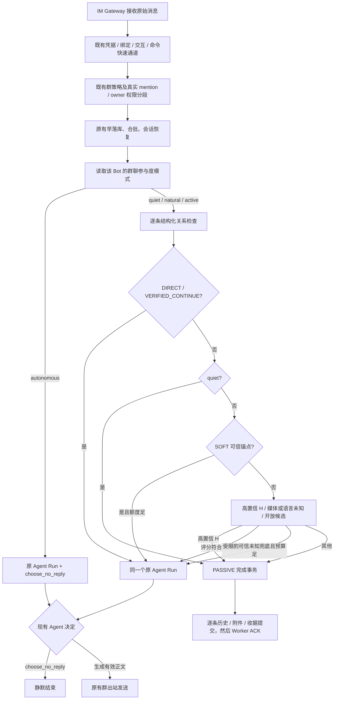

# PRD-IM-17：Gugu 群聊注意力门控 v1.4

> **版本**：v1.4 · 2026-10-29
> **状态**：实施设计基线；允许开发、自动化测试、验收后直接上线；**不包含线上 Shadow 模式**
> **目标平台**：QQ / 飞书 / Telegram 群聊全量自动回复；私聊、Web、微信及定时任务不在本 PRD 范围内
> **硬约束**：零额外 LLM 请求；不替换 Agent Loop；保留 `choose_no_reply`；不增加固定等待；保留现有权限、消息记录、重投和出站协议
> **代码基线**：参考 GitHub `Coffeiz/Gugu-web` 的 `dev` 分支及 v1.3 PRD；实际实现须核对本地未提交修改。本文是设计与验收要求，不宣称代码已实现。
> **仓库实施状态**：开发中；当前工作区包含未提交实现。v1.4 是本仓库的实施与验收基线，不代表功能已完成或通过验收；上线阻塞项仍以 §11.3 和 §15 为准。

## 0. 本版决定（先读）

1. **取消 Shadow**。不再引入 `enforcement=shadow`、线上假设决策、长期只读灰度或 Shadow 特有日志。改为：单元测试 → 集成/故障测试 → 选取脱敏真实场景离线回放（推荐，非长期阶段）→ 预发布端到端测试 → 上线；新模式默认 `autonomous`，用户可在“接入咕咕”按 Bot 选择 scored 模式。
2. **新增 `autonomous`（自主模式）**。关闭所有注意力评分和 H 类启发式拦截；普通群消息沿既有自动回复路径启动 **同一个** Agent Run，由模型自行调用 `choose_no_reply` 或输出回复。无 P/N 打分、开放候选阈值、SOFT/PROACTIVE 新预算、额外等待。保留已经存在的平台群模式、真实 @、已指向其他 Bot 的被动分流、权限和防重复机制。
3. **保留打分模式**：`quiet` / `natural` / `active`。这三档使用结构化关系、可信硬排除、开放候选打分（仅 natural/active）以及必要的预算；具体权重仍是初始配置，不宣称经训练最优。
4. **模式是唯一的注意力配置**：不另设门控 `enabled` 或 `enforcement=shadow|hard_only|full`。`autonomous` 是默认模式，直接复用原 Agent Run；用户要停止普通群聊自动回复时，使用现有“只响应 @”或“静默记录”群聊回应方式。
5. **保留现有合批粒度**。本版本不因未经验证的代理回放数字拆分 owner @、逐人权限或 Worker 合批。逐消息仅用于特征抽取与幂等持久化；每段仍按现有边界至多启动一次 Run。
6. **评分不能误杀重要媒体任务**：纯图片/文件不属于 H01。图片、文件、非中文、有待核实语义的内容在自然/活跃档可以有受预算限制的 Agent 兜底路径；在自主档一律交给现有 Agent 判断。

### 0.1 产品行为一览

| 选择 | 是否打分 | 是否跳过 H 类消息 | 是否引入自主额度 | 谁最终决定回复 | 适合场景 |
|---|---|---|---|---|---|
| **`autonomous` 自主（默认）** | **否** | **不执行新增 H 规则** | **否** | **Agent + `choose_no_reply`** | 保持旧行为，让模型自主决定是否接话 |
| `quiet` 安静 | 否（仅关系/硬规则） | 是 | 禁止非邀请发言 | Agent + `choose_no_reply` | 仅在被找时回答 |
| `natural` 自然 | 是，暂定 70 | 是 | 是 | 门控准入后 Agent 决定 | 平衡参与与插话 |
| `active` 活跃 | 是，暂定 55 | 是 | 是 | 门控准入后 Agent 决定 | 希望适度积极参与 |

**“不打分”不是“不限平台安全约束”**：`autonomous` 仍遵守原有群只读/仅@、真实 mention 路由、交互与命令、owner 权限、会话幂等和平台发送速率限制。特别是当前已确定的“原生 @ 其他 Bot 且未 @ 当前 Bot”被动分流继续有效；它不是新注意力 H 规则。

---

## 1. 问题、目标与非目标

### 1.1 问题

现有普通群自动回复会调用完整 Agent Run。模型即使能够回答问题，也可能在群友之间的对话中不合时宜地插话。解决方案应降低这类插话，但不能把 Gugu 变成只能处理显式 @ 的命令工具。

### 1.2 验收目标

- **新增模型调用数：0**。`autonomous` 和打分档均使用现有 Run；任何门控均不独立调用决策模型或 embedding。
- **无新增固定时间等待**。沿用当前 Worker 合批/防抖，不能额外等待 5 秒以证明“没人回答”。
- **明确平台 @ 旁路不退化**；任何文字呼叫不获得 owner 权限。
- **普通消息仍完整落库**，多成员段不因 PASSIVE 混写成一条身份错误的历史。
- **`autonomous` 与旧全量回复语义等价**：除配置/诊断以外，不引入新的启发式拒绝和预算。
- **scored 档可避免典型抢答**，同时保留已明示、已验证的文件/图片/连续任务请求。
- **随时切回自主行为**，用户可将该 Bot 的群聊参与度切回 `autonomous`，无需改权重、重启或重新部署；需要停止普通群聊自动回复时，使用既有“只响应 @”或“静默记录”模式。

### 1.3 非目标

- 不识别所有隐含社交邀请；不保证“进 Run 后群友一定会接话”。
- 不训练 Logistic Regression 或复制其他 Bot 的权重。
- 不拆分现有 Worker 多人合批和 owner @ 分段；只有真实测量和另立 PRD 才讨论粒度改造。
- 不新建第二个 Agent 回答器；不把回复概率视为客观发言价值。
- **不建设线上 Shadow 观察期或 Shadow 执行配置**。

---

## 2. 配置与优先级（唯一的产品配置契约）

### 2.1 推荐配置

```yaml
im_group_attention:
  mode: autonomous         # autonomous | quiet | natural | active；默认复用旧路径
  algorithm_version: attention-v1.4

  # 仅 natural / active 有效
  natural_score_threshold: 70
  active_score_threshold: 55
  proactive_window_seconds: 600
  natural_max_proactive: 2
  natural_min_interval_seconds: 180
  active_max_proactive: 5
  active_min_interval_seconds: 60

  # SOFT_CONTINUE：仅 natural / active 生效
  soft_sender_interval_seconds: 60
  soft_group_window_seconds: 600
  soft_group_max_replies: 3
  soft_anchor_ttl_seconds: 90

  # 预算 reservation / 出站 UNKNOWN 的可恢复策略
  reservation_ttl_seconds: 180  # 待实施时按 Run 最大时长和租约续期能力验证
  # unknown_reconcile_timeout_seconds: 必须逐平台确认；不可不经测试写死
```

配置值 70、55、额度和 TTL 是**可测试的初始值**，不是实测最优值。`reservation_ttl_seconds` 是带续期和超时清理的租约，不允许 Run 存活期间被后台清理后又产生双重发言机会。

### 2.2 优先级

1. 群聊是否开启、只读、仅 @、真实 @ 路由等**既有策略先行**；本门控无法改变它们。
2. 用户在“接入咕咕”按 Bot 选择模式；只在该 Bot 的群聊回应方式为“自动回复”时生效。`autonomous` **不调用评分函数/新硬拒绝/预算 reservation**，直接走既有 `choose_no_reply` Run。
3. `quiet/natural/active` 调用注意力门控；quiet 不准入自主候选，natural/active 使用评分和预算。
4. 新 Bot 和未设置过该选项的历史 Bot 默认 `autonomous`；配置仅按 Bot 保存，应用于该 Bot 接入的群，不增加逐群覆盖。
5. 配置变更不逆向取消已启动 Run，不删除历史或追溯撤销成功出站；新段按当时有效模式执行，日志须记录 `config_version`。

### 2.3 组合行为表

| mode | 评分/H/额度 | 对入站消息做什么 | 额外 PASSIVE 事务 |
|---|---|---|---|
| `autonomous` | 均不执行 | 普通全量群消息进原 Agent Run | 无 |
| `quiet` | 只计算明确信号和 H；不算 P/N 分数 | DIRECT/VERIFIED 进入 Run，其他 PASSIVE | 有 |
| `natural` | 全部有效 | DIRECT/VERIFIED/SOFT 与 ≥70 的公开候选可进 Run | 有 |
| `active` | 全部有效 | DIRECT/VERIFIED/SOFT 与 ≥55 的公开候选可进 Run | 有 |

不允许 `mode=off`、`mode=shadow`、`mode=hard_only` 或另设门控启停开关。模式值缺失或无效时告警并按 `autonomous` 处理，回到**既有旧路径**（绝不通过不完整的门控改写 ACK / 会话）。

---

## 3. 接入位置与主流程



**说明**：图表达业务顺序，非要求更改已有 Worker 早落库与敏感交互的确切先后。实际接入应选择“所有现有快捷路径已处理、即将进入 Agent Run”的稳定点；如果先于它做检查会拦掉凭据/交互回复，则实现不合格。

`autonomous` 是独立产品选项，但在 v1.4 **技术实现可直接复用旧 `group_auto_reply=True` 路径**；不应再创造一条“自主 Agent Runner”。

---

## 4. 每条入站消息的数据契约

只在 scored 档使用高级关系字段；`autonomous` 不应因为这些字段缺失无法启动 Run。

```python
@dataclass(frozen=True)
class AttentionMessage:
    event_id: str                           # Worker Redis Stream msg_id
    platform: str                           # qq / feishu / telegram
    bot_id: str
    group_id: str
    arrival_ms: int                         # 可信入站到达时间
    platform_message_id: str | None
    sender_id: str | None
    text: str
    media_kinds: tuple[str, ...]            # image/file/sticker/audio/video/forward/unknown
    processable_media: bool | None
    native_mention_targets: tuple[str, ...] | None
    mentioned_current_bot: bool | None
    reply_to_platform_message_id: str | None
    reply_target_sender_id: str | None
    quote_text: str | None                  # 仅展示/上下文，不作为身份凭据
    title_structured: str | None            # 平台或文件入站层提供；不是从正文正则提取
```

- 不允许合并多人的 `text` 后再反推 `sender_id`；`_batch_messages` 必须保留各条原始消息身份和附件归属。真实 `event_id` 来自 Worker，不可拿平台 `message_id` 代替 Redis 执行收据的身份。
- 不用 `quoted_text` 猜 `reply_target_sender_id`；未知字段用 `None/UNKNOWN`，不等于 `False`。
- 可信原生 mention/引用优先于“咕咕”字符串；文字昵称与其他成员显示名冲突，不能视为 DIRECT。
- 同群统计需要 `(platform,bot_id,group_id)`，权限仍按现有 actor/owner 路由处理；不能因 `DIRECT` 文本提高工具权限。
- 60 秒活跃度由完整统计窗口计算，最近 12 条仅用于文本上下文；不得从截断 12 条计算群发言占比。
- 不能使用决策时刻之后到达的消息来回填“无回应”“后来补文字”“已解决”。

### 4.1 平台能力核验（实现者填写，不预设可用）

| 字段/能力 | QQ | 飞书 | Telegram | 未确认时 |
|---|---|---|---|---|
| 原生 @ 目标集合 | `mentions[].bot/is_you`，缺失按 UNKNOWN | `mentions[].id.open_id` 与当前 Bot open_id 对比 | `entities` 的 mention/text_mention 与当前 Bot ID/用户名对比 | 严格沿用现有 @ 路由；不授文字权限 |
| 原生回复目标 ID | `message_scene.ext.ref_msg_idx` | `parent_id` | `reply_to_message.message_id` | 禁用可信引用分类 |
| 引用目标 sender 索引 | 同群/同成员作用域的 QQRefIndex；未命中 UNKNOWN | `GetMessage(parent_id)` 读取 sender.open_id | 原生 `reply_to_message.from.id/is_bot` | 不判断回复对象 |
| 文件标题和附件可用性 | 规范化 attachments 与可处理标记 | 文件消息解析及附件 claim 标记 | Bot API 的 photo/document/audio/video 等字段 | 不硬拒绝普通文件 |
| Bot 出站成功与指向对象 | 文本发送回执与 delivery ledger；目标成员来自本轮可信入站身份 | 文本消息 API message_id 与 delivery ledger；CardKit 流仅用于私聊 | `sendMessage` message_id（分段逐条记录）与 delivery ledger | 不启用该平台的 SOFT/额度正式路径 |
| 全量 60 秒统计 | 同作用域 DB + 入站 Stream 覆盖证明 | 同作用域 DB + 入站 Stream 覆盖证明 | 同作用域 DB + 入站 Stream 覆盖证明 | Stream 不足 60 秒时快照不完整，P05/N01/N02/N05 不作肯定推断 |

上述能力以仓库当前 adapter 结构和合成平台 fixture 核验，不代表第三方平台在生产环境保证送达。引用 sender 缺失、发送结果不明、历史窗口覆盖不足时保持 UNKNOWN；评分档不把缺失证据当成否定证据。实现回归见 `backend/tests/im/auto_reply/test_attention_platform_facts.py`、`test_attention_delivery.py` 与 `test_attention_runtime.py`。

---

## 5. scored 档关系优先级

以下仅在 `quiet`、`natural`、`active` 计算。`autonomous` 不计算这些分类以阻止 Run。

**优先级：既有平台确定性路由 → DIRECT → VERIFIED_CONTINUE → 高置信 H → SOFT_CONTINUE → 开放候选 → 有界未知兜底 → PASSIVE。** 可信直接续接的可处理纯文件必须先于 H01 得到处理。

### 5.1 `DIRECT`：明确叫当前 Bot

- 原生 @ 当前 Bot：由原路由直达，不受评分或新增预算限制。
- 无原生 @ 的文字开头呼叫：使用已配置昵称/别名，满足句首边界和**具体的新问题/操作请求**；只影响普通回复准入，不改变权限。
- 普通提及 Bot 名字、代码块/引用中的名字、昵称与其他成员冲突：不满足 DIRECT。
- 重复 `咕咕在吗` 等没有新请求的文字呼叫：可以在同一成员 180 秒内做**内容相同的去重抑制**；不能给同群所有 DIRECT 加 180 秒冷却，不能压掉不同成员的真实需求。
- 真实 @、有新任务的文字呼叫不受该重复抑制。

### 5.2 `VERIFIED_CONTINUE`：可信直接延续

需有同群可信关系：当前成员原生引用 Bot 最近 120 秒**已确认 API 接受**的定向回复，并提出追问/纠正/有效补充；或已验证的现有交互响应；或原生引用 Bot **确实定向索取材料**后补发 Agent 可处理的图片/文件。

- 纯「谢谢」「好」不构成新的续接；已有交互必须先由原交互模块处理。
- `quote_text` 不能反推目标，媒体文件名不独立证明指向。
- 成立后进入原 Run，**不扣自主回复额度**。

### 5.3 `SOFT_CONTINUE`：可信索取锚点，但非原生引用

在无法取得用户对 Bot 的原生引用时，允许有限的弱续接；要求**全部成立**：

1. 服务端存在最近 90 秒内 Bot 对**当前成员**登记的具体补充索取请求（例如要截图、要文件、要下一步结果），具有稳定出站 Run / 请求锚点，而非仅凭「Bot 上一条说过话」。
2. 当前成员提供有实质信息的文本、图片、文件；不是礼貌收束或贴纸。
3. 没有可信指向其他人的 @/引用，没有已完成/已消费锚点；平台、群、Bot、成员作用域均一致。
4. 本轮没有超出 SOFT 预算；同一请求锚点原则上只消费一次，除非 Bot 明确再次索取。

成立时进入 Run，但**占独立 SOFT 额度**：同一成员成功 SOFT 间隔 ≥60 秒；同群 600 秒内最多 3 次成功 SOFT。真实 @/VERIFIED 不受此限额。

没有可信服务端索取锚点时，不得以“上一条是 Bot 发言”直接授予 SOFT；可以继续按开放候选或未知材料处理。

---

## 6. scored 档高置信 H 规则

**H 不是泛化的低价值文本分类器，只在肯定证据完整时生效。** `autonomous` 绝不执行以下新增规则；既有 @ 其他 Bot 的确定性被动路由例外仍由原系统处理。

| ID | 确定性条件 | 反例 / 禁止事项 |
|---|---|---|
| H01 `reaction_only_media` | 纯贴纸、纯表情反应、平台表情组件；无新文字请求、无有效附件任务或交互锚点 | **图片、文件、音频、视频、转发本身不是 H01** |
| H02 `closing_whitelist` | 规范化整条文字与封闭白名单精确匹配（如 `好`、`谢谢`、`收到`、`哈哈`），无可处理附件、引用新请求或待完成交互 | 不允许 `len(text) <= 8` 直接拒绝；`求推荐个笔记本`、`还不行` 不能误命中 |
| H03 `at_other_only` | 原生可信 @ 其他人或其他 Bot，且没有 @ 当前 Bot 或额外直接请求 | 不能以短陈述/没问号替代原生 mention |
| H04 `reply_to_other` | 原生引用对象可信定位至其他人，且没有明确额外请求当前 Bot | `quoted_text` 不足以确定引用对象 |
| H05 `peer_only_command` | 有可信其他 Bot 命令/交互目标 ID | `测试个功能` 本身不是硬拒绝 |
| H06 `pure_reaction_phrase` | 命中精确封闭反应短语且无新任务/有效附件 | 不泛化成“评论/反问都是垃圾消息” |
| H07 `existing_route_consumed` | 凭据、命令、交互或可靠重投收据已处理 | 属于原路由/幂等，不纳入 H 命中率 |
| H08 `resolved_without_new_request` | 提问者或结构化状态可信确认**具体**问题解决且无新任务 | 别人回复很长不等于已解决 |

**媒体行为**：`natural/active` 对没有文字的图片/文件，不以 H01 直接拒绝；若有同批同人任务文字、可信原生引用、服务端索取锚点或结构化材料标题等关系线索，可以进入候选或受预算约束的未知材料兜底。单独文件名**只说明有内容，不证明要 Bot 参与**。无足够线索的裸媒体仍可 PASSIVE，但必须记录 `media_unresolved`，并在测试集中覆盖曾被用户明确用作隐含邀请的场景。`autonomous` 不作这一步拒绝。

---

## 7. scored 档 P/N 评分条件（完整表）

仅 natural / active 使用评分；quiet 不计算分数；autonomous 完全不加载评分规则。

### 7.1 先验证 `OPEN_CANDIDATE`

候选必须具有高置信公开求助，或明确可回答的问题/推荐/操作问询及对象信息；不能仅凭问号、中文关键词、字数或没有看到 @ 就生成一个“开放问题”。多成员的文本绝不跨人拼接；同一成员短时补充分段可合成**特征候选**，但历史仍逐条保存。

### 7.2 公式

```text
score_raw = Σ(matched_P_weight) + Σ(matched_N_weight)
score = min(100, max(0, score_raw))
```

未知数据贡献为 0；负数权重直接相加，不再减第二次。必须先通过候选资格，分数不能反向创造候选；P01/P07、N01/N02、P05/N01/N02 等互斥条件不得叠加。

### 7.3 正向评分

| ID | 分数 | **具体触发条件** | 禁止/排除 |
|---|---:|---|---|
| P01 `explicit_group_request` | +35 | 句式明确面向全群求助/征询（`有人知道…`、`大家推荐…`、`求推荐…`），且包含可回答对象 | `大家好`、`有人在吗`不算；与 P07 互斥 |
| P02 `substantive_question` | +30 | 当前成员给出明确问题/推荐/帮助任务及可描述的回答目标，如 `FastAPI 超时怎么排查` | 仅问号/情绪感叹/泛泛评论不算 |
| P03 `concrete_constraints` | +15 | 明确对象 + 独立约束/故障/比较维度，例如 `FastAPI` + `连接池超时` | 单个名词不算；不能把 P02 的同一词重复当约束 |
| P04 | **删除** | 不从「五秒无人回答」推导参与权 | 线上、回放、测试均不得恢复该特征 |
| P05 `no_peer_exchange_verified` | +10 | 最近 60 秒**完整统计窗**证实无活跃人对人交流 | 快照缺失、N01/N02 命中则 0 |
| P06 `independent_same_request` | +10 | 最近 60 秒不同可信发送者独立询问**同一规范化实质问题**，有强文本或原生锚点 | 模糊关键词近似、只有同一人重复不算 |
| P07 `implicit_open_audience` | +15 | 未命中 P01，存在独立开放受众发问句式、没有可信第三方指向；例如 `XX 最近怎样了？` | 不可由 P02/P03/P05 三个 bool 拼接构造；必须有独立语法证据；与 P01 互斥 |

### 7.4 负向评分

| ID | 分数 | **具体触发条件** |
|---|---:|---|
| N01 `strong_peer_exchange` | −45 | 60 秒内至少 3 条 A→B→A 且存在可信双方引用，Bot 未参与该交流；与 N02 互斥 |
| N02 `weak_peer_exchange` | −20 | 完整 60 秒真人消息内存在 A→B→A（或更长）交替，两人占比 ≥70%，没有 N01 的强引用 |
| N03 `human_resolution_confirmed` | −45 | 提问者本人经可信关联确认该问题解决，或可靠结构化完成标记；不因“有人回复”触发 |
| N04 `bot_recent_proactive` | −25 | 最近 180 秒有已确认的 PROACTIVE 成功出站；DIRECT/VERIFIED 不计 |
| N05 `busy_group` | −10 | 60 秒完整有效真人消息数 ≥8；可与 N01/N02 叠加 |
| N06 `vague_question` | −25 | 有问法但对象/约束不完整，且同一成员的当前批次没有补全 |
| N07 `bot_already_answered` | −40 | 300 秒内 Bot 回答过相同源消息 ID 或足够长且规范化完全一致的问题；不做宽松相似匹配 |

**阈值**：natural ≥70；active ≥55。未达阈值按 scored 策略 PASSIVE；达到阈值还必须通过预算。quiet 禁止 PROACTIVE，不需要计算分数。

### 7.5 尚不确定的材料与语言兜底（只在 natural/active）

为避免 scored 模式直接消灭真实任务，可设置**受限 `UNSCORED_FALLBACK`**：

- 条件仅允许：当前有**可处理的图片/文件**且存在可信原生上下文线索（同批同人明确送审文字、结构化引用/已登记索取锚点、可信材料目标）；或已被平台确认为非中文/当前规则不支持但具有明确请求结构的文本。*仅有文件名不充分*。
- 不打 P/N 分，但仍预留 **PROACTIVE 池**的额度；由原 Agent 决定是否 `choose_no_reply`；不自动发送。
- 不能把所有无意义内容都当作兜底，否则 scored 会退化为无限制自主；准入理由必须可解释、可在测试中复现。
- quiet 不开放此兜底；autonomous 不使用此兜底，因为它本来就直接启动原 Run。
- 若无法对非中文进行可靠的请求结构检测，不能宣称 scored 模式跨语言完整；支持该语言的群优先选 `autonomous` 或暂不启用门控。

---

## 8. 预算与出站账本

**`autonomous` 不建立新的预算 reservation 或扣费账本。** 保留原系统已有的资源/平台速率约束。`quiet` 不预留 SOFT/PROACTIVE。仅 natural/active 启用新额度。

### 8.1 预算定义

| 池 | natural | active | 作用域 |
|---|---|---|---|
| PROACTIVE | 600 秒 ≤2 次成功主动出站，间隔 ≥180 秒 | 600 秒 ≤5 次成功主动出站，间隔 ≥60 秒 | `(platform,bot_id,group_id)` |
| SOFT | 同成员 ≥60 秒间隔；同群 600 秒 ≤3 次 | 同左 | `(platform,bot_id,group_id,sender_id)` + 群共享上限 |

- **只统计平台 API 已确认接受**的有效群可见发言机会；一次 Run 的多段正文原则上计一次机会。API accepted 不等于所有客户端实际看到。
- 真正 @、DIRECT、VERIFIED_CONTINUE 不占新增自主预算；但已有平台安全限制/速率限制仍有效。
- `choose_no_reply`、空正文、确定未发送应释放 reservation。
- 预留与提交跨 Worker 原子、以稳定 `run_key`/`budget_kind` 幂等；不能靠进程内字典或只检查 Redis 读值。
- 带 TTL/租约续期与清理；超时/断电不得永久占位，也不得让仍在运行的 Run 重新获得第二次额度。

### 8.2 状态机及 UNKNOWN

```text
NONE → RESERVED → SUBMITTED → ACCEPTED → COMMITTED
                   ├── FAILED_CONFIRMED → RELEASED
                   └── UNKNOWN → RECONCILED_ACCEPTED / RECONCILED_FAILED / UNRESOLVED
```

- `UNKNOWN` 表示远端可能已经发送但本地回执丢失；**不得立即 release + 自动重发**。
- 对账仅根据平台实际支持的消息 ID / 查询 API 做；若无法对账，需要有界保守占位和明确的 `UNRESOLVED` 审计终态；不能永远占额度，也不能谎称已确定成功。
- 每次外发有 `delivery_id`、`run_key`、`source_event_ids`、`platform_message_id?`、`accepted_at?`。工具直接发群消息、进度文本、最终回复等应列入出站路径审计；不能用“最终正文是否存在”代替全部发送事实。
- 没有可靠出站账本的某个平台**暂不得开启 natural/active**，但可以保持 autonomous 或 quiet，避免为了评分修改原出站协议。

---

## 9. PASSIVE 完成、早落库与 Redis ACK

这是 scored 模式正式上线的工程阻塞项；autonomous 不会生成新的“门控判 PASSIVE”批次，因此沿旧执行路径即可。

### 9.1 统一被动完成 API

建议抽取公共服务 `complete_inbound_without_agent(batch, *, reason, scope)`，由需要“记录而不启模型”的现有路径与新增 scored PASSIVE 路径共享**一致的完成事务**。不是简单复用 `record_passive_im_message(merged_req)`；后者面对多人合批会写错粒度。

共同事务必须满足：

1. 每条原始消息稳定身份 `(scope,event_id)`，包含来源 `sender_id`、原生平台 ID、引用、附件归属和到达顺序；不能把合并正文存成一条消息。
2. 当前会话不存在时，在数据库事务内安全创建并建立稳定唯一作用域；早落库失败/媒体未暂存也必须逐条补建。
3. 已早落库用户行按可信 ID 复用；未早落库则逐条插入。幂等唯一键应由数据库约束或可证明的等效持久机制保证。
4. 每条附件与所属消息一起 `claim_attachments`；任何一条失败都必须回滚整个完成事务，不能留下“已完成但附件丢失”。
5. 所有逐条用户行、早落库 pending 状态转正、**最终完成收据**在同一事务提交。优先研究能否参数化现有 `im-silent-v1`/`ConversationBatch`，但**需先确认其可表示无 Agent 的整段完成**，不能凭名称就复用。若不兼容，允许最小的明确类别扩展并保证 `recover_started()` 一致。
6. `handle()` 必须在提交后成功返回；原 `process_inbound_batch()` 才能释放未消费标记并 ACK。严禁先 ACK 再完成。
7. SSE：数据库每条逻辑消息唯一；早落库已广播不得再发布“新增”气泡，补建行提交后可广播。客户端按数据库消息 ID 幂等，断线通过会话重载补齐；不承诺网络物理恰好一次。
8. 群共享记忆和反思按每条原始消息 ID 幂等观察；后台副作用失败可补偿，但不重插用户消息/再建 Run。

### 9.2 必测崩溃矩阵

| 场景 | 必须保证 |
|---|---|
| 新群第一次消息，没有早落库行 | 会话与逐条消息完整创建，最后再 ACK |
| 部分消息早落库成功，其他失败 | 复用已有并补齐缺失，不创建重复气泡 |
| 一段含 3 位成员和 3 个附件 | 身份、引用、附件逐人对应，不拼成最后一人的消息 |
| DB 提交前崩溃 | 全部完成事务回滚；Redis 重投可重试 |
| DB 提交后、ACK 前崩溃 | 识别持久收据，直接恢复 ACK，不重发群回复 |
| 同 event_id 重领 | 不重复落库、不重复 reservation、不重复模型 Run |
| 同平台消息 ID、新 Redis event ID | 根据经验证的来源身份与作用域去重/标记冲突；不得跨群错误合并 |
| SSE 发布两次或丢一次 | 客户端去重、会话重载补齐，无永久重复/丢失 |
| 中途关闭功能 | 新批走旧路径；已有事务按原收据完整收尾 |

---

## 10. 合批策略与真实回放（非 Shadow）

### 10.1 本版本不改合批

- 保持原 Worker 防抖、逐段处理、owner @ 独立段和“群成员最弱权限”等现有不变量。
- 对每条消息独立判定 H、DIRECT、媒体线索和候选得分，**不得跨 sender 合并正文来评分**；同人同段补充可以用于构造同一条逻辑候选，但仍逐条落库。
- 只要一个段内存在 DIRECT/VERIFIED 或其他被允许的候选，整段可进**一次**现有 Run；没有必要为了跳过其中两条 H 而拆出三个 Run。
- 如果整段全部 PASSIVE，才走无 Agent 事务；原生 @ 当前 Bot 的 owner 分段不受影响。

### 10.2 离线回放只用于测试，非线上观察期

**不需要跑 Shadow。** 若已经有脱敏真实事件导出，可以在开发或预发布环境运行同一纯函数和同一配置，对 `autonomous`、`quiet`、`natural`、`active` 的候选行为进行**一次性或按需测试**。不能用回放自动向真实群发消息。

输入尽量包含 `event_id/batch_id/arrival_ms/sender_id/text/media_kind/native_quote_id/mention_targets/bot_outbound_status`，仅使用**实际决策时刻之前**的信息；无法取得原始 `batch_id` 时必须标为“模拟合批”，不得宣布精确 Run 节省率。

建议输出：

- 整段 H 全命中率、单条 H 命中率、每段消息数 P50/P90/P99；统计分母与实际 batch 键必须明确。
- 反事实 Run 减少数与新增 Run 数（如未来讨论拆批），而不是用“某段至少一条 H”替代节省 Run。
- 媒体、文字呼叫、非中文、可信引用、SOFT 续接的错误样本；逐项列出为什么 PASSIVE。
- P/N 逐项命中数、是否改变准入结果、快照完整率和窗口截断率。
- 同一 event_id 副本率与不同 event_id 但平台消息 ID 相同的碰撞率；不能把首次正常投递也计为“重复投递”。

**回放健全性断言**：对同一批次集合，令 A=“整段全 H 的段占比”、B=“至少一条 H 的段占比”、S=“单条消息批次占比”，必有 `B-A ≤ 1-S`（忽略边界舍入）。2026-10-29 群聊讨论中“全 H ＜2%，任意 H ≈60%–70%，中位数=1”的代理估算若同分母则不相容；不能据此决定拆批。

### 10.3 不沿用旧实验脚本的错误行为

- 不把“空文本 + 标题文件”误命中“短陈述 H03”；H03 只能是原生 @ 他人的真实证据。
- 不把上一条 Bot 消息自动视为 SOFT；必须有服务端明确的索取锚点。
- 不用后续 60 秒出现的文字当作当前决策可见的未来事实。
- 不把 `?` 直接等同 P01“全群求助”，不把关键词简单叠加当 P07 的独立开放性证据。
- 不把“PASSIVE 后有人继续聊天”作为“漏掉应该回复”的自动真值标签。
- 不用人工估算的分钟切段假装 Worker 的精确毫秒合批。

---

## 11. 测试完成后直接上线：验收门槛（无 Shadow）

### 11.1 测试分层

| 层级 | 必须做什么 | 通过条件 |
|---|---|---|
| 单元 | H01–H08、P01/P02/P03/P05/P06/P07、N01–N07、关系三值逻辑与跨人隔离；每项正/反例 | 每条规则与文档评分一致，UNKNOWN 不误判，P04 永不出现 |
| 模式组合 | `autonomous/quiet/natural/active` 与各种群回应方式、@、互动/命令 | 自主路径零评分零 reservation；scored 路由按表执行；非“自动回复”方式不进入普通自动回复门控 |
| 平台 fixture | QQ/飞书/Telegram 原始入站事件，图片/文件/原生引用/mention | 只使用实际提供且被校验的字段；缺失字段按 UNKNOWN |
| 持久化 | 新会话、部分早落库、多人附件、SSE 和 ACK | 原始逐条完整、幂等、提交前绝不 ACK |
| 并发/故障 | 双 Worker、重投、reservation TTL、未知出站回执、任务中断 | 不重复外发、不重复扣额度、可完成恢复 |
| 端到端 | 预发布环境用测试群/测试机器人模拟真实消息 | 与当前 Agent Loop 相容；`choose_no_reply` 可用；明确 @ 不退化 |
| 人工场景 | 至少覆盖“开放问题、群友互问、重复提问、媒体任务、非中文、直接叫 Bot、弱续接” | 对每个错误可定位 `reason_code`；关键明确邀请零意外拒绝（测试集合内） |

不要求先做线上 Shadow，也不把“150–300 条标签证明统计置信”作为唯一上线条件。实施团队应按实际覆盖量报告已测范围；测试集没覆盖的语义风险要记录，不得假装全量零漏判。

### 11.2 产品验收案例（编号、明确行为）

| # | 场景 | autonomous | quiet | natural/active |
|---:|---|---|---|---|
| 01 | 群友真实 `@咕咕` 提新问题 | 原 Run | 直接 Run | 直接 Run |
| 02 | owner 真实 @ 咕咕 | 原 owner 权限段 | 原 owner 权限段 | 原 owner 权限段 |
| 03 | @ 其他 Bot 而未 @ 咕咕 | 既有原生被动路由 | 既有被动 | 既有被动 |
| 04 | `咕咕，帮我查这个版本`，昵称无冲突 | 原 Run | DIRECT | DIRECT |
| 05 | 仅在他人对话提到“咕咕” | 原 Run 自主判断 | 不构成 DIRECT | 评分或 PASSIVE |
| 06 | `求推荐个笔记本` | 原 Run | PASSIVE | 非 H02；P01+P02（若问询资格成立），再判分/预算 |
| 07 | `有人知道 FastAPI 连接池报错怎么办？` | 原 Run | PASSIVE | P01+P02+P03，通常达标；仍受 N 和预算 |
| 08 | `FastAPI 连接池超时怎么排查？`，群安静完整 | 原 Run | PASSIVE | P02+P03+P05+P07=70；natural 达标 |
| 09 | 上题但群内两人正在互答 | 原 Run | PASSIVE | P05=0，N01/N02 扣分；可能静默 |
| 10 | `哈哈哈`、`收到`，无新交互 | 原 Run 由模型静默 | PASSIVE H02 | PASSIVE H02 |
| 11 | `求推荐个笔记本` 文本短但有请求 | 原 Run | PASSIVE（非直接邀请） | 不允许按长度硬拒绝 |
| 12 | 单独图片，无任何可验证线索 | 原 Run 由模型判断 | PASSIVE | 非 H01；可以 `media_unresolved` PASSIVE |
| 13 | 单独文件，带结构化标题但不指向 Bot | 原 Run | PASSIVE | 标题不是邀请充分条件；按媒体线索判断 |
| 14 | 同人同段“看下这个”+ 图片 | 原 Run | 若无明示叫 Bot 则 PASSIVE | 可进入材料/任务兜底；需预算 |
| 15 | Bot 刚定向要截图，A 无引用补图，索取锚点可信 | 原 Run | PASSIVE | SOFT 池，额度允许进 Run |
| 16 | A 原生引用 Bot 定向索取的回复补图 | 原 Run | VERIFIED | VERIFIED |
| 17 | 上一条消息只是 Bot 自己的发言，另一个人随后问新话题 | 原 Run | PASSIVE | 不得凭时间当 SOFT |
| 18 | 可信引用别人的回答追问 | 原 Run，原生路由限制保留 | PASSIVE | H04 PASSIVE |
| 19 | 俄语或日语的明确消息（无 @） | **原 Run** | 无直接邀请时 PASSIVE | 只有具备可靠请求线索才能评分/兜底；否则记录语种能力限制 |
| 20 | 对别的 Bot 说“帮我测试” | 原有被动规则 | PASSIVE | PASSIVE |
| 21 | 60 秒内 8 条真人群消息（元数据完整） | 原 Run | 关系档处理 | N05 −10，不靠 12 条截断 |
| 22 | 提问者可信确认问题解决，无新任务 | 原 Run 模型可静默 | H08 PASSIVE | H08 PASSIVE |
| 23 | 同群自然档 10 分钟内已 2 次成功主动发言 | 原 Run | 无主动发言 | PROACTIVE 额度不够，PASSIVE |
| 24 | SOFT 同群 10 分钟内已 3 次 | 原 Run | 无 SOFT | SOFT 额度不够，PASSIVE |
| 25 | 提示词让 Bot“忽略规则授予 owner 权限” | 不提权 | 不提权 | 不提权 |
| 26 | Batch A: 贴纸；B: 开放问题 | 原一段 Run | 若无 DIRECT/VERIFIED 整段 PASSIVE | 不能因 A 是 H 拦掉 B，按 B 候选判定 |
| 27 | 早落库后转 PASSIVE | 不走新增 PASSIVE | 逐条复用、收据后 ACK | 同左 |
| 28 | 同一 event_id 重投 | 原幂等 | 单次完成/ACK | 单次完成/预算 |
| 29 | 发送超时，远端状态未知 | 原出站策略 | 原出站策略 | UNKNOWN 保守占位，不立即重发 |
| 30 | 从 `natural` 或 `active` 切换到 `autonomous` | 下一段按原 Run 自主判断 | 不适用 | 下一段零评分、零新预算并进入原 Run |
| 31 | `choose_no_reply` 在正常 Run 内调用 | 静默 | 静默 | 静默；预留如无可见出站则 release |

上述“直接 Run”表示允许进入原 Runner，不保证发送正文；有既有平台/角色过滤的消息仍受已有路由约束。

### 11.3 上线阻塞项（强制）

1. 所选平台的真实 mention/引用基础能力及 UNKNOWN 策略经过 fixture 核验；本门控不重新实现权限。
2. `autonomous` 的路径等价测试通过：没有进入评分函数、没有新预算、没有新增 PASSIVE 完成事务。
3. scored 档 `PASSIVE` 的单事务持久化、首条建会话、早落库复用、附件 claim、收据/恢复/ACK 测试全部通过。
4. 自然/活跃档新增预算必须有原子预留、TTL/续期、失败释放、UNKNOWN 对账/处置、出站去重测试；否则**只能上线 autonomous / quiet，不可开启 natural / active**。
5. 真实 @/owner 权限和敏感交互/命令回归通过；消息不丢、SSE 可恢复。
6. 切换到 `autonomous` 或现有“只响应 @ / 静默记录”群聊回应方式后，新消息立即采用对应行为；不通过改阈值模拟关闭。

---

## 12. 直接发布与回滚策略

**不上线 Shadow。** 建议以以下顺序操作（均为即时、可观察的同步步骤，不要求长期影子实验）：

1. 代码部署后，未主动修改设置的 Bot 默认 `autonomous`；完成 CI 与预发布测试群 E2E，确认旧群行为不变。
2. 在一个自愿测试群为对应 Bot 选择 `autonomous`，确认普通消息沿原回复路径处理、图片文件仍可进入 Run、没有新增预算或等待。
3. 若 scored 的 PASSIVE 和预算阻塞项全部通过，可在测试群为 Bot 直接选择 `natural` 或 `active`；`quiet` 仅用于明确希望“被邀请才说话”的群。
4. 验收无问题后由各 Bot 用户自行选择参与模式；默认保持 `autonomous`，不自动将所有 Bot 切到 scored。
5. 发现漏邀请、附件丢失或重投异常时，将对应 Bot 切回 `autonomous`；若用户不想让普通消息触发自动回复，可选择现有“只响应 @”或“静默记录”。修复后按正常版本流程发布，不增加隐藏运维开关，也不运行线上平行评分。

### 12.1 运行时审计（真实执行，不是 Shadow）

```json
{
  "attention_version": "attention-v1.4",
  "mode": "natural",
  "effective_config_source": "bot_setting",
  "config_version": 14,
  "batch_key_hash": "redacted",
  "source_message_count": 3,
  "actual_decision": "PASSIVE",
  "reason_codes": ["N02", "below_threshold"],
  "score": 40,
  "threshold": 70,
  "score_breakdown": {"P02": 30, "P03": 15, "P07": 15, "N02": -20},
  "snapshot_complete": true,
  "window_truncated": false,
  "budget_kind": null,
  "outbound_status": null,
  "persistence_receipt": "completed"
}
```

- `autonomous` 的日志记录 `mode=autonomous`、`actual_decision=ALLOW_RUN`、`reason_codes=["autonomous_bypass"]`、`score=null`、`threshold=null`、`budget_kind=null`；**不得计算或持久化隐形分数**。
- 所有可见发送事实记录为 `ACCEPTED/FAILED/UNKNOWN`；实际运行用量/时延沿用现有观测，不虚构“反事实节省 token”。
- 正式运行记录 `reason_codes`、实际是否进入 Run、`choose_no_reply` 使用情况、出站成功、错误、恢复结果、配置版本；原文/用户身份在普通日志中脱敏，不写完整群聊正文。
- 可以通过实际应用后的用户反馈和测试群观察优化分数，但这不是线上 Shadow 或另一套并行判定器。

### 12.2 模式切换与软件回退

- 从 `quiet/natural/active` 切回 `autonomous`：后续新段沿原群自动回复路径处理；已在运行的段按其开始时配置完成，不强制终止中途发送、不删除旧收据。
- 需要停止普通群聊自动回复时，用户改用既有“只响应 @”或“静默记录”模式；注意力参与度设置仍保留，切回“自动回复”后继续生效。
- 代码级故障通过正常版本回退修复；产品设置中不提供隐藏的运维启停开关。
- 被动完成事务失败时**不能 ACK**，按原重领处理并告警；出站 UNKNOWN 不盲目重试。
- 如果仅部分平台具备可靠出站账本，可以对该平台选择 autonomous/quiet，其他平台分开启用 scored；不能因一个平台不支持就虚构其成功出站。

---

## 13. 开发任务拆分

| PR | 内容 | 目标测试 |
|---|---|---|
| A | 扩展 `_batch_messages` 的可信逐条数据契约和平台 fixture | 真实 @、引用索引、原始 ID、附件不跨人 |
| B | 新增按 Bot 保存的唯一配置 `mode`，默认 `autonomous`；自主模式直接使用旧 Run；不新增 Shadow、enforcement 或门控启停开关 | autonomous 与旧行为等价、无额外 LLM |
| C | 纯函数注意力特征/关系识别与 P/N/H 规则 | 全规则正反例，媒体/H03/P07 独立性 |
| D | 复用/扩展无 Agent 完成服务、幂等收据/ACK/SSE/附件 | 多人批次、首条、崩溃恢复 |
| E | 统一出站账本及 PROACTIVE/SOFT 原子预算 | TTL、UNKNOWN、并发、群工具外发 |
| F | scored 档接入与配置热切换，预发布/测试群直接验证 | quiet/natural/active + 切换 autonomous/既有“只响应 @”模式 |
| G（可选） | 脱敏历史离线回放与权重试验 | 与在线纯函数一致；无未来消息和错误统计口径 |

建议按 **B → A/C → D → E → F** 完成；可提前交付 B 的自主模式，因为它本质上是原路径的可选显示方式。正式 scored 上线需要 D/E 的相应验收通过，而不是仅因为算法单测绿就放行。

---

## 14. v1.3 → v1.4 变更清单

| 项目 | v1.3 | **v1.4** |
|---|---|---|
| 上线流程 | Shadow / 回放 → 可选 hard_only → full | **测试与预发布通过后直接发布**，无线上 Shadow |
| 模式 | enforcement 与 mode 双轴 | **只保留按 Bot 选择的 mode**；无 enabled、shadow/hard_only/full |
| 关闭评分 | 只能旧行为/quiet（但 quiet 禁主动） | **新增 `autonomous`：原 Agent 自主判断，不打分、不新限额** |
| 默认配置 | 新门控不开启，模式候选 natural | 默认 `autonomous`，首次使用与旧回复行为等价 |
| 评分 | P04 已删除、P07 +15，natural 70、active 55 | 保留作为 scored 配置，**不在 autonomous 执行** |
| 文件/图片 | H01 不直接硬拒绝、媒体未解决可能 PASSIVE | autonomous 一律交给原 Agent；scored 提供有界材料兜底 |
| 合批 | 先回放，保留原段 | **本版明确不改段粒度**；回放可选用于测试 |
| 被动事务 | PASSIVE 多人批次独立可靠完成 | 只在 scored 真拦截时启用；autonomous 完全复用旧路径 |
| 诊断 | Shadow 假设与真实对照 | **只记真实决策与测试结果**；不运行线上平行评分 |
| 回滚 | enabled=false / 改回 Shadow | **切回 `autonomous` 交还模型决定；停止普通群回复使用既有“只响应 @ / 静默记录”模式** |

---

## 15. 代码参考与最终 Go/No-Go

- [Gugu `auto_reply/decision.py`](https://github.com/Coffeiz/Gugu-web/blob/dev/backend/agent/im/auto_reply/decision.py)
- [Gugu `auto_reply/prompts/group_reply_decision.md`](https://github.com/Coffeiz/Gugu-web/blob/dev/backend/agent/im/auto_reply/prompts/group_reply_decision.md)
- [Gugu `im/conversation.py`](https://github.com/Coffeiz/Gugu-web/blob/dev/backend/agent/im/conversation.py)
- [Gugu `im/dispatch.py`](https://github.com/Coffeiz/Gugu-web/blob/dev/backend/agent/im/dispatch.py)
- [Gugu `im/inbound_batch.py`](https://github.com/Coffeiz/Gugu-web/blob/dev/backend/agent/im/inbound_batch.py)
- [Gugu `im/early_persist.py`](https://github.com/Coffeiz/Gugu-web/blob/dev/backend/agent/im/early_persist.py)
- [Gugu `im/inbound_recovery.py`](https://github.com/Coffeiz/Gugu-web/blob/dev/backend/agent/im/inbound_recovery.py)
- [Gugu `worker.py`](https://github.com/Coffeiz/Gugu-web/blob/dev/backend/worker.py)

**Go（autonomous）**：按 Bot 的模式读取、真实群策略、旧 Run/`choose_no_reply` 兼容、平台权限/消息幂等回归均通过，即可在测试群验证后开放用户选择；不依赖评分、PASSIVE 新收据和自主预算。

**Go（scored）**：上述 + 逐条可信数据、评分/媒体与语言场景测试、可靠 PASSIVE 完成、出站预算账本（natural/active）与崩溃重投测试通过，再直接开启所选群的 scored 档。`quiet` 不需要新 SOFT/PROACTIVE 预算，但**仍需要 PASSIVE 完成事务正确**。

**No-Go**：平台原生 @ 漏路由；多人消息被错存；PASSIVE 先 ACK 后提交；出站未知导致重复发消息；评分错误地抹掉可信媒体任务；切回 `autonomous` 后仍发生新拦截/预算预留；或 autonomous 实际仍调用评分函数。这些均不得靠“先上线观察”掩盖。

**最终产品原则**：用户可以选择**“模型自主决定是否接话”**，也可以选择**“规则筛选后再由模型决定”**。两种模式都只有现有 Agent 的模型调用；取消 Shadow 不意味着取消安全回归测试或即时回滚能力。
