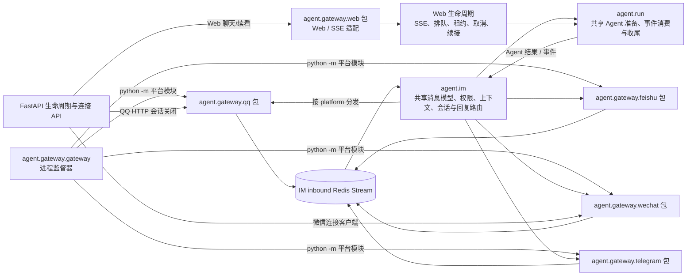

# Gateway 平台目录拆分方案

> 状态：实施中。阶段 0 至阶段 6 已完成复审；阶段 7 边界收尾待执行。
> 方案基线：2026-10-12 仓库代码结构。

## 1. 背景与目标

当前各平台 Gateway 实现集中在 `backend/agent/gateway/` 根目录。几个平台模块同时承担连接生命周期、入站事件解析、凭据读取、出站 API、媒体处理和流式回复，单文件过大后，阅读、测试和局部修改的成本都在上升。

当前主要文件约为：

| 文件 | 约行数 | 主要内容 |
|---|---:|---|
| `qq.py` | 1,735 | QQ WebSocket、入站消息与交互、HTTP 客户端、文本流、群聊、键盘和文件 |
| `feishu.py` | 1,493 | 飞书 WebSocket、事件处理、消息/卡片/文件、流式卡片和工具摘要接入 |
| `wechat.py` | 603 | iLink 长轮询、消息归一化、typing、文本和媒体发送 |
| `telegram.py` | 283 | Telegram 长轮询、去重/游标、出站节流、文本和文件 |
| `feishu_tool_summary.py` | 276 | 飞书工具调用摘要流 |
| `wechat_client.py` | 195 | iLink HTTP 客户端 |
| `wechat_media_crypto.py` | 148 | iLink 媒体加密/解密相关函数 |
| `wechat_config_cache.py` | 138 | 微信配置缓存与重试 |
| `wechat_typing.py` | 107 | typing 状态续期 |

另有 `web.py` 约 1,372 行，包含 Web SSE 请求准备、生成任务/排队、取消、续看、LLM 事件消费与持久化。它不是 IM 平台适配器，仍应作为独立 Web 传输子系统拆分。与此同时，仓库已有 `agent/im/` 与 `agent/run/` 两层公共能力：前者承载 IM 领域共享逻辑，后者承载 Web/IM 可复用的 Agent run 内核。目录拆分不能把这些公共能力复制进各 Gateway，也不代表要统一 Web 与 IM 的传输生命周期。

本方案目标是让平台实现和 Web 传输各自有明确的目录边界，并在目录内按稳定职责组织代码；不是为了文件数量平均而拆文件，也不是统一重写四套网关与 Web 生命周期。

### 本次目标

- 将 QQ、飞书、微信、Telegram 和 Web/SSE 适配迁移到各自的 Gateway 包目录。
- 把连接运行时、平台事件适配、出站能力，以及 Web 传输生命周期的模块边界从超大文件中分离。
- 保持平台 Gateway、Web 传输适配、IM 领域公共层和 Agent run 公共层之间的单向依赖；明确可复用的代码归属，避免重复实现。
- 保持现有模块启动命令、跨模块导入、消息协议、权限判断、重试语义和用户可见行为不变。
- 保留薄兼容入口，分阶段迁移消费者和测试，不要求一次性重写全部导入路径。
- 让各平台包依赖共享 IM 层，而不是互相依赖或复制共享 Agent 逻辑。

### 明确不在本次范围

- 不修改 `agent.im.loop`、`agent.im.replies` 的共享消息语义或权限模型；目录拆分仅复用这些既有边界。
- 不调整 Redis Stream、消息 payload、数据库模型、Bot 凭据保存方式及子进程环境变量协议。
- 不改变平台 API、消息格式、群聊规则、流式策略、重试或限流行为。
- 不拆 `gateway.py` 进程监督器；Web/SSE 与 IM 平台分属不同包，不把 Web 适配器并入任何 IM 包。
- Web 包结构迁移与 Web 接入 `agent/run/` 是两个独立工作切片：前者只整理文件归属，后者才处理准备/事件消费/收尾的复用与行为对齐，不在同一提交中混做。
- 不统一 Web SSE 与 IM 平台的传输/会话生命周期；Web 的队列、租约、取消、续接和 SSE 协议仍由 Web 适配层拥有。
- 不新增统一的 `BaseAdapter` 抽象。现有 `gateway/base.py` 的 `BaseAdapter` 没有实际消费者，不能仅因目录拆分而扩大其职责。
- 不顺手清理历史兼容逻辑或重构 Agent Loop。

## 2. 当前调用与运行边界



### 2.1 公共模块盘点与归属

| 公共模块 | 当前归属与职责 | 拆分方案中的处理 |
|---|---|---|
| IM 消息契约 | `agent/im/models.py`：平台消息、回复、目标、发送者及聊天类型规范化 | 保持为所有 IM 平台的统一领域契约；平台包只负责转入/转出平台格式 |
| IM 回复与出站路由 | `agent/im/replies.py`：按平台分发文本、文件、交互、工具事件和 Agent 回复 | 继续作为唯一跨平台出站路由，不在 `gateway/common` 复制 |
| IM 附件与文件发送 | `agent/im/files.py`：附件暂存、语音暂存、文件权限和能力检查 | 保持共享；底层平台下载、解密、上传协议仍由平台适配器负责 |
| IM 身份、权限、上下文与会话 | `agent/im/identity.py`、`permissions.py`、`context_policy.py`、`context_loader.py`、`session.py` 等 | 保持为 IM 领域公共层；不能搬入某个平台包，也不等同于 Web UI 的会话/SSE 生命周期 |
| Agent run 内核 | `agent/run/`：`prepare_agent_run`、`consume_agent_events`、`RunOutcome`、`CollectSink`/`WebStreamSink`、`finalize_agent_run` | Web 和 IM 的执行公共层。IM 的 `runner.py` 已接入；Web 当前仍有自有生成/收尾路径，并直接复用了部分能力准备 helper，后续应单独做 parity 后逐段接入 |
| Web 传输生命周期 | `agent/gateway/web.py` 及其使用的 `genstream`：SSE、后台生成所有权、排队、租约/心跳、取消、续接/重放 | 只归 Web 包；不得下沉到 IM 公共层或 `agent/run/`，也不得由平台 Gateway 接管 |

公共依赖方向：`平台 Gateway -> agent.im -> agent.run`；Web 传输适配器可以调用 `agent.run`，但 `agent.run` 不依赖任何平台或 Web SSE。IM 与 Web 各自把公共 Agent 结果映射到自己的传输/展示协议。

需要保持的现有对外边界：

1. `backend/agent/gateway/gateway.py` 中 `PLATFORM_MODULE` 继续指向 `agent.gateway.qq`、`agent.gateway.feishu`、`agent.gateway.wechat`、`agent.gateway.telegram`。平台名仍可直接作为 Python 可执行模块启动。
2. FastAPI 生命周期与 `worker.py` 都直接导入 `agent.gateway.qq` 的 HTTP session 管理函数；微信连接 API 和相关工具目前直接导入 `agent.gateway.wechat_client`。
3. `agent.im.replies` 按平台导入并调用出站能力；`agent.im.loop` 使用 Telegram `send_message` 和飞书 `FeishuToolSummaryStream`。
4. 现有测试通过旧模块路径导入符号或 monkeypatch 模块属性。包迁移必须保留这些测试 seam，不能只保证生产启动成功。
5. 平台密钥继续由现有数据库读取或环境变量注入；不得将密钥加入命令行参数、包常量、可见日志或新配置文件。

## 3. 目标目录结构

```text
backend/agent/gateway/
├── gateway.py                    # 保留：跨平台子进程监督、凭据环境注入、重启退避
├── web/                          # 新增 Web/SSE 子系统包；迁移 web.py
│   ├── __init__.py               # 兼容导出 stream/resume/cancel_local_generation
│   ├── stream.py                 # Web SSE 请求编排、订阅、后台任务启动与排队分流
│   ├── preparation.py            # 请求预检、上下文/附件准备的可独立步骤
│   ├── generation.py             # 当前 _generate_unlocked 的事件消费与持久化
│   ├── run_lifecycle.py          # gate、心跳、取消、失败收口和任务注册
│   ├── queued.py                 # 排队 run 的 SSE 接管、过滤、ping 和超时
│   ├── events.py                 # 经调用图确认后放置可复用 SSE 事件辅助
│   └── resume.py                 # 刷新续看：快照重放与实时订阅
├── base.py                       # 保留现状；不为本次拆分引入新抽象
├── qq/                           # 新增平台包；迁移 qq.py
│   ├── __init__.py               # 旧路径兼容导出与稳定平台 API
│   ├── __main__.py               # python -m agent.gateway.qq 入口
│   ├── runtime.py                # WebSocket 生命周期、重连与平台进程入口
│   ├── events.py                 # 入站消息、引用、mention、互动与 ACK 适配
│   ├── client.py                 # HTTP 会话、凭据/token、请求和错误分类
│   └── outbound.py               # 文本流、私聊/群聊、键盘、链接卡片、文件发送
├── feishu/                       # 新增平台包；迁移 feishu.py
│   ├── __init__.py               # 旧路径兼容导出与稳定平台 API
│   ├── __main__.py               # python -m agent.gateway.feishu 入口
│   ├── runtime.py                # WebSocket client、异步 runner、服务生命周期
│   ├── events.py                 # 消息、卡片动作、mention、路由/过期校验
│   ├── cards.py                  # 卡片元素/Markdown 格式化的共享纯函数
│   ├── messages.py               # 文本、交互卡片、链接卡片和文件发送
│   ├── streaming.py              # 流式卡片创建、更新、收尾与降级
│   └── tool_summary.py           # 迁移 feishu_tool_summary.py
├── wechat/                       # 新增平台包；迁移 wechat.py 及配套模块
│   ├── __init__.py               # 旧路径兼容导出与稳定平台 API
│   ├── __main__.py               # python -m agent.gateway.wechat 入口
│   ├── runtime.py                # 长轮询、生命周期、入站消息归一化与入队
│   ├── client.py                 # 从 wechat_client.py 迁移 ILinkClient
│   ├── config_cache.py            # 从 wechat_config_cache.py 迁移配置缓存
│   ├── media_crypto.py            # 从 wechat_media_crypto.py 迁移加解密实现
│   ├── typing.py                 # 从 wechat_typing.py 迁移 typing 状态续期
│   └── outbound.py               # 文本、typing、媒体上传和出站发送
└── telegram/                     # 新增平台包；迁移 telegram.py
    ├── __init__.py               # 旧路径兼容导出与稳定平台 API
    ├── __main__.py               # python -m agent.gateway.telegram 入口
    └── runtime.py                # 长轮询、去重/游标、限流和文本/文件出站

# 迁移期兼容模块（在所有调用者迁移前保留；平台同名 .py 由包 __init__.py 接管）
backend/agent/gateway/feishu_tool_summary.py  # 转为薄 re-export shim
backend/agent/gateway/wechat_client.py        # 转为薄 re-export shim
backend/agent/gateway/wechat_config_cache.py  # 转为薄 re-export shim
backend/agent/gateway/wechat_media_crypto.py  # 转为薄 re-export shim
backend/agent/gateway/wechat_typing.py        # 转为薄 re-export shim
```

> Python 不允许同一导入名同时由 `qq.py` 与 `qq/` 充当。每个平台从单文件切换到包时，应在一个完整、可运行的迁移步骤中删除同名 `.py`，并由包的 `__init__.py` 接管旧导入路径；不能先落一个不完整目录再留到后续阶段修复。

### 3.1 拆分尺度原则

- `runtime.py` 只承载连接生命周期、轮询/重连循环及平台入口，不放共享 Agent 编排。
- `events.py` 只将平台事件解析为已有统一 IM payload，并执行平台入站 ACK/互动回调；不自行执行 Agent。
- `client.py` 承载平台传输、凭据/token 解析、请求、安全错误分类；发送业务语义留给 `outbound.py`。
- `outbound.py` 按平台实际能力组织发送。QQ、飞书的流式/卡片职责需要单独模块；微信媒体流程复杂，出站可独立于运行时；Telegram 当前规模不大，先保持单一运行模块，避免过度拆成小文件。
- 目录内模块按依赖方向组织：`runtime/events/outbound -> client`；纯格式化与平台领域函数可被对应边界调用，但不得反向导入 `runtime`。
- 平台包之间不直接 import。跨平台路由继续由 `agent.im.replies` / `agent.im.loop` 负责。

## 4. 源码迁移映射

### 4.1 QQ

| 当前 `qq.py` 职责/符号范围 | 目标模块 |
|---|---|
| HTTP trace、session 创建/关闭、API base、access token、gateway URL、请求错误和 `_qq_request` | `qq/client.py` |
| 引用索引、消息索引键、引用提取、bot mention 判断、事件 ACK、原始消息与互动处理 | `qq/events.py` |
| WebSocket 连接与心跳、`_run_raw_ws`、`_serve`、`serve` | `qq/runtime.py` |
| 消息序号、`QQPrivateTextStream`、C2C/群消息、键盘/链接键盘、文件发送 | `qq/outbound.py` |
| 跨平台调用的 `send_c2c`、`send_group`、`send_keyboard`、`send_link_keyboard`、`send_file`、`create_private_text_stream`、`close_qq_http_session`、`QQAPIError` | 由 `qq/__init__.py` 显式导出，稳定旧调用路径 |

QQ 拆分时需特别处理 `_qq_request` 与出站函数之间的依赖，避免 `client -> outbound -> client` 循环。请求客户端应接收显式凭据/请求上下文，或通过单向依赖暴露低层 request 函数；凭据仍按当前 user bot 读取。

### 4.2 飞书

| 当前 `feishu.py` / `feishu_tool_summary.py` 职责 | 目标模块 |
|---|---|
| `_GatewayAsyncRunner`、`serve`、WebSocket client 和 handler 注册 | `feishu/runtime.py` |
| 入站消息/卡片动作、引用文字、mention、过期事件与 bot 路由校验、媒体归一化入口 | `feishu/events.py` |
| `_md_to_bold`、表格解析与 `_build_card_elements` 等共享卡片纯格式化能力 | `feishu/cards.py` |
| 文本、交互卡片、链接卡片和文件发送 | `feishu/messages.py` |
| 流式卡片 create/update/finalize、节流/序号、纯文本降级 | `feishu/streaming.py` |
| `FeishuToolSummaryStream` 及其摘要渲染 | `feishu/tool_summary.py`；摘要渲染依赖 `feishu/cards.py` |
| 现有 `agent.gateway.feishu_tool_summary` 导入路径 | 根目录薄兼容模块；过渡期内 re-export `feishu.tool_summary` |

飞书 SDK 回调当前为同步函数，内部通过常驻异步 runner 调用异步逻辑。该线程/事件循环所有权和停止时的任务清理必须整体迁移，不能拆分时顺手改为另一套并发模型。当前摘要模块从旧 `feishu.py` 导入 `_build_card_elements`、`_md_to_bold` 私有函数；迁移时应先把这类纯格式化函数收敛到 `cards.py`，避免新 `tool_summary.py` 反向依赖 runtime 或包 facade，形成循环导入。

### 4.3 微信

| 当前文件/职责 | 目标模块 |
|---|---|
| `wechat.py` 的 `_handle_msg`、`_serve_async`、启动通知和长轮询入口 | `wechat/runtime.py` |
| `wechat_client.py` 的 `ILinkClient`、协议常量与请求头 | `wechat/client.py` |
| `wechat_config_cache.py` 的 `WeixinConfigManager` 与缓存重试策略 | `wechat/config_cache.py` |
| `wechat_media_crypto.py` 的媒体加解密和上传数据准备函数 | `wechat/media_crypto.py` |
| `wechat_typing.py` 的 `TypingIndicator` | `wechat/typing.py` |
| `wechat.py` 的文本、typing、CDN 上传、图片和文件发送 | `wechat/outbound.py` |
| 入站媒体下载/解密/暂存 | 继续使用 `agent.im.media_ingress_wechat`，不复制到 Gateway 包 |
| `agent.gateway.wechat_client`（连接 API、测试等现有消费者） | 根目录薄兼容模块，re-export `wechat.client` |

微信拆分必须保留 `context_token` 的入站、排队和出站传递；配置缓存、typing ticket、媒体引用及其失败降级不可被当成纯结构代码删除。连接 API 继续只依赖 `ILinkClient` 的公开接口，不依赖 runtime 私有状态。

### 4.4 Telegram

当前 Telegram Gateway 约 283 行；Bot API HTTP 实现已独立位于 `app.services.telegram_bot_api`，且连接 API 和媒体入站也直接使用该服务。

因此本次只将 `telegram.py` 迁入 `telegram/runtime.py`，把 `telegram/__main__.py` 作为模块入口，`telegram/__init__.py` 显式 re-export 现有 `send_message` / `send_file` 等共享调用符号。Bot API 客户端继续留在 `app.services.telegram_bot_api`，不在 gateway 包内复制或再包一层。

如后续该模块继续增长，再按实际职责拆 `polling.py` 和 `outbound.py`；不把本次目录迁移变成预防性微拆分。

### 4.5 Web / SSE 与 Agent run 公共层

Web Gateway 与 IM 平台有不同的传输生命周期：HTTP 请求建立 SSE 订阅，后台生成脱离请求继续运行；同会话可排队；页面刷新通过 `resume()` 从快照重放并续订；取消既要支持本地 task.cancel，也要支持跨 Worker 的 Redis 标记。因此 Web 必须成为独立 `web/` 包，不能套用 IM 包的 runtime/events/outbound 模板。

Agent 执行逻辑则不应因此长期复制。`agent/run/` 已统一 IM collect/stream 的准备、事件消费和收尾；`web.py` 已直接复用 `agent.run.preparation` 中的 MCP/RAG 与能力准备 helper，但 Web 的完整 `prepare_agent_run`、统一 `consume_agent_events` 和 `finalize_agent_run` 接入尚未完成。应先锁定 Web 行为，再把可共用的执行阶段接入该公共层；SSE 帧编码、生成租约/心跳、后台任务所有权、排队与续接保持在 Web Adapter。

| 当前 `web.py` 职责/符号 | 目标模块 |
|---|---|
| `stream(req)` 中的 SSE 请求编排、订阅建立、启动/排队分流 | `web/stream.py`；页面协议及事件先保持原样 |
| 请求配额/上下文/附件/语音等生成前准备 | `web/preparation.py`；保留 Web 专属预检和 SSE 前置语义，稳定的 Agent run 准备逐步委托 `agent.run.preparation` |
| `_generate_unlocked` 中后台生成协调、SSE 发布、租约/所有权管理 | `web/generation.py` / `web/run_lifecycle.py`；AgentEvent 的公共解析、清洗、用量/工具/时间线投影逐步委托 `agent.run.execution`，SSE 帧映射仍在 Web |
| `_generate`、`_refresh_generation_history`、`_finalize_preflight_failure`、任务登记/取消和 heartbeat | `web/run_lifecycle.py` |
| `_stream_queued_run` 及排队等待常量 | `web/queued.py` |
| `resume(session_id)` 的快照 timeline/旧快照兼容重放与订阅 | `web/resume.py` |
| `_publish_session_append` 及纯 SSE 编码/公共事件辅助（经调用图确认后） | 优先归到 `web/events.py`；仅属于 Web 事件协议的逻辑留在 Web，Agent 事件语义不再复制 |
| API 当前通过 `from agent.gateway import web as web_adapter` 使用的入口 | `web/__init__.py` 显式导出 `stream`、`resume`；取消端点继续可从 `agent.gateway.web` 导入 `cancel_local_generation` |

实施时需要以 `web.py` 的完整调用图为准，特别审查 `stream()` 内嵌的 `_load_snapshot`、`_load_system_prompt`、`_process` 和生成任务登记闭包。只有具有明确契约的逻辑才抽成 preparation/event helper；不要把闭包机械搬成大量跨模块参数，也不要让 `generation` 与 `run_lifecycle` 互相 import。

Web 的主要风险不是启动命令，而是 SSE 帧序列和后台任务所有权。必须维持 `started/phase/notice/done/queued` 等现有帧、心跳/租约、owner_run_id 隔离、session gate、排队接管、刷新重放顺序、取消/孤儿收尾与持久化语义。公共 run 内核负责 Agent 准备/事件消费/最终化；Web Adapter 负责 Web 请求和传输生命周期。两者可以协作，但不能互相吞并职责。

## 5. 兼容策略与依赖规则

### 5.1 启动兼容

- 保留 `python -m agent.gateway.gateway` 作为唯一跨平台监督器入口。
- 每个平台包提供 `__main__.py`，保证现有 `python -m agent.gateway.<platform>` 命令不变。
- `gateway.py` 的 `PLATFORM_MODULE` 值不改；进程环境变量名称、字段来源、停止和重启策略不改。
- 新旧入口测试不得真的连接外部平台；使用 stub 子进程、假环境变量和本地 mock。

### 5.2 导入兼容

- 平台包 `__init__.py` 显式导出 `agent.im.replies`、`agent.im.loop`、FastAPI 生命周期和现有测试依赖的稳定符号。
- 将 `feishu_tool_summary.py`、`wechat_client.py` 及微信配套模块改为薄 re-export shim，直到仓库内 import 和维护者工具都不再依赖旧路径；`web.py` 的原导入名由 `web/__init__.py` facade 接管。
- 在迁移前先列出根目录平台模块公开符号与测试 monkeypatch seam；不要通过 `from .runtime import *` 暴露所有实现细节。
- 兼容 facade 仅保障导入/调用路径。若旧测试依赖给 package 属性 monkeypatch 后改变内部模块全局变量，需将测试改为注入 client/transport 或 patch 实际实现模块；不能假设 Python re-export 会自动同步模块全局变量。
- 删除某个 shim 前，需用仓库级搜索覆盖生产代码、测试、脚本、文档和启动配置；第三方扩展是否依赖私有路径无法证明时，倾向长期保留成本很低的兼容层。

### 5.3 依赖方向

```text
agent.gateway.gateway (监督器)
        │ 启动平台包
        ▼
gateway.<platform>.runtime ──> events / outbound ──> client
                                      │
                                      └──> agent.im 共享入站/权限/媒体服务

agent.im.replies / loop ──> 平台包公开出站 API
```

- `gateway` 监督器不能依赖平台私有实现。
- 平台 runtime 不得依赖 `agent.im.loop` 的具体 Agent 执行实现；只做解析、入队和出站。
- 平台之间不能互相 import。
- `agent.im.replies` 作为跨平台出站路由层可依赖各平台包的稳定 facade，但平台实现不能反向依赖 replies。
- 保持 `agent.im.media_ingress_*` 是媒体入站处理的归属，不将媒体权限/暂存逻辑搬入平台包。

## 6. 分阶段实施与停止门槛

每阶段均为独立代码迁移单元，但不要求每阶段单独提交。每阶段先搬迁、再验证，禁止同时改行为、协议或权限规则。若该阶段的兼容测试或行为测试失败，先停在当前平台修复，不继续批量迁移。

### 阶段 0：冻结基线与调用清单

- 记录四个平台公开出站函数、模块启动路径、跨层直接导入、环境变量名及根目录测试替身。
- 为每个平台建立专用测试清单，注明测试所 patch 的模块对象和预期可观察行为。
- 为 Web 补齐 SSE 帧 characterization、排队/续看/取消/心跳现有测试基线；记录 FastAPI API 的导入方式和 monkeypatch seam。
- 确认 `gateway.py`、`agent.im.replies`、`agent.im.loop`、FastAPI lifespan 和 Web API 现有契约。
- 不改生产代码；测试清单与本方案一起作为实施检查依据。

阶段 0 基线记录（2026-10-13）：

- 模块启动命令为 `python -m agent.gateway.gateway` 监督器，以及 `python -m agent.gateway.{qq,feishu,wechat,telegram}` 四个平台入口；`gateway.py` 的映射仍指向这些模块名。
- 平台环境变量保持现有名称：QQ 使用 `QQ_APP_ID`、`QQ_APP_SECRET`、`QQ_SANDBOX`、`QQ_BOT_ID`、`QQ_OWNER`；飞书使用 `FEISHU_APP_ID`、`FEISHU_APP_SECRET`、`FEISHU_BOT_ID`、`FEISHU_OWNER`；微信使用 `WECHAT_BOT_TOKEN`、`WECHAT_BASE_URL`、`WECHAT_BOT_ID`、`WECHAT_OWNER`；Telegram 使用 `TELEGRAM_BOT_ID`、`TELEGRAM_OWNER`、`TELEGRAM_BOT_TOKEN`。凭据继续通过既有环境注入，不记录值。
- 跨层调用 seam：`app.main` 与 `worker` 导入 QQ `start_qq_http_session` / `close_qq_http_session`；微信连接 API 导入 `wechat_client.ILinkClient`；`agent.im.replies` 按平台包路由出站；`agent.im.loop` 导入 Telegram `send_message` 和根路径飞书摘要类。
- 测试 seam：QQ、飞书及 Web 当前测试直接 patch 旧模块对象属性（如 QQ `_qq_request`、`create_private_text_stream`，飞书凭据/卡片/出站函数，Web 队列常量、生成生命周期函数与 `genstream`）。包迁移后 facade 不会自动转发对模块属性的 monkeypatch；迁移必须让生产调用和测试 patch 都落到实际实现模块，或使用已有显式注入点。
- 平台测试清单：QQ 以 `tests/im/qq/` 的 raw WebSocket、raw send、错误契约、绑定/连接、群聊历史和 Redis key 迁移为主，旧模块 seam 包括 `_qq_request`、`_post`、`_qq_ack`、`R.produce`、`create_private_text_stream`；断言入站 ACK/归一化、引用/mention、回复路由、重试降级和会话资源关闭。飞书以 `tests/im/feishu/` 的 gateway guards、interactions、media、tool summary 为主，旧模块 seam 包括凭据读取、卡片 create/update/finalize、下载、`send_text` 和 `R.produce_sync`；断言 stale/misrouted 过滤、SDK runner 生命周期、交互/媒体归一化和流式卡片顺序/降级。微信现有覆盖为 `tests/im/test_wechat_quotes.py`、`test_start_im_activity_order.py`，主要断言引用媒体入队、权限预检顺序和 typing 停止幂等；当前没有独立的 client/config cache/crypto/typing 生命周期回归，阶段 2 必须补上。Telegram 以 `tests/im/telegram/` 的 gateway、contract、Bot API、connect、format、policy、media 和 parser 为主，连接层 mock Bot API/Redis/DB；断言 update 去重/游标、限流/Retry-After、文本/文件、连接凭据脱敏与安全 URL 行为。
- 共享导入覆盖：`tests/im/test_im_replies.py` 验证平台出站分发，`tests/platform/realtime/test_streaming_regressions.py` 验证 IM 执行/取消收口；当前没有直接验证 `app.main`/`worker` lifespan 对 QQ HTTP session 的关闭调用，阶段 4 应以显式 monkeypatch 测试保护该 seam。
- Web 基线覆盖文件：`tests/platform/realtime/test_web_queued_stream.py`、`test_web_session_events.py`、`test_web_resume_contract.py`、`test_streaming_regressions.py`、`tests/agent/test_genstream_cancel.py`。事件/行为覆盖 `queued`、旧 run 过滤、快照与实时事件顺序、续看 timeline 重放、idle/replayed `done`、跨标签页 session 通知、心跳/租约、取消和失败收口；迁移必须保持 SSE 行原样及 owner run 隔离。阶段 5 另需补全 `stream()` 的完整前置帧和后台生成帧序列 characterization，再移动实现。
- 阶段 0 专项命令：`PYTHONPATH=. .venv/bin/pytest -q tests/im tests/platform/realtime/test_web_queued_stream.py tests/platform/realtime/test_web_session_events.py tests/platform/realtime/test_web_resume_contract.py tests/platform/realtime/test_streaming_regressions.py tests/agent/test_genstream_cancel.py`；结果 `465 passed`（2026-10-13，3 个第三方弃用警告）。

### 阶段 1：Telegram 包迁移（低耦合试点）

- 将 `telegram.py` 迁为 `telegram/runtime.py`，新增 `__init__.py` 和 `__main__.py`。
- Bot API 仍调用 `app.services.telegram_bot_api`。
- 验证 `python -m agent.gateway.telegram` 入口、入站去重/游标、每 chat 限流、文本/文件发送、旧路径导入与连接配置。
- 该阶段验证包入口和兼容 facade 的实施方式，再应用到其他平台。

阶段 1 复审记录（2026-10-13）：

- 原 `telegram.py` 内容原样迁至 `telegram/runtime.py`；包 facade 显式导出 `main`、`send_message`、`send_file`，`__main__.py` 保留模块启动路径。Bot API 继续从 `app.services.telegram_bot_api` 引用。
- 生产消费者仍通过 `agent.gateway.telegram` 取得稳定出站入口；实现级测试改为导入 `telegram.runtime` 并 patch 实际运行模块，避免 facade re-export 与内部全局变量脱节。新增测试验证旧包路径导出仍指向实际实现。
- `PYTHONPATH=. .venv/bin/pytest -q tests/im/telegram`：`78 passed`（2026-10-13，2 个第三方弃用警告）。缺少凭据的模块入口验证以合成无效配置触发原有配置失败分支，退出码为 1，未调用 Telegram 网络 API。
- 复审结论：目录与兼容入口符合阶段 1 设计；协议、Redis payload/去重键/游标、限流、凭据读取与出站行为未改。允许进入阶段 2。

### 阶段 2：微信包迁移

- 将微信运行时和四个配套模块迁入 `wechat/`。
- 保留根目录旧模块作为薄 shim；`wechat_client` 首先迁移，因为它被 FastAPI 连接 API 直接依赖。
- 核验 `context_token`、媒体入站、引用媒体、typing ticket、缓存 TTL/重试、凭据环境变量和关闭路径。

阶段 2 复审记录（2026-10-13）：

- `wechat.py` 的入站/长轮询/进程生命周期迁至 `wechat/runtime.py`，文本/typing/CDN 上传/图片文件发送迁至 `wechat/outbound.py`；client、配置缓存、媒体加解密、typing 实现迁入对应包模块。根路径四个配套模块保留为显式 re-export shim，FastAPI 连接 API 仍可从旧路径导入 `ILinkClient`。
- 生产调用改用包 facade 稳定出站 API；入站测试改为 patch `wechat.runtime` 的实现模块。内部组件通过相对导入依赖 canonical 模块，不反向依赖根 shim。
- 新增行为测试验证 iLink 文本/媒体消息携带入站 `context_token`、媒体 item 结构、缺失 token 时拒绝发送、配置缓存命中与失败退避、AES key 编码和 PKCS7 round-trip、typing ON/OFF、long-poll 取消时关闭 client、网关 token/base URL 环境注入及旧导入路径兼容。
- `PYTHONPATH=. .venv/bin/pytest -q tests/im tests/platform/realtime/test_web_queued_stream.py tests/platform/realtime/test_web_session_events.py tests/platform/realtime/test_web_resume_contract.py tests/platform/realtime/test_streaming_regressions.py tests/agent/test_genstream_cancel.py`：`480 passed`（2026-10-13，3 个第三方弃用警告）；`compileall` 通过。`python -m agent.gateway.wechat` 在未配置 token 时按原配置错误退出，未连接平台。
- 复审对照确认 runtime 与 outbound 函数体和迁移前一致，改动限于职责归档、相对导入和路径说明；协议、凭据来源、媒体流程、typing 与关闭语义未改。允许进入阶段 3。

### 阶段 3：飞书包迁移

- 先迁 `FeishuToolSummaryStream` 并保留根路径 shim，再拆分 runtime、events、messages 和 streaming。
- 验证 SDK 同步回调到常驻异步 runner 的线程/事件循环边界。
- 核验 stale/misrouted event 拒绝、mention/引用解析、卡片互动、附件、流式卡片 sequence 和失败降级。

阶段 3 复审记录（2026-10-13）：

- `feishu.py` 拆入 `feishu/runtime.py`、`events.py`、`cards.py`、`messages.py`、`streaming.py`；`FeishuToolSummaryStream` 迁到 `feishu/tool_summary.py`。根路径 `feishu_tool_summary.py` 保留显式兼容导出，稳定的飞书发送 API 由 `feishu/__init__.py` 显式导出，`python -m agent.gateway.feishu` 由包入口继续启动。
- `agent.im.loop` 改为从包内导入工具摘要实现。实现级测试与 patch seam 指向实际模块；跨平台回复和工具调用仍通过 `agent.gateway.feishu` facade。
- 事件适配层不反向导入发送模块：runtime 将常驻 runner 和同步发送回调装入 `_EventServices` 注入事件处理器；卡片动作消费仍投递到同一 runner，线程/事件循环所有权没有变化。
- 迁移前后 AST 对照覆盖原 `feishu.py` 的 44 个顶层类/函数：无符号遗漏；除 runner/发送回调注入的 `_handle_card_action`、`_make_on_message` 与 `serve` 接线外，其余函数体保持一致。卡片摘要旧导入路径由现有测试覆盖。
- 新增卡片动作回调测试，验证一次性 action token、事件 ID、操作人及 bot 归属被传给消费流程。stale/misrouted 过滤、mention、引用/媒体解析、常驻 runner、卡片 sequence 与流式失败降级均由现有行为测试保护。
- `PYTHONPATH=. .venv/bin/pytest -q tests/im`：`444 passed`；`tests/im/feishu`、IM 协议/链接卡片及 `test_streaming_regressions.py` 定向回归：`108 passed`；`compileall` 与 `git diff --check` 通过。飞书模块入口在缺少注入凭据时仍以原配置错误退出，未调用平台网络 API。
- Ripwire 质量差异将跨模块搬迁的高复杂度函数按新路径计作新符号；逐符号 AST 对照确认这些复杂函数体并未因此变更。阶段复审未发现新的 facade 导出或实际职责越界。允许进入阶段 4。

### 阶段 4：QQ 包迁移

- 先迁 client/session 和错误类型，再迁 events/runtime，最后迁 outbound/streams。
- 将 `close_qq_http_session` facade 保持在 `agent.gateway.qq`，使 FastAPI shutdown 行为不变。
- 核验 WebSocket heartbeat/ACK、消息引用索引、群聊 mention 和权限策略、HTTP token/cache、Markdown 降级、键盘/链接键盘、文件发送、C2C 流式以及取消/关闭。
- QQ 是改动面最大的阶段，不与其他平台迁移并行进行。

阶段 4 复审记录（2026-10-13）：

- `qq.py` 按 client、events、runtime、outbound 拆入 `qq/` 包；包 facade 显式导出稳定的 `QQAPIError`、HTTP session 生命周期、发送 API 和 `serve`，`__main__.py` 保留 `python -m agent.gateway.qq` 入口。FastAPI lifespan 的旧导入仍指向 facade。
- QQ 实现级测试改为导入 canonical 模块并 patch 其真实依赖；跨层发送测试继续通过 facade 验证公开路由。新增 facade 行为测试确认生命周期/发送入口指向实现，并能关闭所持有的 HTTP session。
- 迁移前后 AST 对照覆盖旧 `qq.py` 的 53 个顶层类/函数：无遗漏、无新增符号，函数体均保持一致。模块导入关系保持 runtime/events/outbound 单向依赖 client；事件层对出站函数的需要仍使用现有底层发送 seam。
- 微信 facade 改为按需导出，避免导入旧 `wechat_client` shim 时包初始化提前加载 outbound 而形成循环导入；旧路径导入和包 facade 的公开发送/运行入口均通过实际导入检查。
- `PYTHONPATH=. .venv/bin/pytest -q tests/im`：`446 passed`（2026-10-13，3 个弃用警告）；QQ 相关 Agent 链接/工具历史与 facade 回归：`48 passed`（1 个弃用警告）；`compileall` 与 `git diff --check` 通过。QQ 模块运行入口在缺少配置时按既有错误退出，未连接真实平台；旧路径和 facade 兼容导入检查通过。
- 复审确认阶段改动集中在职责迁移、兼容入口和测试 patch seam；未改 QQ 消息协议、重试/权限规则或 session 所有权。阶段 4 结构和定向行为复审通过。

### 阶段 5：Web/SSE 包迁移（独立高风险阶段）

- 在移动任何代码前，先补或确认 SSE 事件序列、会话事件通知、后台生成、排队、刷新续看、跨 Worker 取消、取消后工具气泡收尾等行为测试。
- 把 `web.py` 迁为 `web/` 包，并由 `__init__.py` 显式维持 `web_adapter.stream`、`web_adapter.resume` 和 `agent.gateway.web.cancel_local_generation` 的调用形式。
- 先按上表搬迁到 `stream`、`preparation`、`generation`、`run_lifecycle`、`queued`、`resume`；首轮只搬职责，不统一 Agent Run lifecycle，不变更 SSE 数据。
- 逐步搬迁 API 与测试导入；所有测试 monkeypatch 需要指向真实实现模块或稳定的注入 seam。
- 定向验证完成后再执行完整后端测试。此阶段不得与 IM 平台迁移并行。

阶段 5 复审记录（2026-10-13）：

- `web.py` 拆入 `web/stream.py`、`queued.py`、`resume.py`、`generation.py`、`run_lifecycle.py` 和 `events.py`；`web/__init__.py` 显式维持 `stream`、`resume`、`cancel_local_generation` 三个旧调用入口。API 取消端点及 app 导入兼容通过运行时导入检查。
- `stream()` 内的请求预检、上下文/附件准备及其局部闭包仍放在 `stream.py`：这些步骤共享同一 DB 事务和请求状态，当前没有独立稳定的返回契约；抽成大量参数的 preparation API 会扩大本轮改动。稳定 Agent 准备复用留待阶段 6 parity 测试后完成，符合“先迁移传输生命周期、不顺手统一 run”的边界。
- queued、resume、session append、后台生成/取消测试均改为 patch canonical 实现模块；新增主请求行为测试覆盖用户消息落库后的 `session_id` 帧，以及后台 token、done 的顺序与内容。
- 迁移前后 AST 对照覆盖原 `web.py` 的 10 个顶层函数：无遗漏、无新增，函数体完全一致。模块依赖为 stream → queued/events/run_lifecycle，run_lifecycle → generation，generation → events；无反向导入。
- 更新上下文压缩静态检查脚本，使其扫描 Web 包路径，并对照当前 `loop/runner.py` 的 provider-round 阈值调用。检查通过；`web` facade/API 导入通过；`compileall` 与 `git diff --check` 通过。
- Web/SSE、取消、文件工具关联的定向回归：`61 passed`（2026-10-13，3 个弃用警告）。
- 复审结论：SSE 帧、队列归属、续看重放、后台任务和取消收口实现体未改变；公共导入路径保持不变。阶段 5 通过，进入阶段 6 parity 与 Agent run 接入。

### 阶段 6：Web 接入共享 Agent run（独立于目录搬迁）

- 先为 Web 当前生成路径补齐/确认 parity 测试：用户消息与附件准备、MCP/RAG/能力装配、逐轮文本清洗、工具事件顺序与展示时间线、用量/文件、取消/错误、最终持久化及跨标签页通知。
- 保留 Web 专属前置语义：配额错误时机、乐观用户消息、pending queue、greeting/references、后台生成 task 所有权和 Web session gate；确认可表达后再复用 `prepare_agent_run`，不向公共层塞散乱的 `if web` 分支。
- 将 AgentEvent 消费逐步接入 `consume_agent_events`/`RunOutcome`；Web SSE 帧转换与 `genstream.publish` 留在 Web sink/adapter。需要时为 `agent/run/` 增加显式 sink/callback 契约，不让公共层导入 `agent.gateway.web`。
- 对照 Web 当前 `finalize_run` 与 `finalize_agent_run` 的持久化、副作用、通知和失败语义；只有 parity 测试覆盖后才迁移收尾。保持“持久化先于最终事件/广播”的现有契约。
- 每次只迁一个阶段：准备、事件消费、收尾。任一 parity 测试失败即停止并定位，不将 Web/IM 传输生命周期合并，也不同时进行平台目录迁移。

阶段 6 复审记录（2026-10-13）：

- Web 后台生成现在由 `agent/run/execution.py` 的 `consume_agent_events` 解析并填充 `RunOutcome`；`WebStreamSink.on_event` 将需要外发的已解析事件交给 Web 适配器，公共 run 层不导入 Gateway。Web 仍在适配器内处理跨轮去重、`owner_run_id`、`user_message_id`、交互事件 session 归属及 genstream 发布。
- 公共消费器统一负责 token 清洗、usage/compaction、工具事件耗时和状态、文件与链接按钮时间线、取消/错误识别。内部 `_usage` 仍不外发；其余此前由 Web 转发的事件维持原顺序。流式 sanitizer 缓存的尾部字符现在会作为 token 交给 Sink，避免接入公共消费器后丢失尾字节。
- Web 后台生成行为测试覆盖成功、Provider 错误和 in-band 取消；成功路径检查多轮去重、工具/链接按钮时间线、usage 落库及持久化先于 `done`，取消路径检查工具停止终态和部分历史先于 `done`。验证：run 生命周期、准备 parity、AgentEvent 消费、Web/SSE 与取消测试共 `83 passed`；`compileall` 和 `git diff --check` 通过。
- Web 的请求预检与上下文准备不改用完整 `prepare_agent_run`：Web 在后台生成前已完成会话创建、用户消息及附件 claim、配额时机和首轮广播，完整入口会重复这些副作用。Web 继续复用其中稳定的 `load_mcp_tools_and_rag_context`、`prepare_run_capabilities` 与 `run_context.prepare_run`；主请求 parity 测试继续验证 `session_id` 与用户消息先行行为。
- 收尾继续调用共享的 `finalize_run` 持久化原语，但暂不套用 `finalize_agent_run` 门面：Web 需要 `session_exists_required`、当前 provider `run_id`/`round_id`、同步标题生成及 `session_title` SSE、来源标签页 session 广播和 Web 原有反思输入。切换门面会改变这些可观察语义；本阶段保持它们不变。
- 复审结论：事件消费重复实现已移除，Web/IM 传输与后台任务所有权仍分离；成功、错误、取消三种终态均有 Web 生成路径测试。阶段 6 通过，进入阶段 7 边界收尾。

### 阶段 7：边界收尾

- 检查所有平台根路径 shim 的消费者；只有在确认不需要兼容时才考虑删除，否则保留薄层。
- 更新 `docs/agent/08-CHANNELS.md` 的模块入口与目录结构说明；不改平台能力矩阵，除非实现行为确有变化。
- 运行完整定向 IM/Web Gateway 测试及后端测试；再做静态导入循环、旧路径引用和包入口检查。
- 最终 diff 必须证明该系列仅重组代码和文档，没有改变对外行为。

阶段 7 复审记录（2026-10-13）：

- `docs/agent/08-CHANNELS.md` 已更新实际 Gateway 包入口、Web/SSE 与 `agent.run` 的边界，并补齐 Telegram 目录和能力说明；文档中不再引用已删除的 `qq.py`、`feishu.py`、`wechat.py`、`web.py` 实现路径。
- 兼容导入烟测通过：12 个包入口、旧微信组件 shim、飞书工具摘要 shim、Gateway 监督器及 Agent API 均可导入；不创建平台连接或访问外部网络。跨平台入口映射未变。
- 全量后端测试在干净验证快照中通过：`4464 passed, 3 skipped`。快照包含 Gateway 提交和本阶段日历测试修正，不包含主工作树中其他未提交内容；测试运行时使用临时链接的本地虚拟环境、RAG worker 制品及临时安装的 npm 依赖，没有读取或改写用户运行配置。
- 全量运行前发现 `test_phase2_project_and_calendar_reads_preserve_user_scope` 将项目和活动日期固定为 2026-10-12，导致之后运行时“即将到来的活动”计数错误。测试现按当前日期构造开始日期、未来截止日期和次日活动，独立复测通过；权限隔离及 upcoming 结果断言保持不变。
- 本阶段定向 AgentRun、Web/SSE 与实时流测试：`83 passed`；兼容入口烟测 12 项通过，导入和 `git diff --check` 检查通过。
- 阶段复审结论：Gateway 包入口、旧路径兼容、导入烟测、定向 IM/Web 测试和全量后端测试均通过。主工作树中另有未提交的 storage/quota、Mermaid 等用户修改，本次全量验证使用隔离快照，避免这些独立改动影响结果。

## 7. 测试与验收标准

### 行为测试

| 平台 | 必须覆盖的现有回归面 |
|---|---|
| QQ | 原始 WebSocket 入站/ACK、引用与 mention、互动回调、C2C/群聊回复策略、键盘、文件、错误分类、会话关闭 |
| 飞书 | 网关 guard、媒体入站、引用/mention、卡片交互、工具摘要流、流式卡片创建/更新/完成/降级 |
| 微信 | 长轮询顺序、消息归一化、`context_token` 回复、媒体加解密/上传、配置缓存、typing 生命周期 |
| Telegram | update 去重和游标原子持久化、编辑消息过滤、429 Retry-After、私聊/群聊节流、文本/文件出站、Bot API 错误脱敏 |
| Web/SSE | SSE 帧序列兼容、生成脱离请求存活、同会话排队及 owner_run_id 过滤、刷新快照重放/续订、跨 Worker 取消、heartbeat/lease、取消后的工具终态与失败收口 |
| Web 接入共享 run | 与现有 Web 路径对照准备结果、Outcome 字段、工具/文本时间线顺序、取消/错误终态、持久化与通知；Agent run 行为一致且 Web SSE 帧不变 |
| 共享路径 | `agent.im.replies` 平台分发、`agent.im.loop` 飞书工具摘要/Telegram 发送、FastAPI lifespan QQ 清理、微信扫码连接 API |

测试按行为契约组织；结构测试仅用于包入口、导入兼容和禁止平台间依赖等边界，不以源码字符串或文件行数作为功能正确性证据。

### 运行与兼容验收

- 四个平台 `python -m agent.gateway.<platform>` 都能进入各自包入口；在缺少必要运行环境/凭据时给出原有可识别失败，不连接真实平台。
- Web API 通过 `agent.gateway.web` 包的兼容导出继续调用 `stream`、`resume` 和取消 helper。
- `python -m agent.gateway.gateway` 的监督器映射和构造的子进程命令不变。
- 所有已列出的旧导入路径继续可用；旧测试的 monkeypatch 行为经过实际执行验证。
- Redis 入站 payload 的字段、序列化、去重键与游标不变。
- 无新增跨平台 import cycle；无模块导入时启动线程、连接外网、初始化 Bot client 或读取/打印密钥的副作用。
- 可见错误仍经过脱敏；原始响应/异常仍只能通过受限诊断通道记录。
- 逐平台定向测试通过后，再串行执行完整后端测试。是否在 devserver 验证由实施任务另行决定，不属于本方案的预先承诺。

### 完成定义

满足以下条件后，才可称拆分完成：

1. 四个平台位于独立包目录并能以原模块名启动，Web Gateway 位于独立包目录且 Web API 兼容入口不变。
2. 监督器、FastAPI、IM Loop/回复分发、Web SSE 和历史兼容导入均已覆盖。
3. 各平台和 Web 的关键用户行为与安全边界由测试保护，定向测试和完整后端测试通过。
4. Web 与 IM 复用 `agent/run/` 的公共执行逻辑；Web SSE/后台任务生命周期仍归 Web，parity 与帧协议测试通过。
5. 迁移未改变消息协议、SSE 帧、数据库、凭据传递、权限、平台行为及失败语义。
6. 文档反映真实目录与边界；未使用目录拆分借机引入统一抽象、复制共享逻辑或扩大范围。

## 8. 主要风险与控制

| 风险 | 影响 | 控制方式 |
|---|---|---|
| `.py` 到同名包的导入冲突 | 平台模块启动失败或导入到旧实现 | 单个平台在完整迁移中原子替换旧文件，并立刻验证 `python -m` |
| re-export 不保持 monkeypatch 语义 | 测试假对象没有替换实际运行依赖 | 盘点 patch 点，改为明确依赖注入或 patch 实现模块并验证行为 |
| 拆文件造成循环导入 | 模块导入失败或初始化顺序敏感 | 保持单向依赖；出站接口集中在包 facade，client 不反向导入 runtime |
| 移动文件改变启动副作用 | 多出线程、HTTP session 或事件循环，或资源未关闭 | 导入无副作用；单独测试显式启动/关闭和 lifespan 清理 |
| 结构重构夹带行为修改 | 群聊、媒体、权限或重试回归 | 每平台一次迁移；第一遍原样搬家；行为优化另开任务 |
| Web SSE 或后台任务生命周期轻微变化 | 空气泡、排队串 run、刷新后状态错乱、取消失效或重复持久化 | Web 独立高风险阶段；先锁定帧序列和 owner_run_id 行为，再迁移并做 cancellation/queue/resume 行为测试 |
| shim 永久化造成表面重复 | 维护者不清楚权威实现位置 | shim 只含导出，不含业务逻辑；注释标明 canonical 包路径 |
| 过度拆分 | 文件过多、依赖关系反而难读 | Telegram 保持紧凑；只按真实边界拆 QQ/飞书/微信，实施时允许合并不独立的小模块 |

## 9. 公共模块演进原则

- `agent/im/` 是 IM 领域公共层：统一平台消息契约、身份/权限、上下文/会话、附件暂存和出站路由。平台 Gateway 只做协议适配，不复制这些规则。
- `agent/run/` 是 Web、IM 与其他 Agent 入口可共用的执行内核：准备、AgentEvent 消费、Outcome 和最终化。平台输出与 Web SSE 都通过 adapter/sink 接入，公共层不依赖任何入口模块。
- `agent/gateway/web/` 仅拥有 Web 传输生命周期：SSE、后台生成所有权、排队、租约/心跳、取消、续看/重放。不得把它迁入 `agent/im/` 或由 `agent/run/` 接管。
- 不新增无真实复用需求的 `gateway/common`、万能 `BaseAdapter` 或跨平台下载器。平台 API、事件解析、限流重试、媒体鉴权/解密和卡片/引用/mention 表达仍由各平台拥有。
- 文件搬迁和共享逻辑统一分别验收；若两个边界的迁移需要同时改变行为才能成立，应暂停拆分并先更新设计，而不是把复杂度藏入兼容 facade。
