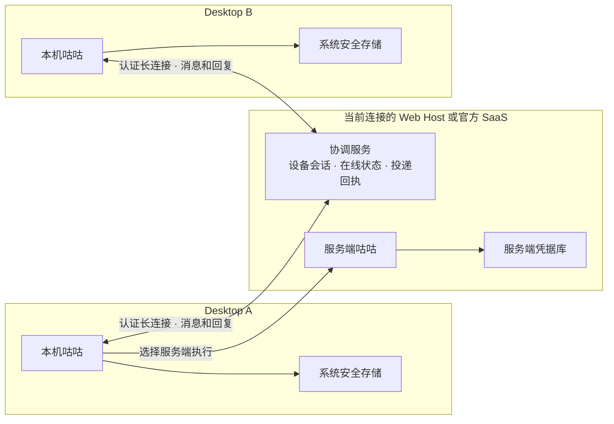

# Gugu 2.0 多端连接与凭据设计

Desktop 已可登录自部署 Web Host，并在本机加密保存远程会话。本文定义设备在线识别、咕咕跨端对话和多端凭据配置的目标设计。业务数据同步与任务转交见 [Gugu 2.0 架构说明](Gugu-2.0-架构说明.md)。

## 架构

每台 Desktop 主动建立连接。协调服务在同一服务器、同一账号内发现设备和投递消息，官方 SaaS 同时校验租户。跨服务器或跨账号配对留待后续设计。

## 在线与跨端对话

- **设备在线**由心跳和连接租约判定，断线或休眠后显示最后在线时间。重连时旧连接只能清理自己的状态。设备页可单独撤销设备会话，撤销后该连接失效并停止投递。
- **咕咕可接收消息**要求执行宿主已就绪且用户开启接收。本机咕咕随设备离线，服务端咕咕按服务状态独立展示。浏览器可显示设备状态，只有注册了接收能力的执行宿主才列为对话目标。
- **跨端对话**从聊天里选择目标咕咕，仅发送消息正文和用户选中的上下文。协调服务每次投递都复核账号、设备会话和接收权限。接收端按消息 ID 去重，在自身执行环境生成一条回复。发起端显示目标、投递状态和回复来源。
- **失败处理**区分等待接收、已接收、已回复、失败和过期。目标离线时直接提示未送达。接收状态未知时查询回执或用原消息 ID 重试。首版仅支持在线文本问答，跨端文件、Shell 和任务转交需要独立授权。

## 执行位置与凭据

创建 Run 时先固定执行位置，再按能力选择模型与凭据。远程 Run 使用目标宿主的配置。跨端对话的回复使用接收方的执行位置。

| 执行位置 | 凭据优先级（从高到低） |
| --- | --- |
| Desktop 本机 | Agent 指定的本机凭据 → 当前设备覆盖 → 本机默认 |
| 自部署 Web Host | Agent 指定的服务端凭据 → 账号在该 Web Host 的 BYOK 默认 → 管理员向该用户开放的服务模型 |
| 官方 SaaS | Agent 指定的云端凭据 → 账号在 SaaS 的 BYOK 默认 → 账号有权使用的官方服务模型 |

**服务模型回退**仅在选择「自动」或「继承默认」、当前宿主未配置适用的账号 BYOK 默认且服务模型对该账号可用时生效。已选凭据失效、额度耗尽或调用失败时，显示具体错误并停止。运行前展示模型来源，切换计费主体须经用户明确选择。Run 保存凭据引用和版本，恢复及调用 Provider 前复核权限和有效性。

**共享授权**由用户选择将本机 Key 授权给指定 Web Host 或官方 SaaS，并确认目标账号、Provider、地址和适用能力。目标宿主加密保存一份可独立撤销和轮换的凭据，用户可将其设为账号默认。同一账号的设备在该宿主执行时可共用此默认。云端任务按授权决定能否在发起设备离线后继续。

本机 Key 保存在系统安全存储，SQLite 保存普通配置和引用。设备页管理会话和本机覆盖，模型与凭据页按执行位置管理配置。普通配置在同一服务器和账号内同步，写入时校验版本，离线缓存恢复后先核对身份和版本。跨服务器导入参数时，在目标环境重新绑定凭据。

## 实现归属

| 位置 | 职责 |
| --- | --- |
| Core | 远程登录与设备会话、跨端消息与回执契约、BYOK 客户端及配置解析 |
| Desktop | 会话存储、设备长连接、本机 Agent 和安全存储接入 |
| Web Host / SaaS | 会话鉴权、在线协调、消息投递、凭据管理。SaaS 接入租户鉴权和云端存储 |
| `packages/database/` | 设备会话、版本化凭据、默认绑定及 Agent 和设备覆盖的迁移 |

## 分阶段验收

| 阶段 | 验收条件 |
| --- | --- |
| 1. 自部署多端 | 两台 Desktop 使用同一 Web Host 的账号默认凭据，不同服务器的会话和凭据隔离，继承模式可使用获准的服务模型 |
| 2. 在线与配置 | 两台设备互相识别在线，断线和休眠后状态更新，单设备撤销生效，过期配置写入被拒绝 |
| 2a. 跨端对话 | 两台设备可互相问答，重试只触发一次回复，离线、拒收、撤销及越权投递有明确结果 |
| 3. 官方云端 | 授权任务可在 Desktop 离线后继续，跨租户引用被拒绝，撤销后后续调用失效 |
| 4. 本机覆盖 | 两台设备可各用自己的 Key，切换到云端时应用云端绑定，失效绑定显示明确错误 |
