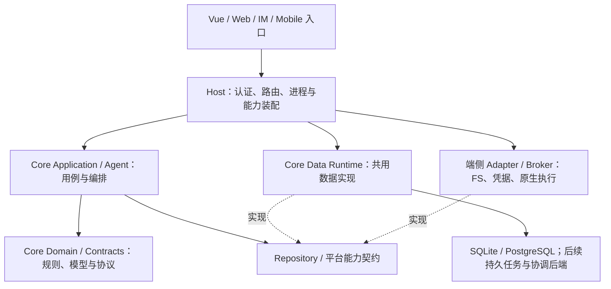
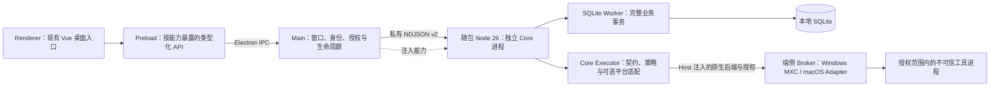

# Gugu 2.0 架构与迁移任务清单

> 更新：2026-11-12。本文是多端职责、Node/TypeScript 迁移顺序及完成状态的统一入口。
> 首批实现历史基线：`ca943c889f7963b1fad10aba0c3d3559f491db49`；[PR #118](https://github.com/Coffeiz/Gugu-web/pull/118) 指向 `v2.0`，核查时尚未合并。
> 本轮实现：**T1 测试分层与同逻辑回归、Electron 桌面验证切片、共用执行边界**。精确提交的最终 CI 与合并状态统一记录在 [PR #118](https://github.com/Coffeiz/Gugu-web/pull/118)，不把接入 CI 等同于通过验收。
> 当前桌面：**Electron + TypeScript Host + 随包 Node 26**。Windows 本机源码与独立目录包已实测；旧 Tauri 源码保留在 `compat/desktop-tauri/`。完整 Agent、其他业务域、同步与正式发行仍按后续阶段推进。

阅读顺序：先看本文；选库和依赖替换查 [依赖迁移矩阵](Gugu-2.0-Python-to-Node-Dependency-Migration.md)；历史方案与实验过程查 [归档索引](_archive/gugu-2.0/README.md)。旧文档中的 Python Core、IPC v1、“Node 尚未实施”等描述均属于历史快照，不再作为当前实施依据。

## 1. 目标架构与产品边界

### 1.1 已确定的方向

- 业务领域、应用用例、统一数据运行时和 Agent 编排逐步集中到顶层 `gugu-core/`，目标语言为 TypeScript，完整桌面/服务端 Runtime 由 Node 承载。
- `gugu-desktop/` 使用 Electron + TypeScript 装配桌面 Host，替换现有 Tauri 窗口与 Rust IPC 层。可复用的执行契约、策略与平台适配收敛到 Core 的 `agent/executor/`；端侧 Host 注入授权与原生后端，必要时使用独立原生 helper。`gugu-saas/` 是未来的服务端 Host 目录，具备独立构建边界后可迁入私有仓库。Core 不反向依赖 SaaS 或 Electron 源码。
- `frontend/` 暂时保留，共享现有 Vue UI，不在本轮重命名或整体搬迁。
- macOS、Windows 桌面采用本地优先、应用内单用户；Linux/NAS 与 SaaS 保留多用户。桌面是默认家节点，SaaS 不是必经中转。
- SaaS 长期以多用户 DB、云同步及相应消息/任务路由为职责，不持有用户 FS，也不装配本机用户目录、watcher 或通用 Shell。首版可保留旧 FS 兼容链路，须完成数据去向和恢复验收后再退出。
- 各 Host 使用同一套 Core 定义，但分别拥有数据实例和运行生命周期。代码共享、数据同步、远程任务转交是三件事，分别验收。

### 1.2 各端职责

| 产品/入口 | 数据与运行职责 | FS / 执行职责 | 当前状态 |
| --- | --- | --- | --- |
| macOS / Windows Desktop | Electron Host 装配本地 Node Core、SQLite、稳定本地所有者；默认家节点 | 本机目录授权、系统凭据、watcher、原生执行 Broker | Electron + Node 数据验证壳已实现；完整 Agent、FS 产品接入和正式发行未完成 |
| Linux / NAS 自托管 | 多用户、服务端 Core Runtime、PostgreSQL；按部署需要使用 Redis | 保留服务端文件、存储和现有执行后端，由 Host 装配 | 当前主要仍为 Python Web/Worker 路径 |
| SaaS | 多用户 PostgreSQL、云同步、连接路由；按启用能力装配常驻 Core Runtime 副本 | 长期无用户 FS；需要端侧资源时走显式授权的任务转交 | 新 Node SaaS Host 与云同步尚未实现；旧 FS 仅为过渡兼容 |
| Mobile | 可作为远端入口，后续也可承载独立本地数据/Runtime | 仅实现移动平台允许的文件和系统能力 | 目标方案；只承诺共享可移植 TS 边界，不假定能运行完整 Node、桌面原生模块或任意 Shell |
| Web 控制台、IM 等入口 | 请求转换、连接、展示；业务事实由选定 Runtime 持久化 | 不因能够连接 Runtime 而获得端侧权限 | 现有入口保留；跨设备绑定/路由待实现 |

入口可保存展示缓存、连接配置和临时输入，但不成为 Canonical 历史或业务数据的独立真源。SaaS 常驻副本实际启用的 Agent/云端计算能力须在后续能力表中明确，不能从“有 Runtime 副本”推导出已有完整云端 Agent 或端侧执行授权。

### 1.3 依赖方向



Domain/Contracts 不导入 Node、SQL 或具体 Host；Application/Agent 面向明确的数据及平台契约。Core 外层的 Data Runtime 可以使用 Kysely、SQLite、PostgreSQL 等库，共用 schema、编码和事务实现。Host 提供配置、私有数据位置及生命周期，不复制领域规则，不把全局运行配置注入内层模块。

### 1.4 Electron 桌面进程与通信方案



- **Renderer / Preload**：复用 `frontend/src/desktop/` 的 Vue 界面，已用逐项声明的 `contextBridge` API 替换 Tauri `invoke`。显式设置 `nodeIntegration: false`、`contextIsolation: true`、`sandbox: true`；不暴露原始 `ipcRenderer`、任意 channel、Shell、SQL 或通用文件路径接口。主进程校验调用窗口、frame/来源、命令和 DTO；身份、数据库路径及执行授权由 Host 建立。使用受限自定义协议加载随包 UI，验证资源根目录，限制导航/新窗口并设置 CSP。依据 [Electron 安全建议](https://www.electronjs.org/docs/latest/tutorial/security) 与 [Context Isolation](https://www.electronjs.org/docs/latest/tutorial/context-isolation)。
- **Main**：管理窗口、单实例、菜单、系统对话框、私有数据位置、授权、子进程及退出回收；将现有 Rust Host 的白名单、完整性校验、有界通信、未知结果恢复等契约迁入 TS。业务事务仍由 Core 执行。主进程与渲染进程职责依据 [Electron 进程模型](https://www.electronjs.org/docs/latest/tutorial/process-model)。
- **Core 进程**：首个 Electron 版本继续随包独立 Node 26，通过固定可执行路径、固定参数和 `shell: false` 启动，清理环境注入；复用现有 NDJSON v2、Worker、schema 3 和操作收据。Core 不导入 Electron，不在 UI/Main 执行同步数据库工作，不启动 localhost HTTP 服务或依赖系统 PATH。
- **运行时版本与 ABI**：Electron 自带 Node 的版本不等于 Core 声明的 Node 26。本阶段保留独立 Node，接受新增包体成本并纳入 N0 预算；`better-sqlite3` 仅在独立 Node 的 Worker 加载，按该 Node ABI 和目标架构装配。未来若改为 Electron `utilityProcess`，须先验证内嵌 Node、Core engines 和原生模块 ABI，再单独决策；启动失败不能自动切换运行时。Electron 原生模块的 ABI 差异见 [官方说明](https://www.electronjs.org/docs/latest/tutorial/using-native-node-modules)。
- **Executor / 原生 Broker**：Core 的 `agent/executor/` 定义执行请求、确认/取消、策略与能力协商，并提供可选的 MXC/平台适配；授权材料、真实目录和可用原生后端由 Host 注入。`mxc.ts` 封装 SDK 或版本化 native bridge 调用，不依赖 Electron/Tauri；`platform.ts` 仅选择已授权且能落实策略的 Adapter。必要的原生 helper 保持有界协议和能力校验。桌面 `sandbox/diagnostics.ts` 只负责探测与脱敏诊断，不再复制执行策略或另建业务执行器。Electron 渲染沙箱不能据此替代 OS 隔离或放宽 MXC 策略。
- **装配与发行**：按 `electron-builder.yml` 使用 **electron-builder**，由 `scripts/package.ts` 装配 Core 制品、目标架构依赖与许可证，并生成安装包；`scripts/smoke.ts` 运行独立制品冒烟。固定 Electron、electron-builder 及后续更新依赖的稳定版本后再改锁文件。UI/Main/Preload 可放 ASAR；独立 Node、Core/Worker、生产依赖及原生 helper 通过真实资源目录分发，独立 Node 不依赖 Electron 的 ASAR 虚拟文件系统。pnpm workspace 依赖收集、资源摘要和安装后路径必须实测。参见 [electron-builder 稳定版配置](https://www.electron.build/v26/docs/configuration/) 与 [ASAR 限制](https://www.electronjs.org/docs/latest/tutorial/asar-archives)。
- **更新**：`main/updater.ts` 管理版本检查、下载/校验及用户确认安装；调用 `lifecycle.ts` 停止接收写入、收敛未完成操作并退出 Core 后再安装。发行签名、更新来源校验、失败后的可启动版本及数据 schema 回滚分别验收；验证版不默认开启生产更新通道。后续可接入 `electron-updater`，具体格式及平台要求按 [官方更新文档](https://www.electron.build/v26/docs/features/auto-update/) 冻结。

当前替换窗口壳未升级数据 schema。Electron 必须复用既有稳定 owner 和数据位置；若两种壳的数据目录规则不同，须显式停写、备份、确认并验证搬迁，不能启动成空库。迁移期两种壳不得同时写同一库；活动构建与桥接已退出 Tauri，旧源码保留归档；CI、正式签名和产品发行分别验收。

<a id="directory-plan"></a>

## 2. 目标目录与职责

核心职责树如下；辅助构建脚本和图标不逐项展开。`〔规划〕` 表示目录/文件尚不存在或尚未迁入对应能力；本轮仅补文档，不创建空壳模块，也不根据目录规划勾选实现完成。

```text
gugu-core/                         # 公开、可独立构建的 TS Core
  src/
    contracts/                     # DTO、版本、错误类别、数据与平台能力契约
    domain/                        # 项目/联系人等纯规则；逐域扩展
    application/                   # 用例、Repository 契约、跨域协调与授权规则调用
    data/
      schema.ts                    # 共享数据模型与支持的 schema 版本
      codec.ts                     # UUID、UTC 微秒、布尔/整数及行转换
      repositories.ts              # 共用 SQL 仓储；所有查询/修改限定 owner
      runtime.ts                   # UoW、事务、取消、持久操作收据
      sqlite.ts                    # 本地连接、初始化、显式升级及备份
      postgres.ts                  # 连接池、会话配置与 PG Adapter
      migrations/                  # 〔规划〕完整业务迁移历史与升级路径
    runtime/
      local.ts                     # Node Host 的 Worker 客户端与有界请求生命周期
      worker.ts                    # 完整用例排队执行；不按每条 SQL 做 RPC
      commands.ts                  # 命令分派与共用参数边界
      transport/                   # 独立传输适配，不放业务分派
        stdio.ts                   # 迁入现有 NDJSON v2；保留限额和错误契约
        ipc.ts                     # 可注入消息端口的进程 IPC；不导入 Electron
      jobs/                        # 〔规划〕持久 Job、租约、恢复及调度
    agent/                         # Executor 已实现；其他 Agent 能力逐域迁移
      harness/                     # 〔规划〕Run 状态机、Canonical 历史、上下文与流式编排
      providers/                   # 〔规划〕模型协议、事件映射、用量和错误契约
      tools/                       # 〔规划〕工具定义、参数校验、确认与执行协调
      executor/                    # 执行边界；可移植契约与可选 Node/原生适配分离
        contracts.ts               # 请求、结果、能力、取消与 native bridge 契约
        policy.ts                  # 由可信授权计算执行限制，缺能力即拒绝
        mxc.ts                     # Windows MXC 适配；由 Host 注入后端与授权
        platform.ts                # 按能力选择适配器，不隐式提升权限或回退宿主
  tests/                           # 独立 Core 的回归；T1 再按类型整理
gugu-desktop/
  src/                             # Electron Host，不放领域/数据库实现
    main/
      index.ts                     # 组合各模块、注册应用入口与桥接
      windows.ts                   # 窗口、安全配置、导航与窗口来源管理
      core-host.ts                 # 可信 IPC 边界、随包 Core 通信与完整性/恢复
      lifecycle.ts                 # 单实例、Core 启停、休眠/退出和资源回收
      updater.ts                   # 更新检查、制品校验、确认安装与恢复
    preload/
      index.ts                     # 最小 contextBridge API；无通用 IPC 透传
    sandbox/
      diagnostics.ts               # 平台能力/版本探测与脱敏诊断，无执行策略副本
  scripts/
    package.ts                     # 装配 Core/原生资源、依赖与许可证，调用打包
    smoke.ts                       # 干净临时环境中的安装资源与重启/故障冒烟
  electron-builder.yml             # 资源布局、平台安装包、签名与更新配置
gugu-saas/                         # 〔规划〕API/Gateway、多用户身份、同步与部署装配
gugu-mobile/                       # 〔规划〕移动 Host 与系统能力 Adapter
frontend/                          # 保留 Vue/Web 与 src/desktop；桌面 bridge 待接 preload
backend/                           # 迁移期 Python Web/Agent/Worker 与现有业务
compat/                            # Python 兼容包及 desktop-tauri 源码归档，不复制新能力
docs/                              # refactor 主清单/矩阵/归档，testing 分层规范与映射
```

正式 stdio 已移入 `runtime/transport/stdio.ts`；原 `.mjs` 制品/主动验证脚本作为 package/smoke 的共用辅助保留。旧 Tauri 源码在 `compat/desktop-tauri/`，不再装配。生成的 Node/Core/原生资源放打包暂存及应用资源目录，不作为新的源代码职责层，也不提交 Git。

### 2.1 关键职责不能混淆

| 模块 | 负责 | 由其他模块负责 |
| --- | --- | --- |
| Core Domain / Application | 领域不变量、业务用例、所有权规则、确认与副作用语义 | Host 建立可信身份、展示确认并验证调用来源 |
| Core Data Runtime | 仓储、schema、事务、精度、CAS、操作收据及迁移实现 | Host 停写、备份编排、独占升级、启动和运维配置 |
| Core Agent | Canonical 历史、Provider 适配、上下文、工具及 Run 编排 | Host 注入凭据、网络/进程能力与入口交付 |
| Core Runtime / Transport | `commands.ts` 统一命令边界；stdio/进程 IPC 只处理编码、消息、背压、超时与错误终态 | Electron IPC 的窗口/frame 来源校验和 Preload 暴露由 Desktop 负责 |
| Core Executor | 共用执行契约、策略计算、能力协商、MXC/平台适配及执行终态 | Host 注入真实授权、原生后端、私有资源与生命周期；OS 后端强制隔离 |
| Host Broker | 数据及平台 Adapter 装配、能力协商、进程和资源生命周期 | 业务数据规则继续由 Core 统一维护 |
| FS Adapter | 真实目录、句柄/bookmark、读写、监听与路径强制边界 | Core 保存逻辑引用和业务用途；机器授权材料不跨设备复制 |
| Execution Adapter | Shell/PTY/MCP stdio 隔离、网络/资源限制、取消与进程树回收 | Core 决定调用意图和授权要求；模型字段不能成为权限凭据 |

SQLite 内部数据文件、初始化与备份属于 Data Adapter，不等于提供用户工作目录 FS。数据库查询不经过命令执行沙箱；可信 Core 的数据库和密钥也不能随工作区授权暴露给待执行进程。

### 2.2 Transport、Executor 与桌面装配边界

`runtime/transport/ipc.ts` 是 Core 进程消息传输适配，与 Renderer → Preload → Main 的 Electron IPC 属于两个边界。它通过注入端口连接，不 import Electron，不把原始 IPC 对象交给工具/界面。stdio 与 IPC 复用同一命令、收据、限额和错误契约；每个 Host 在装配时显式选择一种传输，不在异常时自动切换或重放修改。Electron 继续使用 NDJSON v2；通用 IPC 适配已独立回归，其他 Host 接入时仍须显式选择。

`agent/executor/` 位于 Core 的可选外层：`contracts.ts` / `policy.ts` 不依赖 Electron 或平台 SDK；`mxc.ts` 及平台后端仅由获准的 Node Host 显式装配。可移植 Core 入口不主动导入 MXC、Node 进程或原生模块；Linux/NAS、无 FS 的 SaaS、Mobile 按各自能力集选择实现，不能因为共享包中有 `mxc.ts` 就获得桌面权限。`policy.ts` 只能收紧可信 Host 授权并检查可落实能力，最终文件/网络/进程限制仍须由 OS 后端强制执行。

`agent/harness/` 管理 Agent Run 与事件顺序，`providers/` 适配模型协议，`tools/` 描述工具意图并通过确认门调用 Executor；三者不自行绕过执行边界。桌面 `diagnostics.ts` 只显示脱敏后的能力/版本与拒绝原因，不运行任意命令、不改 ACL，也不通过诊断结果自动放宽策略。真实目录授权、watcher、系统凭据仍是端侧能力，由 Host 注入，具体平台文件待功能切片时补充，不在主进程入口堆叠实现。

`main/index.ts` 只组合模块；窗口创建与来源管理归 `windows.ts`，Core 通信与可信请求边界归 `core-host.ts`，单实例/启停/退出回收归 `lifecycle.ts`，更新流程归 `updater.ts`。这些模块共享同一个 Core 生命周期，更新器不另起数据写入进程。`electron-builder.yml` 只声明打包/签名/更新规则，证书和密钥从安全存储或临时环境变量注入，不写入配置或生成资源。

## 3. 数据统一与 Node 迁移规则

1. 一个完整业务命令由同一个 UoW/连接拥有事务。仓储不自行 commit；项目、撤销记录、关联元数据、需要可靠投递的 outbox 必须一起设计。
2. 同一部署的同一写域只有一个权威写入口。未具备完整 Node 命令时，整条 Web 命令继续走原 Python 路径，不拆成 Python/Node 两次提交，也不双写。
3. SQLite 与 PG 通过同一业务契约验收，差异集中在 Adapter：用户隔离、UUID、UTC 微秒、缺字段/null、布尔/整数、JSON、排序、CAS、回滚与持久化均需验证。
4. 当前本地 schema 为 **3**、正式桌面 NDJSON 为 **v2**。业务写入与操作收据同事务提交；相同操作 ID/内容重读原结果，内容不一致冲突。未知提交状态不自动重放修改。
5. 旧本地 v1/v2 库须停应用后显式备份升级；不自动覆盖或修复用户库。旧 Python 不直接写 v3，回滚需恢复升级前备份并配套旧代码。
6. SQLite 由专属 Worker 调度完整用例，Host 单实例；队列、帧、超时和取消有明确边界。线程异步不等于数据库可随意并发写入。
7. 文件字节与 SQL 不能天然共享事务。先确定暂存、引用提交、幂等任务、补偿/对账和用户可见终态，再迁移文件联动命令。
8. 凭据只由 Host 安全配置/系统凭据来源注入；测试不读取或覆盖用户 `.env`、`config.override.json`、真实数据目录或部署数据库。

**当前结论：项目/联系人这一批 DB 底座已经实现，不代表全部业务数据、Web 写路径或云同步已统一。**

## 4. 多端 FS、沙箱、同步与任务转交

桌面优先原生执行。Windows 的 MXC 1.0.1 是已做有限验证的 Adapter 候选；macOS 原生 Adapter 尚待验证与选择。Electron Renderer 沙箱和 Node Worker 都不能替代不可信执行的 OS 隔离。请求的文件/网络/进程约束无法落实时必须拒绝，不自动回退宿主执行或放宽策略。

| 平台能力 | 已有事实 | 仍需完成 |
| --- | --- | --- |
| Windows MXC | 已验证授权目录、只读/越界拒绝、受控网络拒绝、超时和终止；实验 Host 有固定验证入口 | 严格 UI 策略下 Node 初始化仍有兼容缺口；Node/MCP/PTY、链接/重解析点、继承句柄、完整进程树和真实发行环境验收 |
| macOS 执行 | Electron 数据制品与实际应用验证已接入三平台矩阵 | 可发布的原生隔离 Adapter、目录授权、网络、进程回收、签名后边界；不能将数据制品通过算作沙箱通过 |
| FS / watcher / Secrets | 现有 Web/NAS 能力保留；平台职责已划分 | 桌面目录选择与绑定、系统凭据、watcher 及丢事件对账的完整接入 |
| 云同步 | 方向和本地稳定身份/版本底座已有定义 | 实体全局 ID、同步游标、墓碑、冲突/重放/离线恢复、设备绑定与隔离协议 |
| 任务转交 | 与数据同步分开设计 | 任务/父 Run ID、目标、授权引用、幂等/租约、接受/结果/取消回执及离线状态 |

同步不复制本机绝对路径、bookmark、OS 授权、凭据或活跃进程。附件/记忆的逻辑记录、元数据与原始字节分别规划；云端附件对象存储是否提供仍需单独冻结，不能把“记录已同步”显示成“文件已备份”。SaaS 退出旧 FS 前，须明确附件和长期记忆正文的去向及恢复路径。

## 5. 迁移 checklist

`[x]` 表示该项已有代码或明确交付证据；`[ ]` 表示未完成，部分已有基础也不勾选。实现完成、PR 合并、正式发行分别记录。不得用 CI 总数或目录存在推断业务等价。

### N0——边界与基线

- [x] 确定顶层 Core、端侧 FS/沙箱、桌面单用户和服务端多用户边界。
- [x] 确定 TS/Node 方向；当前使用 Node 26 LTS、pnpm 10.15、Kysely、Zod、better-sqlite3 与 pg，版本由 lockfile 固定。
- [x] 桌面切换到 Electron + TS Host 验证实现；复用 Vue 入口、独立 Node Core 和原生 Broker 边界，完整产品与发行另行验收。
- [x] 建立可移植 Domain/Contracts、独立 Core 包和依赖边界检查。
- [x] 保留 Python 参考实现及首批共享合成语料。
- [x] 建立现有 Node Core 对应 Python 行为映射与有意差异登记，见测试专题。
- [ ] 冻结冷启动、内存、包体、IPC 等待、读写 P50/P95、取消/恢复的同口径性能预算。

### N1——数据统一底座，先覆盖项目/联系人

- [x] 项目/联系人领域校验、应用服务与共用 SQL 仓储。
- [x] SQLite/PG Adapter、UoW、跨域提交/回滚、owner 隔离和项目 CAS。
- [x] UUID、UTC 微秒、列别名、归档/墓碑过滤与旧库互读的首批契约。
- [x] SQLite 显式初始化、备份升级、坏库/部分唯一约束拒绝及失败恢复。
- [x] 原子操作收据、冲突检查、重启后查询及未知结果恢复提示。
- [x] 修复满队列/并发关闭、非法收据参数、时间/编号边界；仓储与事务职责拆分，启用未使用代码检查。
- [x] 补充现有项目/联系人同逻辑回归、共用双库契约、Python 序列对照及 pytest 语义分层；最终门禁结果以 PR 为准。
- [ ] 完整业务 schema/Alembic 历史、升级与跨版本回滚策略交接。

### N2——桌面数据 Host 与平台能力

**已有验证基础（Tauri 实现；不是 Electron 完成状态）：**

- [x] Tauri/Rust Host 启动随包 Node，使用私有 NDJSON v2；SQLite 在 Worker 执行用例。
- [x] 单实例、能力白名单、帧/队列/超时限制、制品版本/架构/摘要校验。
- [x] Windows x64、macOS arm64/x64 的独立制品冒烟、Rust IPC/故障回归、平台构建；macOS app 内资源再次校验。
- [x] 制品装配包含 Node、生产依赖和许可证，不要求终端用户现场安装 Python。
- [x] Windows MXC 固定任务及有限隔离验证，失败不回退宿主执行。

**Electron 验证切片（实现与最终 CI/发行分别验收）：**

- [x] 固定 Electron 45.3.1、electron-builder 26.18.0、electron-updater 6.8.11；区分内嵌 Node 与独立 Core Node 26 的 ABI。
- [x] 实现拆分的 TS Main/Preload、可信来源/能力白名单、受限 UI 协议，并替换 Vue 桌面 bridge。
- [x] stdio 移入 `runtime/transport/`；通用 IPC 与命令/收据契约共用，不依赖 Electron、不自动切换。
- [x] 迁入有界 Core Host、完整性/版本/ABI 校验、参数快照、未知结果与操作 ID 恢复、单实例及退出/暂停回收。
- [x] 保留数据位置/稳定 owner，以 SQLite 独占连接阻止其他连接并行使用；不自动升级或创建空库掩盖兼容错误。
- [x] 实现 Executor 契约/策略/平台适配和 Host 注入边界，Windows 合成资料完成六项原生验证；诊断不修改 ACL。
- [x] 实现更新状态机及确认、停写、取消和失败路径回归；生产签名/更新通道另行验收。
- [x] 实现 package/smoke，Windows 独立目录包已验证创建/重启/收据/Renderer 隔离；三平台检查已接入 Runtime integration。
- [x] 活动依赖、壳层和桥接退出 Tauri；旧源码保留在 `compat/desktop-tauri/`，不删除历史实现。

**共同产品与发行门槛：**

- [ ] 正式签名/公证、最低 OS 实机、干净离线安装、升级回滚、休眠/退出/多窗口验收。
- [ ] macOS 原生执行 Adapter 与 Windows 完整不可信负载矩阵。
- [ ] 端侧 FS、watcher、Secrets、PTY 和完整 Agent 的产品接入。

### N3——Web/NAS 接入统一 Node 写路径

- [ ] 盘点 API、Agent 工具、Worker/调度、撤销和迁移的所有写入口。
- [ ] 可信身份到 DataContext、HTTP/SSE/错误与字段映射保持兼容。
- [ ] 完整命令中的幂等、撤销、版本、关联记录、文件联动与提交后事件一起迁移。
- [ ] 真实 PG 外键/锁/连接恢复、跨用户、并发和故障注入验收。
- [ ] 每个写域全部调用方切换后，再移除其旧 Python 写实现。

### N4——扩展数据域、Agent 与多端协作

- [ ] 会话/消息/附件引用、Canonical 历史与顺序规则。
- [ ] Run/Job、确认授权、租约、持久调度、outbox 和重启恢复。
- [ ] 按 `agent/harness/`、`providers/`、`tools/` 拆分 Agent 实现，调用共用 Executor；保证测试和可移植入口不隐式装载平台后端。
- [ ] Provider/流式事件、工具、取消与背压；代码权限、confirm、URL 安全和脱敏边界。
- [ ] 原生 wire/thinking/signature、上下文压缩、反思及缓存/用量契约。
- [ ] 便签/画布/日历、长期记忆/RAG、媒体/Office 按依赖矩阵逐域迁移和验收。
- [ ] SaaS 数据同步、设备绑定/路由及受限任务转交。
- [ ] SaaS 旧 FS 的内容迁移、完整性与恢复验收，通过后退出兼容 FS。
- [ ] Mobile 可移植 Core 与独立 Host 的平台可行性验证。

### N5——收敛与发行

- [ ] `backend/` 的现有业务与 Host 按稳定边界交接到目标布局，前端搬迁另行决策。
- [ ] 无生产调用方后移除对应 `compat/` 包、安装路径和重复依赖；保留仍需独立运行的计算服务。
- [ ] `gugu-saas` 独立构建、协议稳定，再评估闭源拆仓；Core 构建不依赖私有源码。
- [ ] 平台安全、可恢复升级和完整产品验收通过后发布 2.0。

<a id="core-test-parity"></a>

## 6. T1：Node Core 回归等价与测试分层

### 6.1 任务边界与交付

**目标**：为已经存在的 Node Core 行为补齐与当前 Python 后端同逻辑的回归，建立可独立运行的快速、集成和跨语言对照测试。先让这批 Core 的语义可验证，再扩展 N3/N4。

**已落地**：显式分类清单、快速/集成/IPC/PG/parity/all 命令、共用 SQLite/PG 数据契约、42 组语料与 16 步维护序列、测试源码类型检查、根 fast/affected/分层和 CI 接入。覆盖仅针对已有 Node 切片，不代表全部 Python 领域已迁移。

- [x] T1.1 生成行为对照清单，记录 Python 用例/生产入口、Node 对应入口、契约断言、差异、标记、CI 及验收状态。
- [x] T1.2 补齐当前 Domain/Application 的合法、非法和组合状态分支。
- [x] T1.3 在临时文件 SQLite 和隔离 PG 上运行相同数据契约；补联系人更新/删除、所有者隔离及错误终态等缺口。
- [x] T1.4 扩充同输入对照、旧库互读、升级备份与恢复；保留独立期望结果，不仅把 Python 输出当真源。
- [x] T1.5 按下表标注测试类型，整理发现范围，落地分层及定向运行命令。
- [x] T1.6 接入根调度、affected/fast 选择、元数据/清单和现有 CI；证明每层实际收集了预期测试。
- [x] T1.7 接入差异/故障回归及完整 CI 矩阵；精确提交、两项必需 CI 和合并门禁结果统一记录在 PR。

本任务不以复制整个 pytest 数量或重写所有后端领域为目标。Python 独有的 Web 事务、文件联动和 Agent 工具能力若尚未迁到 Node，必须标为“待功能迁移”，不得写成已有 Node 等价覆盖，也不为凑测试偷偷增加一套不完整实现。

### 6.2 Python 与 Node 对照来源

详细对应关系、入口、运行类型及有意差异集中维护在 [Node Core 回归对照清单](../testing/node-core-parity.md)，不再在主文档重复维护测试文件表。

差异分为“已等价”“待补覆盖”“待功能迁移”“有记录的有意差异”。名称长度、数字归档等既有差异分别断言两端结果；不通过抹去 owner、排序、微秒、版本或副作用来制造等价。

### 6.3 与 pytest 相同的类型和分层选择

当前事实源为 [pytest.ini](../../backend/pytest.ini)、[pytest 收集规则](../../backend/tests/conftest.py) 和 [根分层调度](../../scripts/tests/run-test-tier.mjs)。pytest 目前通过下列标记组合分层，并没有一个必须叫 `unit` 的 marker；Node 应对齐其含义。

| 标记/维度 | 现有 pytest 语义 | Node Core 对应规则（已接入显式清单） |
| --- | --- | --- |
| 无慢速/边界标记 | 默认快速、隔离测试 | 纯领域、应用用例、隔离临时 SQLite/编码/迁移测试；不因文件名含 DB 就自动归外部服务 |
| `slow` | 执行较慢 | 显式成本标记；不是业务正确性等级 |
| `external_service` | 真实外部服务或真实系统 I/O 边界 | 真实 PG/后续 Redis 等，必须提供显式隔离连接 |
| `process` | 子进程、PTY/终端等运行边界 | Node Worker 生命周期、子进程、stdio、CLI；Python Golden 因实际启动参考进程也带此标记 |
| `e2e_support` | 为浏览器 E2E 提供环境/支撑 | 只有确实支撑 E2E 的 fixture/桥接测试才标注；普通 IPC 测试不冒充浏览器 E2E |
| `layer` | 元数据中的 L0/L1/L2 等层级 | 沿用现有 `test-metadata.json`；与运行依赖标记分开，不用 L1/L2 代替 marker 选择 |
| 对照/契约用途 | 可另记录行为来源 | Golden/parity、双库 contract 属于用途，可与 `process`/`external_service` 同时存在 |

与 pytest 一致：`process` 或 `external_service` 自动归入 `slow`。默认快速层选取 `not slow and not external_service and not process and not e2e_support`；集成层选取四项的并集。分类以依赖与隔离方式为准，清单/显式标记驱动执行，不依靠测试标题或模糊文件名猜测。

**当前测试目录：**

```text
gugu-core/tests/
  unit/domain/                     # 规则、字段与阶段/待办
  fixtures/                        # 共享双库数据契约与独立合成维护序列
  unit/data/                       # 隔离 SQLite、编码、事务与显式迁移
  integration/postgres/            # external_service + slow
  integration/runtime/             # Worker/Node 进程/stdio，process + slow
  golden/                          # 现有 Python/TS 对照保留此目录，process + slow
```

原有断言随文件迁移保留；`tests/suites.json` 驱动发现和分类，元数据/清单与 CI 已更新。新增混合边界用例仍须拆分或显式分类，不能因标题或文件名误入快速层。

### 6.4 可执行命令

`test` 默认执行 unit 与 Node IPC；以下专用入口均已实现。`test:list` 输出去重后的文件/marker/layer 清单；`typecheck:tests` 检查测试源码。PG/Python 必须显式配置隔离连接/参考解释器，缺失即失败。

| 入口（`pnpm --filter @gugu/core`） | 选择集合 |
| --- | --- |
| `test:unit` | 与 pytest 快速表达式相同，不启动服务、Worker 或子进程 |
| `test:integration` | 四个边界 marker 并集，包含真实进程、PG 与 Python 对照 |
| `test:ipc` | Node Worker/进程/传输，不包含 Python/PG |
| `test:postgres` | 真实隔离 PG，共用数据契约；不以 skip 代替通过 |
| `test:parity` / `test:golden` | Python 对照、旧库互读与恢复 |
| `test:all` | 全部分类的去重并集，缺服务/空选择/未登记文件明确失败 |

根分层调度、`test:fast`、affected 和 CI 已同步接入。Linux 专用 Core job 承担完整双库/对照；桌面矩阵选择快速层及 Node IPC，并验证实际使用的 Host/制品。Electron Host/Preload/窗口/更新/故障回归和真实应用冒烟承担新壳验收；旧 Rust 源码保留归档。各 shard 的并集覆盖完整门禁，分类不替代权限、持久化和故障回归。

CI 若按 `unit`、`ipc`、`postgres`、`parity` 分片，不能再额外执行包含相同用例的 `integration`/`all` 后重复累加数量；按显式收集清单验证并集和交集。

### 6.5 T1 完成条件

- [x] 每个现有 Node Core 业务入口都有 Python 参考或独立契约；差异与未迁移项明确登记。
- [x] 同逻辑用例保护输入、结果及持久化副作用；正常、非法、权限、并发和恢复分支均有对应断言。
- [x] 类型分类、发现清单与元数据一致；每个分层命令报告收集结果并证明没有漏测/重复计数，空选择不能假绿。
- [x] 快速层不启动外部服务或子进程；显式 PG/对照命令不能因缺依赖而全部跳过后显示成功。
- [x] 同一契约已配置到临时 SQLite/真实隔离 PG 与必要 Python 对照；旧回归和安全断言保留，最终执行结果在 PR 按精确提交核验。
- [x] 根调度、CI、包 README、测试规范与实现状态同步；最终两 workflow 全绿是独立的 PR 合并门禁，不能用本清单代替。

## 7. 完成证据与维护规则

已完成项依据 [实现/复查 PR #118](https://github.com/Coffeiz/Gugu-web/pull/118) 及 `ca943c88` 的 [Runtime integration](https://github.com/Coffeiz/Gugu-web/actions/runs/42954592909)、[Docker release](https://github.com/Coffeiz/Gugu-web/actions/runs/42954595536)。该基线已通过 Core 22 条、对照 2 条、前端 982 条、后端 5526 条，以及 Tauri + Node 的三平台数据制品验证；这是首批实现的证据，不是 Electron 已实现、全量迁移等价或正式发行的证明。

每次迁移只更新本文对应条目、测试映射与证据；新的详细排查过程写入 `docs/devlog/`。依赖矩阵只维护候选/采用与兼容门槛，历史归档不再维护实时状态。分支/PR 继续按 `v2.0` 路线推进；提交、推送、CI 触发和合并分别遵守仓库授权与发布规范。
