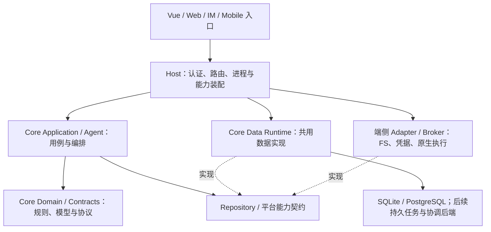
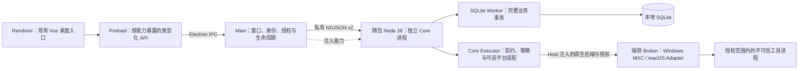

# Gugu 2.0 架构说明

> 更新：2026-11-12。本文只维护目标架构、多端职责和跨端约束；实施顺序、当前完成状态与待办见[迁移任务清单](Gugu-2.0-迁移任务清单.md)。
> 当前桌面路线为 Electron + TypeScript Host + 随包 Node 26。完整 Agent、其他业务域、同步与正式发行仍需按迁移任务清单验收。

## 1. 目标架构与产品边界

### 1.1 已确定的方向

- 业务领域、应用用例、统一数据运行时和 Agent 编排逐步集中到顶层 `gugu-core/`，目标语言为 TypeScript，完整桌面/服务端 Runtime 由 Node 承载。
- `gugu-desktop/` 使用 Electron + TypeScript 装配桌面 Host，负责窗口、生命周期和受限 IPC。可复用的执行契约、策略与平台适配收敛到 Core 的 `agent/executor/`；端侧 Host 注入授权与原生后端，必要时使用独立原生 helper。`gugu-webui/` 是 Linux/NAS 自托管版的 Node HTTP Host，负责 Web API/SSE、可信身份上下文、服务生命周期和 Core 装配，并提供现有 Vue 前端的静态构建产物。`gugu-saas/` 保留为 SaaS 专属的 Gateway、身份、同步和部署装配边界；具备独立构建边界后可迁入私有仓库。Core 不反向依赖 Web Host、SaaS 或 Electron 源码。
- `frontend/` 暂时保留，共享现有 Vue UI，不在本轮重命名或整体搬迁。
- macOS、Windows 桌面采用本地优先、应用内单用户；Linux/NAS 与 SaaS 保留多用户。桌面是默认家节点，SaaS 不是必经中转。
- SaaS 长期以多用户 DB、云同步及相应消息/任务路由为职责，不持有用户 FS，也不装配本机用户目录、watcher 或通用 Shell。首版可保留旧 FS 兼容链路，须完成数据去向和恢复验收后再退出。
- 文件正文以授权范围内的本地 FS 为唯一真源，业务读写直接通过 FS Adapter 完成；不再采用“本地文件与 DB 正文副本靠 watcher 同步”的方案。DB 不为本地文件单独生成持久对象 ID；需要索引、搜索或预览时，可保存可丢弃、可从文件重建的派生数据。文件以授权根目录下的相对路径定位，改名或移动后旧路径引用允许失效；watcher 仅可作为派生数据刷新的优化，不得作为一致性或数据恢复的前提。
- Linux/NAS 自部署保留多用户，执行后端目标改为 MXC 调用受授权的系统环境；2.0 不再维护 Linux Docker 执行沙箱。SaaS 不使用该 Linux 自部署执行方案，也不提供因此隐含的宿主机命令能力。MXC 必须在 Linux 上落实账号间的工作区、进程、资源和网络边界后，才可作为多用户通用执行后端启用；系统环境调用不等于无边界的宿主机 Shell。
- 各 Host 使用同一套 Core 定义，但分别拥有数据实例和运行生命周期。代码共享、数据同步、远程任务转交是三件事，分别验收。

### 1.2 各端职责

| 产品/入口 | 数据与运行职责 | FS / 执行职责 | 当前状态 |
| --- | --- | --- | --- |
| macOS / Windows Desktop | Electron Host 装配本地 Node Core、SQLite、稳定本地所有者；默认家节点 | 授权目录内直接读写文件；系统凭据和原生执行 Broker | Electron + Node 数据验证壳已实现；完整 Agent、FS 产品接入和正式发行未完成 |
| Linux / NAS 自托管 | `gugu-webui` Node HTTP Host、多用户 Core Runtime、PostgreSQL；按部署需要使用 Redis | MXC 调用受授权的系统环境；保留多用户执行隔离，Linux Docker 执行沙箱不再作为 2.0 维护目标 | Node Host 首个可启动切片已在 devserver 和 Docker 容器验证；目前有 health、认证用户读取、项目活动/回收站列表、详情/文件计数读取及客户列表/创建/删除，主要业务仍运行在 Python Web/Worker |
| SaaS | 多用户 PostgreSQL、云同步、连接路由；按启用能力装配常驻 Core Runtime 副本 | 不装配 Linux 自部署的 MXC 执行后端；长期无用户 FS，需要端侧资源时走显式授权的任务转交 | 新 Node SaaS Host 与云同步尚未实现；旧 FS 仅为过渡兼容 |
| Mobile | 可作为远端入口，后续也可承载独立本地数据/Runtime | 仅实现移动平台允许的文件和系统能力 | 目标方案；只承诺共享可移植 TS 边界，不假定能运行完整 Node、桌面原生模块或任意 Shell |
| Web 控制台、IM 等入口 | 请求转换、连接、展示；业务事实由选定 Runtime 持久化 | 不因能够连接 Runtime 而获得端侧权限 | 现有入口保留；跨设备绑定/路由待实现 |

入口可保存展示缓存、连接配置和临时输入，但不成为 Canonical 历史或业务数据的独立真源。SaaS 常驻副本实际启用的 Agent/云端计算能力须在后续能力表中明确，不能从“有 Runtime 副本”推导出已有完整云端 Agent 或端侧执行授权。

### 1.3 依赖方向



Domain/Contracts 不导入 Node、SQL 或具体 Host；Application/Agent 面向明确的数据及平台契约。Core 外层的 Data Runtime 可以使用 Kysely、SQLite、PostgreSQL 等库，共用 schema、编码和事务实现。Host 提供配置、私有数据位置及生命周期，不复制领域规则，不把全局运行配置注入内层模块。

### 1.4 Electron 桌面进程与通信方案



- **Renderer / Preload**：复用 `frontend/src/desktop/` 的 Vue 界面，通过逐项声明的 `contextBridge` API 暴露受限业务调用。显式设置 `nodeIntegration: false`、`contextIsolation: true`、`sandbox: true`；不暴露原始 `ipcRenderer`、任意 channel、Shell、SQL 或通用文件路径接口。主进程校验调用窗口、frame/来源、命令和 DTO；身份、数据库路径及执行授权由 Host 建立。使用受限自定义协议加载随包 UI，验证资源根目录，限制导航/新窗口并设置 CSP。依据 [Electron 安全建议](https://www.electronjs.org/docs/latest/tutorial/security) 与 [Context Isolation](https://www.electronjs.org/docs/latest/tutorial/context-isolation)。
- **Main**：管理窗口、单实例、菜单、系统对话框、私有数据位置、授权、子进程及退出回收；将现有 Rust Host 的白名单、完整性校验、有界通信、未知结果恢复等契约迁入 TS。业务事务仍由 Core 执行。主进程与渲染进程职责依据 [Electron 进程模型](https://www.electronjs.org/docs/latest/tutorial/process-model)。
- **Core 进程**：首个 Electron 版本继续随包独立 Node 26，通过固定可执行路径、固定参数和 `shell: false` 启动，清理环境注入；复用现有 NDJSON v2、Worker、schema 3 和操作收据。Core 不导入 Electron，不在 UI/Main 执行同步数据库工作，不启动 localhost HTTP 服务或依赖系统 PATH。
- **运行时版本与 ABI**：Electron 自带 Node 的版本不等于 Core 声明的 Node 26。本阶段保留独立 Node，接受新增包体成本并纳入 N0 预算；`better-sqlite3` 仅在独立 Node 的 Worker 加载，按该 Node ABI 和目标架构装配。未来若改为 Electron `utilityProcess`，须先验证内嵌 Node、Core engines 和原生模块 ABI，再单独决策；启动失败不能自动切换运行时。Electron 原生模块的 ABI 差异见 [官方说明](https://www.electronjs.org/docs/latest/tutorial/using-native-node-modules)。
- **Executor / 原生 Broker**：Core 的 `agent/executor/` 定义执行请求、确认/取消、策略与能力协商，并提供可选的 MXC/平台适配；授权材料、真实目录和可用原生后端由 Host 注入。`mxc.ts` 封装 SDK 或版本化 native bridge 调用，不依赖 Electron；`platform.ts` 仅选择已授权且能落实策略的 Adapter。必要的原生 helper 保持有界协议和能力校验。桌面 `sandbox/diagnostics.ts` 只负责探测与脱敏诊断，不再复制执行策略或另建业务执行器。Electron 渲染沙箱不能据此替代 OS 隔离或放宽 MXC 策略。
- **装配与发行**：按 `electron-builder.yml` 使用 **electron-builder**，由 `scripts/package.ts` 装配 Core 制品、目标架构依赖与许可证，并生成安装包；`scripts/smoke.ts` 运行独立制品冒烟。固定 Electron、electron-builder 及后续更新依赖的稳定版本后再改锁文件。UI/Main/Preload 可放 ASAR；独立 Node、Core/Worker、生产依赖及原生 helper 通过真实资源目录分发，独立 Node 不依赖 Electron 的 ASAR 虚拟文件系统。pnpm workspace 依赖收集、资源摘要和安装后路径必须实测。参见 [electron-builder 稳定版配置](https://www.electron.build/v26/docs/configuration/) 与 [ASAR 限制](https://www.electronjs.org/docs/latest/tutorial/asar-archives)。
- **更新**：`main/updater.ts` 管理版本检查、下载/校验及用户确认安装；调用 `lifecycle.ts` 停止接收写入、收敛未完成操作并退出 Core 后再安装。发行签名、更新来源校验、失败后的可启动版本及数据 schema 回滚分别验收；验证版不默认开启生产更新通道。后续可接入 `electron-updater`，具体格式及平台要求按 [官方更新文档](https://www.electron.build/v26/docs/features/auto-update/) 冻结。

当前替换窗口壳未升级数据 schema。Electron 必须复用既有稳定 owner 和数据位置；数据目录规则变化时须显式停写、备份并验证搬迁，不能启动成空库。不得让多个 Host 同时写同一库；CI、正式签名和产品发行分别验收。

<a id="directory-plan"></a>

## 2. 目标目录与职责

核心职责树如下；辅助构建脚本和图标不逐项展开。`〔规划〕` 表示目录/文件尚不存在或尚未迁入对应能力；本轮仅补文档，不创建空壳模块，也不根据目录规划勾选实现完成。

```text
gugu-core/                         # 公开、可独立构建的 TS Core
  src/
    contracts/                     # DTO、版本、错误类别、数据与平台能力契约
    domain/                        # 项目/联系人等纯规则；逐域扩展
    application/                   # 用例、Repository 契约、跨域协调与授权规则调用
    data/
      schema.ts                    # 共享数据模型与支持的 schema 版本
      codec.ts                     # UUID、UTC 微秒、布尔/整数及行转换
      repositories.ts              # 共用 SQL 仓储；所有查询/修改限定 owner
      runtime.ts                   # UoW、事务、取消、持久操作收据
      sqlite.ts                    # 本地连接、初始化、显式升级及备份
      postgres.ts                  # 连接池、会话配置与 PG Adapter
      migrations/                  # 〔规划〕完整业务迁移历史与升级路径
    runtime/
      local.ts                     # Node Host 的 Worker 客户端与有界请求生命周期
      worker.ts                    # 完整用例排队执行；不按每条 SQL 做 RPC
      commands.ts                  # 命令分派与共用参数边界
      transport/                   # 独立传输适配，不放业务分派
        stdio.ts                   # 迁入现有 NDJSON v2；保留限额和错误契约
        ipc.ts                     # 可注入消息端口的进程 IPC；不导入 Electron
      jobs/                        # 〔规划〕持久 Job、租约、恢复及调度
    agent/                         # Executor 已实现；其他 Agent 能力逐域迁移
      harness/                     # 〔规划〕Run 状态机、Canonical 历史、上下文与流式编排
      providers/                   # 〔规划〕模型协议、事件映射、用量和错误契约
      tools/                       # 〔规划〕工具定义、参数校验、确认与执行协调
      executor/                    # 执行边界；可移植契约与可选 Node/原生适配分离
        contracts.ts               # 请求、结果、能力、取消与 native bridge 契约
        policy.ts                  # 由可信授权计算执行限制，缺能力即拒绝
        mxc.ts                     # Windows MXC 适配；由 Host 注入后端与授权
        platform.ts                # 按能力选择适配器，不隐式提升权限或回退宿主
  tests/                           # 独立 Core 的回归；T1 再按类型整理
gugu-desktop/
  src/                             # Electron Host，不放领域/数据库实现
    main/
      index.ts                     # 组合各模块、注册应用入口与桥接
      windows.ts                   # 窗口、安全配置、导航与窗口来源管理
      core-host.ts                 # 可信 IPC 边界、随包 Core 通信与完整性/恢复
      lifecycle.ts                 # 单实例、Core 启停、休眠/退出和资源回收
      updater.ts                   # 更新检查、制品校验、确认安装与恢复
    preload/
      index.ts                     # 最小 contextBridge API；无通用 IPC 透传
    sandbox/
      diagnostics.ts               # 平台能力/版本探测与脱敏诊断，无执行策略副本
  scripts/
    package.ts                     # 装配 Core/原生资源、依赖与许可证，调用打包
    smoke.ts                       # 干净临时环境中的安装资源与重启/故障冒烟
  electron-builder.yml             # 资源布局、平台安装包、签名与更新配置
gugu-webui/                        # Linux/NAS 自托管版 Node HTTP Host 与部署装配；当前为首个业务读取切片
  package.json                     # workspace 包；依赖 @gugu/core，不复制 Core 源码
  src/
    app.ts                         # Fastify app；健康检查、认证用户读取、项目列表/详情/文件计数与客户路由
    main.ts                        # PostgreSQL/Core 装配、启动、信号处理与优雅关闭
    config.ts                      # 环境变量解析与启动前校验
    auth.ts                        # 当前实现 HS256 用户令牌、Cookie CSRF 与账户版本校验
    database.ts                    # readiness 核对认证和项目读取依赖的 PostgreSQL 表/列
    users.ts                       # 当前用户只读查询、IM bot 投影及活跃时间仓储
    projects.ts                    # 使用 Core 项目查询及 PostgreSQL 项目文件计数投影
    clients.ts                     # 使用 Core Runtime 提供客户列表、创建和删除
    config/
      capabilities.ts              # 本部署显式启用的能力
    http/
      server.ts                    # HTTP 服务生命周期
      middleware/                  # 身份、请求上下文、错误映射与日志
      routes/                      # 保持现有 API 契约的 Web 路由
      sse/                         # 流式事件与连接生命周期
    identity/
      request-identity.ts          # 可信认证身份映射到 Core DataContext
    adapters/
      postgres/                    # 连接池与 Core PostgreSQL Adapter 装配
      executor/                    # 〔规划〕Linux MXC；隔离验收后才允许装配
    workers/                       # 〔规划〕迁入后的后台任务入口与生命周期
  web-dist/                        # frontend 构建生成的静态产物，不提交源码副本
  deploy/
    Dockerfile                     # Linux Web Host 镜像
    compose.yaml                   # Web Host；PostgreSQL 可外接或按部署组合
    nginx/                         # 该部署版的反向代理配置
  scripts/
    build-web.mjs                  # 构建 frontend 并装配静态资源
    smoke.mjs                      # 临时环境中的部署启动冒烟
  tests/
    app.test.ts                    # 当前保护 /health 契约及 readiness 响应
    config.test.ts                 # 当前保护启动配置校验与连接串处理
    auth.test.ts                   # 当前保护令牌、Bearer/Cookie、CSRF 与撤销行为
    auth-route.test.ts             # 当前保护 GET /api/v1/auth/me 用户响应契约
    database.test.ts               # 当前保护 readiness 对必需 PostgreSQL schema 的核对
    projects-route.test.ts         # 当前保护项目列表/详情/文件计数认证、参数和 owner 绑定
    clients-route.test.ts          # 当前保护客户列表、创建、删除与 HTTP 错误映射
    postgres.integration.test.ts   # 显式测试 URL 下以随机隔离 schema 验证真实 PG 用户、项目查询和文件计数
  .env.example                     # 配置项示例，不包含真实凭据
  README.md                        # Linux/NAS 安装、升级、备份与恢复
gugu-saas/                         # 〔规划〕SaaS Gateway、身份、同步与云端部署装配
gugu-mobile/                       # 〔规划〕移动 Host 与系统能力 Adapter
frontend/                          # 保留 Vue/Web 与 src/desktop；桌面 bridge 待接 preload
backend/                           # 迁移期 Python Web/Agent/Worker 与现有业务
compat/                            # 仍在使用的 Python 兼容包，不复制新能力
docs/                              # refactor 主清单/矩阵/归档，testing 分层规范与映射
```

正式 stdio 已移入 `runtime/transport/stdio.ts`；原 `.mjs` 制品/主动验证脚本作为 package/smoke 的共用辅助保留。生成的 Node/Core/原生资源放打包暂存及应用资源目录，不作为新的源代码职责层，也不提交 Git。

### 2.1 关键职责不能混淆

| 模块 | 负责 | 由其他模块负责 |
| --- | --- | --- |
| Core Domain / Application | 领域不变量、业务用例、所有权规则、确认与副作用语义 | Host 建立可信身份、展示确认并验证调用来源 |
| Core Data Runtime | 仓储、schema、事务、精度、CAS、操作收据及迁移实现 | Host 停写、备份编排、独占升级、启动和运维配置 |
| Core Agent | Canonical 历史、Provider 适配、上下文、工具及 Run 编排 | Host 注入凭据、网络/进程能力与入口交付 |
| Core Runtime / Transport | `commands.ts` 统一命令边界；stdio/进程 IPC 只处理编码、消息、背压、超时与错误终态 | Electron IPC 的窗口/frame 来源校验和 Preload 暴露由 Desktop 负责 |
| Core Executor | 共用执行契约、策略计算、能力协商、MXC/平台适配及执行终态 | Host 注入真实授权、原生后端、私有资源与生命周期；OS 后端强制隔离 |
| Host Broker | 数据及平台 Adapter 装配、能力协商、进程和资源生命周期 | 业务数据规则继续由 Core 统一维护 |
| Web Host (`gugu-webui`) | HTTP/SSE、认证身份到 DataContext 的可信映射、Core/PG 装配、前端静态资源服务和服务生命周期 | 不复制 Core 领域/仓储实现；不自行持有第二份业务 schema 或绕过命令边界；Linux 执行能力须待隔离验收后显式装配 |
| FS Adapter | 真实目录、句柄/bookmark、直接读写与路径强制边界 | 文件正文由 FS 持有；以授权根目录和相对路径定位，不另建本地文件对象 ID；机器授权材料不跨设备复制 |
| Execution Adapter | Shell/PTY/MCP stdio 隔离、网络/资源限制、取消与进程树回收 | Core 决定调用意图和授权要求；模型字段不能成为权限凭据 |

SQLite 内部数据文件、初始化与备份属于 Data Adapter，不等于提供用户工作目录 FS。数据库查询不经过命令执行沙箱；可信 Core 的数据库和密钥也不能随工作区授权暴露给待执行进程。

本地文件正文不进入 DB 作为同步副本。派生索引或缓存必须能丢弃并从源文件重建，不能在 DB 与文件不一致时回写旧内容覆盖源文件。需要持久化的文件引用使用授权根目录及相对路径；路径改变后引用可以失效，由用户重新定位，不通过 watcher 推断或重建文件身份。

### 2.2 Transport、Executor 与桌面装配边界

`runtime/transport/ipc.ts` 是 Core 进程消息传输适配，与 Renderer → Preload → Main 的 Electron IPC 属于两个边界。它通过注入端口连接，不 import Electron，不把原始 IPC 对象交给工具/界面。stdio 与 IPC 复用同一命令、收据、限额和错误契约；每个 Host 在装配时显式选择一种传输，不在异常时自动切换或重放修改。Electron 继续使用 NDJSON v2；通用 IPC 适配已独立回归，其他 Host 接入时仍须显式选择。

`agent/executor/` 位于 Core 的可选外层：`contracts.ts` / `policy.ts` 不依赖 Electron 或平台 SDK；`mxc.ts` 及平台后端仅由获准的 Node Host 显式装配。可移植 Core 入口不主动导入 MXC、Node 进程或原生模块；Linux/NAS 自部署目标使用 MXC 调用经授权的系统环境，不再维护 Linux Docker 执行沙箱；SaaS 不装配这条 Linux 执行路径，Mobile 按自身能力集选择实现。共享包中存在 `mxc.ts` 不代表 Host 自动获得执行权限。`policy.ts` 只能收紧可信 Host 授权并检查可落实能力，最终文件/网络/进程限制仍须由 OS 后端强制执行。MXC 的 Linux 多用户隔离尚属验收要求，未验证前不得宣称满足多用户通用执行的安全边界，也不得回退到无隔离的宿主机执行。

`agent/harness/` 管理 Agent Run 与事件顺序，`providers/` 适配模型协议，`tools/` 描述工具意图并通过确认门调用 Executor；三者不自行绕过执行边界。桌面 `diagnostics.ts` 只显示脱敏后的能力/版本与拒绝原因，不运行任意命令、不改 ACL，也不通过诊断结果自动放宽策略。真实目录授权与系统凭据是端侧能力，由 Host 注入；watcher 若接入，只用于刷新派生索引，不参与正文同步或正确性保证。具体平台文件待功能切片时补充，不在主进程入口堆叠实现。

`main/index.ts` 只组合模块；窗口创建与来源管理归 `windows.ts`，Core 通信与可信请求边界归 `core-host.ts`，单实例/启停/退出回收归 `lifecycle.ts`，更新流程归 `updater.ts`。这些模块共享同一个 Core 生命周期，更新器不另起数据写入进程。`electron-builder.yml` 只声明打包/签名/更新规则，证书和密钥从安全存储或临时环境变量注入，不写入配置或生成资源。

## 3. 数据统一与 Node 迁移规则

1. 一个完整业务命令由同一个 UoW/连接拥有事务。仓储不自行 commit；项目、撤销记录、关联元数据、需要可靠投递的 outbox 必须一起设计。
2. 同一部署的同一写域只有一个权威写入口。未具备完整 Node 命令时，整条 Web 命令继续走原 Python 路径，不拆成 Python/Node 两次提交，也不双写。
3. SQLite 与 PG 通过同一业务契约验收，差异集中在 Adapter：用户隔离、UUID、UTC 微秒、缺字段/null、布尔/整数、JSON、排序、CAS、回滚与持久化均需验证。
4. 当前本地 schema 为 **3**、正式桌面 NDJSON 为 **v2**。业务写入与操作收据同事务提交；相同操作 ID/内容重读原结果，内容不一致冲突。未知提交状态不自动重放修改。
5. 旧本地 v1/v2 库须停应用后显式备份升级；不自动覆盖或修复用户库。旧 Python 不直接写 v3，回滚需恢复升级前备份并配套旧代码。
6. SQLite 由专属 Worker 调度完整用例，Host 单实例；队列、帧、超时和取消有明确边界。线程异步不等于数据库可随意并发写入。
7. 文件字节与 SQL 不能天然共享事务。先确定暂存、引用提交、幂等任务、补偿/对账和用户可见终态，再迁移文件联动命令。
8. 凭据只由 Host 安全配置/系统凭据来源注入；测试不读取或覆盖用户 `.env`、`config.override.json`、真实数据目录或部署数据库。

**当前结论：项目/联系人这一批 DB 底座已经实现，不代表全部业务数据、Web 写路径或云同步已统一。**

## 4. 多端 FS、沙箱、同步与任务转交

桌面优先原生执行。Windows 的 MXC 1.0.1 是已做有限验证的 Adapter 候选；macOS 原生 Adapter 尚待验证与选择。Electron Renderer 沙箱和 Node Worker 都不能替代不可信执行的 OS 隔离。请求的文件/网络/进程约束无法落实时必须拒绝，不自动回退宿主执行或放宽策略。

| 平台能力 | 已有事实 | 仍需完成 |
| --- | --- | --- |
| Windows MXC | 已验证授权目录、只读/越界拒绝、受控网络拒绝、超时和终止；实验 Host 有固定验证入口 | 严格 UI 策略下 Node 初始化仍有兼容缺口；Node/MCP/PTY、链接/重解析点、继承句柄、完整进程树和真实发行环境验收 |
| macOS 执行 | Electron 数据制品与实际应用验证已接入三平台矩阵 | 可发布的原生隔离 Adapter、目录授权、网络、进程回收、签名后边界；不能将数据制品通过算作沙箱通过 |
| Linux / NAS MXC | 作为自部署多用户的目标执行后端；Linux Docker 执行沙箱不再作为 2.0 维护目标 | Linux 上的用户隔离、授权目录、进程树、资源/网络限制、超时终止与拒绝策略均须实测；完成前不启用多用户通用执行 |
| 本地 FS | 文件正文由授权范围内的本地文件系统持有，按根目录和相对路径直接读写；不以 DB 副本作为正文真源 | 各平台授权目录及路径边界；原子写入、覆盖恢复、删除恢复；派生数据失效后可重建 |
| 派生索引 / watcher / Secrets | DB 可保存可重建的索引、搜索或预览数据；watcher 不承担文件正文同步 | 索引重建与失效策略；watcher 如启用只能触发刷新；桌面系统凭据接入 |
| 云同步 | 方向和本地稳定身份/版本底座已有定义 | 实体全局 ID、同步游标、墓碑、冲突/重放/离线恢复、设备绑定与隔离协议 |
| 任务转交 | 与数据同步分开设计 | 任务/父 Run ID、目标、授权引用、幂等/租约、接受/结果/取消回执及离线状态 |

同步不复制本机绝对路径、bookmark、OS 授权、凭据或活跃进程。本地路径引用不代表文件已同步到其他设备；附件/记忆的逻辑记录及其正文是否进入云端属于独立产品能力，云端对象存储是否提供仍需单独冻结，不能把“记录已同步”显示成“文件已备份”。SaaS 退出旧 FS 前，须明确附件和长期记忆正文的去向及恢复路径。
