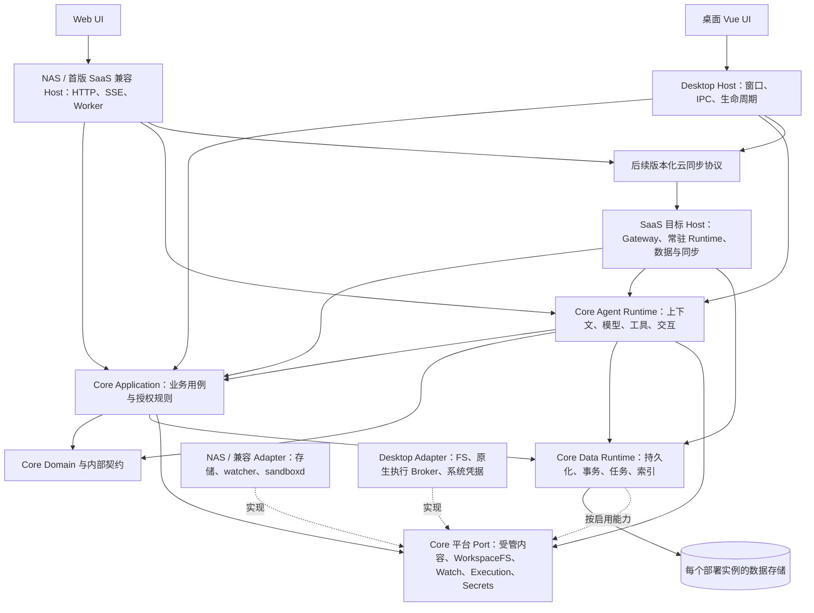

# Gugu Core 与桌面端职责划分方案

> **文档类型**：架构方案
> **状态**：🔲 待评审，尚未实施
> **创建及更新**：2026-11-10
> **代码基线**：2026-11-10 从原仓库快进拉取的 `dev`，提交 `46d67f72`
> **方案分支**：`codex/core-desktop-architecture-latest-dev`
> **历史方案**：[Gugu Core 多端统一架构重构方案](./Gugu-Core多端统一架构重构方案.md)

## 1. 架构结论与范围

建议采用 **入口不拥有业务事实数据、各 Host 运行同一套 Core Runtime、平台能力由各端 Broker 提供** 的结构。Core 统一业务数据、数据运行时和 Agent；桌面是默认家节点，首发目标平台为 macOS 和 Windows。SaaS 是可选付费的 7×24 常驻 Runtime 副本，提供云端数据、同步与任务转交，长期不持有用户 FS，首版可保留现有 FS 作为兼容路径。

这里的“统一”指复用同一套实现、业务契约和数据模型。每个安装实例拥有自己的数据和运行生命周期；云同步需要单独的协议和一致性规则，不能通过共用 Core 或让客户端直连云数据库自动获得。

| 事项 | 本轮结论 | 决策性质 |
| --- | --- | --- |
| Core 范围 | 业务用例、Data Runtime、Agent Runtime、任务及交互语义 | 按本轮需求设计 |
| 端侧范围 | 真实 FS、Sandbox、凭据存储、系统 UI、进程及更新生命周期 | 按本轮需求设计 |
| 入口职责 | IM、Web 控制台、Mobile App 负责请求、展示与连接，不拥有业务事实数据 | 按所提供的产品拓扑图设计 |
| SaaS 长期职责 | 可选的常驻 Core Runtime 副本，保留 Agent、DB、云同步和任务转交；不持有用户 FS | 结合产品拓扑图明确 |
| SaaS 首版兼容 | 可保留现有 FS 及相应调用链，后续按迁移条件退出 | 用户明确允许 |
| 桌面形态 | 本地优先；macOS、Windows；桌面应用内单用户 | 按本轮需求设计 |
| 用户模型 | SaaS、Linux / NAS 保留多用户；桌面端单用户；Mobile 目标形态为独立本地实例 | 按已有用户决策及产品拓扑图设计 |
| 默认家节点 | 默认 Desktop；用户可直连自己的 Runtime，SaaS 不成为必经入口 | 按所提供的产品拓扑图设计 |
| 桌面承载 | 优先验证 Tauri 2 + 现有 Vue UI + Python Core sidecar；原生 Broker 承接平台能力 | 技术建议 |
| 桌面数据库 | 优先验证 SQLite；Web 保留 PostgreSQL；驱动实现统一在 Core 数据包维护 | 技术建议，须通过持久化验证 |
| 桌面命令隔离 | 原生平台 Adapter，首发不依赖 Docker、WSL 或虚拟机 | 技术建议，须通过两平台验证 |
| 首期交付 | 建立边界并完成项目、会话与受控执行的纵向链路 | 分阶段推进，本文不启动实现 |

首批提取先完成现有 Web / NAS 与桌面的纵向链路；跨设备同步、任务转交和 Mobile Runtime 分阶段落地。首期不做任意跨 Host Run 接管、桌面应用内账户切换、仓库拆分或 Agent 语言重写。任务转交是目标能力，不能因首批尚未实现而从契约中删除；它也不等于迁移正在执行的整个 Run。

### 1.1 产品形态与阶段边界

| 产品形态 | 数据职责 | FS 与执行职责 | 同步职责 |
| --- | --- | --- | --- |
| macOS / Windows 桌面 | 独立本地数据与 Core Runtime，默认家节点 | 本机文件、目录授权、监听及受限执行 | 可独立运行、被入口直连，也可连接 SaaS 副本 |
| Mobile 目标形态 | 独立本地 Core Runtime 与 SQLite；另有作为入口的 Mobile App 角色 | 平台允许的应用文件及能力，不直接照搬桌面 Shell 权限 | 可独立承接适配的任务，或作为入口直连 Desktop；具体承载后续验证 |
| Linux / NAS 自托管 | 自托管实例的数据与 Runtime | 保留部署端文件与沙箱能力 | 可作为后续同步端，不随 SaaS 的 FS 退出而删除能力 |
| SaaS 首版兼容形态 | 保持现有数据与运行行为，逐步建立新边界 | 允许暂时保留现有 FS 和相关执行链路 | 先冻结同步数据与协议边界，不要求首批完成完整同步 |
| SaaS 长期目标 | 多用户 PostgreSQL、必要 Redis、常驻 Core Runtime 副本与 Agent | 不持有用户目录、挂载或 FS；需要端侧能力的任务通过显式转交协议发往目标 Runtime | 业务数据同步、消息路由、任务投递与结果通知；订阅 SaaS 为可选项 |

下文的完整 Web Host 能力表指 Linux / NAS 自托管及首版 SaaS 兼容形态。SaaS 长期目标不要求实现其中全部平台 Port。“纯 DB + 云同步”约束用户产品能力，不排除数据库、缓存和服务日志所需的基础设施磁盘。

产品图中 SaaS 明确包含 Core Runtime 副本，因此云端保留可用的 Agent 和业务编排，不再把它解释为只有同步 API 的数据库服务。“纯 DB + 云同步”表达其本地资源边界；它不因此获得端侧 FS 权限。附件原始字节是否云同步仍单独确认，图中没有冻结这一范围。

Mobile 的入口与 Runtime 是两种角色，可以在同一个 App 内组合，也可以只作为远端 Runtime 的界面。Mobile Runtime 属于目标拓扑，尚不代表现有 Python / Cython sidecar 或桌面沙箱可以直接在移动系统发布。

### 1.2 云同步与文件能力分开设计

云同步首先明确可同步的业务记录、稳定实体标识、版本、删除标记、幂等和冲突处理。端侧 FS 的本机路径、bookmark、句柄、目录授权、Sandbox 身份和活跃进程状态不进入跨设备同步；另一个设备拿到文件引用，也必须重新绑定可用的本地资源。

文件和附件的元数据、逻辑引用与原始字节是不同的同步对象。云端是否提供附件对象存储需单独决策；即使以后支持字节同步，也不因此开放 SaaS 目录遍历、挂载或 Shell 文件访问。当前不能把“记录已同步”显示成“文件字节已备份”，也不能把“无云端 FS”解释为将所有大文件塞进关系数据库。

首版保留 SaaS FS 是迁移兼容，不改变长期职责。下线之前须完成既有文件、附件和记忆的去向与完整性校验，关闭受影响入口前提供可恢复的迁移结果；不自动删除旧文件、清空引用或把失败解释为同步成功。

入口层的“不拥有数据”落地为不拥有 Canonical 历史、领域记录或文件事实真源。入口可以保存连接配置、展示缓存和临时输入，但业务提交必须由选定 Runtime 落库；恢复业务状态不能依赖某个 Web 标签页或 IM 连接的缓存。

## 2. 当前实现与旧方案需要调整的地方

### 2.1 当前代码事实

| 当前入口 | 已有职责与耦合 | 对拆分的影响 |
| --- | --- | --- |
| [run/preparation.py](../../backend/agent/run/preparation.py)、[run/finalization.py](../../backend/agent/run/finalization.py) | 已共享准备和收尾，但仍读取应用配置、数据库、权限及通知实现 | 保留统一生命周期，将宿主依赖改为显式装配 |
| [app/db/session.py](../../backend/app/db/session.py)、[app/models](../../backend/app/models/__init__.py)、[projects.py](../../backend/app/services/projects.py) | 连接池、迁移、ORM 与业务查询仍处于应用目录 | 数据实现应成为共用 Core 的一部分，避免各 Host 复制 |
| [events.py](../../backend/app/core/events.py)、[runtime_state.py](../../backend/agent/runtime/runtime_state.py) | 用户级通知、revision、取消及运行协调直接使用 Redis | 先区分持久状态、协调状态与即时通知，再提供运行后端 |
| [RAG README](../../backend/agent/rag/README.md) | 当前检索、投影、排序及索引生命周期为 Python/Cython；索引可重建 | 复用当前引擎，不恢复历史 TypeScript Data Runtime |
| [StorageBackend](../../backend/app/services/storage/__init__.py)、[FileService](../../backend/app/services/storage/file_service/files.py) | 文件字节访问、Rootless 权限、对象存储及元数据编排交织 | 业务规则与物理文件实现分别归属 Core 和 Host |
| [filesystem_authorization.py](../../backend/app/services/filesystem_authorization.py)、[filesystem_policy.py](../../backend/agent/tools/filesystem_policy.py) | Shell 的 workspace 授权与文件库工具规则不同 | 拆分时保留现有 Web 行为，不能把两个授权范围合并 |
| [Sandbox](../../backend/agent/sandbox/client.py)、[Terminal](../../backend/agent/terminal/contracts.py)、[MCP stdio](../../backend/agent/mcp/stdio_client.py) | 当前执行连接依赖 sandboxd、Unix socket 和容器环境 | Shell、PTY、MCP stdio 共用平台执行入口，避免旁路 |
| [文件监听桥](../../backend/app/services/filesync/ts_sidecar.py) | Linux 使用 Python watcher，其他平台当前分支走 Node 制品 | 桌面发布必须显式处理 watcher，不能只打包 Python 就宣称可用 |
| [数据迁移 PRD](../prds/PRD-DATA-1-用户数据可移植导出与桌面迁移.md) | Web 可移植归档已实现，桌面原生导入器未实现；长期记忆还包含对象文件 | 沿用归档契约，不以复制数据库代替完整数据迁移 |

当前 `backend/app/core` 是历史目录名，不等于本方案的 Gugu Core。新边界按依赖和职责判断，不直接整体搬走该目录。

### 2.2 对历史方案的修订

| 历史方案 | 本方案 |
| --- | --- |
| Core 主要包含领域、用例及 Port，具体数据库实现归各 Host | Core 同时包含共用 Data Runtime，实现与逻辑均复用；Host 选择运行配置 |
| Core 禁止任何 ORM/Redis 依赖 | 领域、用例及 Agent 禁止直接依赖；Core 的数据与协调后端包可以依赖对应库 |
| 数据 schema 与迁移实现归 Host | Core 数据包拥有 schema、版本及迁移实现；Host 编排备份、独占迁移和启动 |
| 桌面路线、目标系统尚未确定 | 本地优先，macOS + Windows，桌面单用户 |
| SQLite 与 PGlite 长期并列候选 | 先验证 SQLite + 当前 Python 栈，不再为数据库额外引入 Node 链路；失败后另记选型决策 |
| Sandbox 尚未选择端侧方向 | 桌面优先原生，Web 保留当前 sandboxd/容器执行；统一请求和结果契约 |
| Web Host 统一承担文件与执行能力 | 区分 NAS 完整 Host、SaaS 首版兼容形态和 SaaS 长期无 FS 的常驻 Runtime 副本 |

保留旧方案中垂直切片、明确运行所有者、失败关闭、权限校验、流式存储和迁移恢复原则。

## 3. 目标结构与依赖方向

### 3.1 产品拓扑

以下将提供的产品图转为明确的模块关系。虚线表示共享代码与契约，不表示部署一个全局 Core 服务；NAS 的现有部署形态另按 §1.1 保留。

```mermaid
flowchart TB
    subgraph ENTRY[入口层：不拥有业务事实数据]
        IM[IM 渠道]
        WEB[Web 控制台]
        MAPP[Mobile App]
    end
    DEF[gugu-Core：业务、Agent、执行协议、授权与数据协议]
    subgraph CLOUD[SaaS：可选付费、7×24 常驻副本]
        GW[SaaS Gateway：不持有 FS]
        CR[Core Runtime 副本]
        CB[Host Broker：云端数据与队列适配]
        PG[(PostgreSQL：多用户)]
        REDIS[(Redis：协调与投递)]
        GW --> CR --> CB
        CB --> PG
        CB --> REDIS
    end
    subgraph DESKTOP[Desktop：独立本地实例、默认家节点]
        DR[Core Runtime]
        DBR[Host Broker]
        DDB[(SQLite)]
        DFS[端侧 FS 与 Sandbox]
        DR --> DBR
        DBR --> DDB
        DBR --> DFS
    end
    subgraph MOBILE[Mobile：后续独立 Runtime 目标]
        MR[Core Runtime]
        MBR[Host Broker]
        MDB[(SQLite)]
        MFS[平台允许的 FS 与能力]
        MR --> MBR
        MBR --> MDB
        MBR --> MFS
    end
    IM --> GW
    WEB --> GW
    IM -->|绑定目标、直连| DR
    IM -->|绑定目标、直连| MR
    MAPP -->|直连自己的 Desktop| DR
    CR -->|显式转交任务| DR
    CR -->|显式转交任务| MR
    DEF -. 同一套定义 .-> CR
    DEF -. 同一套定义 .-> DR
    DEF -. 同一套定义 .-> MR
```



入口绑定可选的目标 Runtime，SaaS 不是所有入口的强制中转。每次请求的鉴权、数据范围和执行所有者由可信路由确定，模型不能自行把请求改送到另一台设备。直连的可达性、配对与鉴权仍需协议验证，图中的连线不承诺默认穿透所有网络。

### 3.2 Core 内部依赖



图中的 Core 包含内层业务契约和外层共用实现。Application、Agent 只依赖数据门面和平台 Port；Data Runtime 的 SQL、队列等具体后端实现这些契约，由 Host 在组合入口装配。Domain 不反向导入 Data Runtime。

各 Host 使用独立的数据实例；图中的共用 Data Runtime 表示代码复用。目标 SaaS 装配 Agent、数据与同步用例，提供与其能力匹配的工具；不装配用户 FS、watcher 或本机 Shell 执行器。SaaS 的任务转交 Adapter 走独立协议，目标端 Broker 重新鉴权后执行。兼容与目标 SaaS 是阶段配置，不允许在同一副本内对同一业务记录建立两套并行写入真源。

Core 可以包含 SQLAlchemy、SQLite/PostgreSQL 适配和 Redis 协调实现；禁止依赖 FastAPI 请求、桌面窗口、OS 权限弹窗或 Host 的全局配置。包内部依赖规则替代“整个 Core 不能使用任何基础设施”的旧限制。

### 3.3 Broker 的职责需要明确命名

产品图中的“执行 Broker”同时连接数据库、Redis 和 FS，职责比命令沙箱更宽。建议实现中分成两层：

| 名称 | 职责 | 与 Core 的关系 |
| --- | --- | --- |
| Host Broker / Adapter 装配层 | 数据后端、队列、FS、凭据和平台能力的装配与生命周期 | 复用 Core Data Runtime 的模型和实现，不另写一套业务规则 |
| Sandbox Executor | Shell、PTY、MCP stdio 等进程的隔离、输出、取消与回收 | 实现 Execution Port；桌面可验证 MXC 等候选 |

SQLite / PostgreSQL 查询不经过命令执行沙箱，数据库凭据也不交给待执行进程。图中的 Broker 是能力适配层，不要求把每次 SQL 查询变成一条跨进程 RPC。Mobile 的 FS Sandbox 按移动平台能力定义，不等同于可运行任意桌面命令的 Sandbox Executor。

## 4. 领域职责矩阵

本表描述完整 Host 的职责分配；SaaS 长期目标的裁剪范围以 §1.1 为准。Core 的领域能力共用，不要求每个 Host 都启用全部能力。

| 能力 | Core 负责 | Web Host 负责 | Desktop Host 负责 |
| --- | --- | --- | --- |
| 项目、便签、画布、日历、联系人 | 规则、用例、查询、事务和业务事件 | API 转换、登录主体建立 | UI/IPC 转换、本地数据空间建立 |
| 会话、消息、附件关联 | Canonical 历史、顺序、引用、持久化和保留规则 | HTTP/SSE、渠道交付 | IPC 事件和桌面交付 |
| 记忆与 RAG | 记忆语义、来源、删除屏障、索引投影、检索及最终范围校验 | 提供内容存储能力、选择运行拓扑 | 提供本地内容存储，随包交付原生扩展 |
| Data Runtime | schema、ORM、repository、UoW、后端差异、备份恢复接口 | 提供连接配置和运维编排 | 提供私有数据库位置和升级编排 |
| Run 与 Job | 状态机、持久任务、幂等、租约、恢复与调度规则 | Worker/队列连接、进程部署 | 单实例运行、唤醒、退出和后台驻留策略 |
| 模型和 Provider | 模型适配、用量归一、缓存、错误语义和调用编排 | 站点模型配置与服务端凭据来源 | 本地模型配置与系统凭据来源 |
| 工具与确认 | 注册、输入校验、逐调用授权、destructive 确认、结果记录 | Web/IM 确认展示与提交 | 统一 ConfirmDialog 展示与提交 |
| 文件库与回收站 | 逻辑文件、元数据、项目关联、冲突、撤销和保留规则 | 本地/对象存储实现、下载传输 | 本地文件实现、系统打开与选择器 |
| 外部工作目录 | 授权范围语义、绑定及索引规则 | 服务端目录能力和部署限制 | 用户选目录、OS 授权、路径/句柄解析 |
| 文件监听与对账 | 增量投影、幂等、丢事件后的对账策略 | Web watcher 生命周期 | 平台 watcher 和重启恢复 |
| Shell、PTY、MCP stdio | 调用意图、执行策略、超时取消语义、会话记录 | sandboxd/容器执行 Adapter | 原生 Broker、OS 隔离、进程树和 PTY |
| MCP、IM 等连接 | 可复用协议语义、工具发现及路由规则 | Webhook、公网入口、站点级渠道凭据 | 本地连接及后台进程集成；非首批全量迁移 |
| 身份与账户 | 数据空间与操作范围校验 | 注册、登录、多用户、角色、站点配额和风控 | 无应用账户系统；单个本地所有者 |
| 配置与升级 | 配置结构校验、版本兼容、迁移实现 | 服务配置及发布控制 | 安装、签名、自动更新、系统凭据和数据目录 |

“FS 留在端侧”不等于把文件领域整体移出 Core；“去掉多用户”不等于删除数据范围、文件授权或确认门。

## 5. Core Data Runtime

### 5.1 统一维护什么

Data Runtime 维护四类共用实现：

1. **业务持久化**：会话、消息、项目、Mind、日历、文件元数据、偏好、交互等领域数据，按域组织模型和 repository。
2. **运行持久化**：Run/Job 状态、pending queue、确认请求、任务重试及 outbox。进程内上下文对象不等于持久任务记录。
3. **派生数据**：RAG 索引、revision 和缓存生命周期；派生数据始终可从权威数据重建。
4. **运行后端**：SQL 方言差异、事务、并发控制、持久任务领取及短期协调实现。Web 可使用 Redis 后端，桌面使用本地实现。

Host 调用类似 `open_data_runtime(config, platform_ports)` 的装配入口。入口不从 `app.core.config`、环境全局单例或当前工作目录自行寻找用户配置。数据库文件路径由桌面提供，数据库的打开、连接和事务由 Data Runtime 实现；业务文件路径与文件字节操作仍走 FS Port。数据与同步用例必须能在不装配用户 FS 的 Host 中启动；仅在启用相应文件功能时要求对应 Port，不用空实现掩盖缺失能力。

### 5.2 权威数据与物理存放

| 数据 | 统一所有者 | 物理承载与规则 |
| --- | --- | --- |
| 业务记录、Canonical 消息、Run/Job/交互状态 | Core Data Runtime | Web PostgreSQL；桌面候选 SQLite；UI 不直连数据库 |
| 文件/附件原始字节 | Core 文件领域管理引用，启用内容存储的 Host 保存字节 | 数据库保存稳定引用、版本及元数据；SaaS 首版可保留字节存储，长期云端字节同步范围待单独确认 |
| 长期记忆正文及对象文件 | Core 记忆领域 | 通过受管内容 Port 读写；保留现有真实来源，不把全部记忆误当作数据库行 |
| RAG、缩略图及可重建缓存 | Core 管生命周期，Host 提供存储 | 与事实数据分开；损坏时按显式重建流程恢复 |
| 取消信号、连接在线状态、短租约 | Core 协调契约及后端 | 可用 Redis/本地状态；不能反向覆盖持久 Run 终态或 Canonical 历史 |
| Provider、MCP、Bot 密钥 | Host SecretStore | Core 只使用受控引用，不进入 UI、执行子进程或迁移归档 |

SaaS 退出用户 FS 前，需把需要云端保存的长期记忆正文及其他业务内容从物理对象路径中解耦，形成显式业务记录或版本化内容载荷；哪些内容仅保留端侧应有明确清单。当前 `.agent/` 对象文件不能只留下不可解析的云端路径引用。RAG 索引和运行快照仍不作为业务同步的事实来源。

数据库事务与文件写入无法被一个 SQL 事务天然覆盖。跨二者的操作使用暂存对象、提交引用、outbox 和补偿/对账步骤；失败时保留可恢复记录，不能先报成功再丢文件，也不能自动重放已完成的破坏性操作。

### 5.3 数据库与协调后端建议

建议继续 Python + SQLAlchemy，共用模型及用例；SQLite 为桌面首选验证路径，PostgreSQL 为 Web 既有基线。SQL 差异集中于 `data/backends/`，不散落到 Agent 或 Vue。

现有测试使用 SQLite、模型已有部分方言适配，但这不能证明生产桌面兼容。当前启动代码仍包含 PostgreSQL DDL、`pg_trgm`、advisory lock，RAG 作业也使用行锁。SQLite 验证至少覆盖：

- 文件数据库、外键开启、事务隔离、唯一约束、UTC、JSON、搜索及排序语义；
- Agent 流式写入与 UI 查询、定时任务、RAG 索引更新的同时进行；WAL 下长读和写争用；
- 通过原子领取/条件更新实现 Job 租约，不能把 `SELECT FOR UPDATE` 在 SQLite 中无效当作已加锁；
- 迁移、磁盘满、异常退出、备份恢复和数据库占用；备份必须考虑 WAL，不能直接复制正在使用的主文件；
- 一个桌面 Core 进程拥有数据库写入与调度，多个窗口只经 IPC 访问，不各起一套 Runtime。

SQLite 的备份实现应使用支持运行中一致性快照的 API，或在已停止写入并验证 checkpoint 后执行离线备份；同时验证驱动的事务与外键设置。[SQLite WAL](https://www.sqlite.org/wal.html)、[Online Backup API](https://www.sqlite.org/backup.html)、[SQLAlchemy SQLite 方言](https://docs.sqlalchemy.org/en/20/dialects/sqlite.html)。

Web 的 Redis Streams、Pub/Sub、TTL grant、租约应分别适配，不能用一个内存字典替代全部语义。桌面持久 Job、交互及待投递事件写入本地数据库，活跃取消信号和即时 UI 通知可在内存中。过期的确认在重启后重新确认，不恢复为自动放行。

schema、迁移代码及支持版本归 Core Data Runtime；Host 停止写入、备份、获取独占迁移权、调用迁移并核验后再启动。Core 构造函数不得隐式执行破坏性迁移。Web 身份表与业务表逐步解耦，首批不删除既有外键。

## 6. Core Agent 与任务运行时

Agent Runtime 包含当前 Loop、Canonical/Provider Conversation、上下文预算、压缩、反思、模型适配、工具注册及执行调度。业务工具通过 Application 操作数据；系统工具通过平台 Port 执行。Provider 的 HTTP 客户端可以复用，凭据和运行配置由 Host 注入。

首批提取继续复用现有准备、消费、收尾实现，保持以下行为：

- 会话内串行、不同会话受限并发；上下文顺序及不可变快照边界不变。
- 持久化成功先于完成事件和渠道广播；通知失败不回滚成功写入。
- Provider 实际输入用量及缓存输入口径、取消时的部分历史保存、当前确认重放语义不变。
- 完整模型快照不写入 Redis、数据库或可见日志；日志不包含正文和附件名。

建议明确区分 Run 的 `queued/running/waiting_confirmation/cancelling` 与 `succeeded/failed/cancelled/interrupted`。UI 关闭或事件流断开不是取消；取消必须到达执行所有者，并在 Broker 确认进程回收后产生执行终态。具体状态名在提取契约时与现有 API 映射，不能直接改变旧客户端协议。

每个 Run 固定 `instance_id`、`data_space_id`、`session_id` 和 `run_id`。首期不跨 Host 接管。进程崩溃后，持久任务根据租约恢复；含外部副作用但缺少可靠回执的操作标记为中断待核验，不能整轮自动重跑。即使单用户，重复点击、双窗口或重启也必须保持幂等。

业务失效与任务状态通知在提交后发布，只携带资源引用、状态和 revision；需要可靠投递时通过 outbox。前端重连后按 revision 补读权威状态，不以 Pub/Sub、IPC 缓存或增量聊天流重建持久终态。聊天 token 流与可靠状态通知分开定义顺序、断流及重放语义。

云同步只复制经授权的业务变更，任务转交则使用独立的调用、回执与取消协议。同步一条任务定义，不等于在每个副本都执行该任务；SaaS 保留常驻 Agent，也不因同步到某条 workspace 或任务记录而获得端侧文件及进程授权。

调度规则、任务状态和错过触发的处理策略归 Core；Web Worker 和桌面后台进程是承载方式。桌面默认只承诺应用运行时调度；休眠、退出和恢复时按任务记录执行预先约定的跳过/合并/补跑规则，不承诺关机后仍运行。

### 6.1 入口路由、默认家节点与副本

Desktop 是默认家节点，表示默认的本地资源归属和任务路由偏好，不表示它必须永远在线，也不自动决定所有同步冲突的胜负。SaaS 可在端侧离线时继续接收入站请求、执行已有云端能力并保存任务；需端侧 FS 的任务保持待投递、等待设备或按明确策略过期，不能自行改成云端执行。

同一会话的并发请求须遵守统一的执行所有者、租约和版本规则。IM 事件使用稳定入站标识去重；多个入口或副本看到同一消息，不能各自启动一次根 Run。SaaS 和端侧之间的接入切换须经过显式所有权协调，不能靠“谁先看到消息”决定。

### 6.2 显式任务转交

任务转交将原 Run 的一个受限任务交给另一 Runtime。原 Run 保留编排所有者，目标实例拥有子任务的执行生命周期；它不要求迁移整个内存上下文，也不复制完整模型快照。

| 契约 | 最少包含 |
| --- | --- |
| 任务身份 | `task_id`、`parent_run_id`、发起事件及幂等键 |
| 路由与数据范围 | 发起实例、目标实例、用户 / 数据空间、所需能力、输入引用及版本 |
| 授权 | 可信设备绑定、该调用的确认与授权引用、有效期；由目标端按当前策略复核 |
| 投递状态 | 待投递、已接受、运行、等待确认及明确终态；租约 / epoch 与可重试边界 |
| 结果与控制 | 有序状态事件、结果引用、错误分类、取消请求及目标确认回执 |

首个目标链路建议为 SaaS 到 Desktop 的单个受控任务。目标可用且接受授权后才执行；离线、拒绝、过期和重复投递均有明确结果。取消消息未送达时显示等待取消，不能声称已经停止；缺少副作用回执时标记中断待核验，不重新执行可能已生效的写操作。

设备配对、通道鉴权和任务授权是不同边界。连接成功不等于允许读盘，云端的确认也不自动扩大目标端目录授权。任务转交与数据同步分别定义幂等和恢复语义，不以复制一条数据库任务行代替安全的远程调用。

## 7. FS 与执行接口

### 7.1 拆开三类文件能力

| Port | 用途 | 关键契约 |
| --- | --- | --- |
| `ManagedContentStore` | 文件库、附件、记忆和内部派生对象 | 逻辑对象引用、流式读写、版本/条件覆盖、暂存提交、删除和可恢复错误 |
| `WorkspaceFS` | 用户选定的真实工作目录 | Host 签发的授权引用 + 相对路径；按操作区分读、写、列举和元数据 |
| `WatchSource` | 监听目录变化 | 绑定 ID、相对路径、序号、overflow/restart 信号；Core 决定对账与投影 |

这些 Port 对完整桌面 / NAS Host 适用；Mobile 仅实现其平台允许的能力子集。目标 SaaS 不注册本机用户 FS、watcher 或 Shell，但可根据可信设备能力和授权提供显式任务转交工具。端侧任务按 §6.2 选定目标、确认在线性、复核授权并返回回执，不通过云同步隐式调用某台设备。

受管内容的内部命名空间不提供给模型作为任意文件入口。数据库、凭据和 Core 内部状态位于端侧私有位置，不能因为授权某个工作目录就暴露给命令、插件或 MCP 进程。

外部目录的 OS 授权只由 Host 选择器与 Broker 建立。Core 保存逻辑绑定、授权版本和业务用途；Host 保存路径、bookmark/句柄及平台访问材料。可移植归档只携带逻辑绑定信息，导入后重新选择目录，不继承旧机器授权。

文件库工具和工作区命令的授权分开处理。保留当前 Web 文件库工具的既有操作范围；桌面访问外部目录则必须经过 `WorkspaceFS`/执行授权，不能借“本地文件库”获得全盘访问。

### 7.2 Execution Port

执行契约统一表达能力，而不暴露 Docker 参数、Seatbelt 规则或 Windows token：

| 契约 | 内容 |
| --- | --- |
| 执行请求 | Run/调用 ID、argv、工作区授权引用、相对 cwd、环境白名单、策略版本、截止时间 |
| 文件与网络策略 | 独立的只读/可写根授权、必要运行时只读资源、禁止内容根、断网或受控出口 |
| 确认绑定 | 由可信交互服务确认的具体调用、参数摘要、目标、授权版本和有效期；模型字段不能构成凭据 |
| 执行能力 | 单次命令、长期 stdio、交互 PTY、取消、资源限制；按平台分别声明是否满足 |
| 事件与结果 | 有序输出、大小上限、退出码、拒绝原因、超时/取消/中断，以及是否已回收进程 |

Host Broker 在每次调用时重新校验授权和策略。能力协商只说明能否执行，不授予权限。请求了平台不能强制的网络、文件或资源约束时返回明确错误，不静默降低隔离强度。

Shell、PTY、MCP stdio 和第三方执行型插件都必须经过该入口。不能只限制 Shell，却让 MCP 直接 `Popen`；也不能把当前 [LocalWorkspaceExecutor](../../backend/agent/sandbox/local_executor.py) 的路径/参数预检认作 OS 沙箱，它自身已声明不提供不受信代码的安全隔离。

## 8. 桌面承载与单用户

### 8.1 建议进程结构

```text
桌面 Vue UI（窗口，可多个）
  └─ Desktop Host / Broker（单实例，原生能力和进程管理）
       ├─ Python Core sidecar（业务、Data Runtime、Agent、调度）
       │    ├─ 本地数据库
       │    └─ 共用 Python/Cython RAG
       └─ 受限执行进程（按授权隔离的 Shell / PTY / MCP）
```

优先做 Tauri 2 PoC：复用 Vue，Rust Host 实现 Broker，必要时通过 Swift/系统 API 衔接 macOS。Core 继续 Python，不为桌面重写 Agent；Cython 随目标平台预编译，用户安装后不现场编译。

Tauri 支持外部 sidecar 及调用权限配置，适合作为此结构的候选承载；它不会自动将外部执行进程变成 OS 沙箱。前端只开放业务 IPC，不授予通用 Shell/FS 插件权限。若打包、WebView 兼容或原生桥验证不通过，再记录 Electron 替代决策，避免同时维护两套桌面壳。[Tauri sidecar 文档](https://v2.tauri.app/develop/sidecar/)、[Shell 权限文档](https://v2.tauri.app/plugin/shell/)。

Host 与 Core 优先使用受限的本地 IPC，首期可用父子进程专属管道承载有版本的帧协议；stdout 保留给协议，诊断另走受限出口。禁止通过 Shell 拼接启动参数或使用 URL 传递令牌。若后续使用 Unix socket/Named Pipe，应验证对端与 ACL；不向浏览器暴露无认证的本地服务。

请求、输出流和取消有独立 ID、顺序与背压，大文件走受控流/句柄，不塞进单条 JSON。Host 校验协议兼容、守护 sidecar 并统一退出；Core 重启不导致已执行的工具被无条件重放。

现有非 Linux watcher 使用 Node，迁移期必须选择明确路径：随包交付所需 runtime/制品，或通过同一 WatchSource 契约替换为原生 watcher 并完成行为验证。在替代完成前，不能把“桌面只需 Python sidecar”作为发布事实。

### 8.2 去掉哪些多用户能力

桌面首发删除注册/登录、密码找回、用户列表、角色分配、封禁、邀请、站点配额和其他站点管理入口；用户可调整模型、工具和偏好，这些是本地设置，不是 Admin 权限。

Core 使用可信的 `DataSpaceContext` 表达本次调用的数据范围；SaaS / NAS Host 将登录用户映射到其数据空间，桌面 Host 绑定唯一的本地数据空间。Agent/UI 不可任意指定另一个空间。数据空间是数据范围，不新增桌面租户管理产品或多账户 UI；跨设备连接另行验证云端身份、本地所有者及设备绑定的对应关系。

不创建拥有全局权限的“默认 admin”来绕过历史校验。迁移期必要的 `user_id` 映射封装在兼容 Adapter 内，保留 Web 的 `get_owned()` 与越权测试；目标桌面业务 schema 无须依赖密码、角色等 Web 身份字段。

IM 群友、联系人、记忆中的人物身份是业务数据，不是应用登录账户，不能随多用户系统一起删除。OS 用户、应用数据权限、文件访问授权、确认门及脱敏也继续保留。运行凭据由 macOS Keychain/Windows 系统凭据能力承载，Core 通过 SecretStore 获取受控值。

## 9. macOS 与 Windows 原生执行方案

### 9.1 共同边界

优先保护本地数据和凭据不被模型生成的命令、第三方 stdio 进程读取或修改。Core 和 Broker 是可信进程；待执行代码处于受限子进程。单用户不抵御已完全控制同一 OS 账户的恶意软件，但不得因此放弃子进程隔离。

默认仅允许本次授权工作目录、独立临时目录和明确的只读运行时资源。工作目录即使选到上层目录，也不得把应用私有数据库/凭据根暴露进去；无法实施该排除时拒绝授权。执行环境不继承完整 HOME 配置、代理、云凭据、Provider 密钥或开放文件句柄。

命令子进程的网络策略与 Core 模型联网分开：Core 能调用模型不代表命令可以上网。首期先验证断网；受控网络通过 Broker 管理的出口单独验证，禁止直连、localhost、DNS 或子进程绕过。URL 工具继续复用 URL 安全校验，不能自动跟随未校验重定向。

### 9.2 Windows

首选验证 **AppContainer，必要时评估 LPAC，配合 Job Object**。AppContainer 的能力及对象 ACL 承担资源隔离，Job Object 承担进程树管理和可支持的资源限制。Job Object 或低完整性 token 本身不足以证明文件、网络隔离。[AppContainer 实现说明](https://learn.microsoft.com/en-us/windows/win32/secauthz/implementing-an-appcontainer)、[Job Objects](https://learn.microsoft.com/en-us/windows/win32/procthread/job-objects)。

Broker 管理受限进程身份、启动属性、目录权限与回收，不要求桌面产品增加第二个登录用户。常规 AppContainer 仍可能获得平台公共资源访问，PoC 必须测量实际可读面；如不能满足私有数据边界，则评估 LPAC，不能把创建 AppContainer 成功当作验收。

需要验证 PowerShell/原生命令、Python、Git 等实际工具链，以及 ConPTY、网络拒绝、junction/reparse point、继承句柄、子进程继承与禁止脱离 Job。目录授权不能递归重置用户目录 ACL；如需添加访问 ACE，必须记录所有权、最小化范围并可在崩溃后恢复清理，不覆盖原 ACL。

### 9.3 macOS

先做两条有限验证，再确定可发布的 Adapter：

| 路径 | 适用点 | 必须解决的问题 |
| --- | --- | --- |
| 签名的 App Sandbox helper/XPC + 用户选择目录与 bookmark | 优先评估受支持的应用分发机制 | 是否能在独立执行进程落实本次目录权限、命令/PTY/MCP 兼容，以及网络与 Core 凭据隔离 |
| Seatbelt / `sandbox-exec` 的逐进程策略 | 验证任意命令按 Run 收紧文件和网络权限的可行性 | 弃用接口及非公开策略语言的维护风险、系统升级兼容、签名后行为与长期分发成本 |

App Sandbox 的 helper 继承与 security-scoped bookmark 是受支持机制，但不能从“选择了目录”直接推出任意子进程仅获得这个 Run 的权限；尤其不能让执行进程继承 Core 已积累的目录、联网或私有数据访问权。[Apple helper 文档](https://developer.apple.com/documentation/xcode/embedding-a-helper-tool-in-a-sandboxed-app)、[文件访问文档](https://developer.apple.com/documentation/security/accessing-files-from-the-macos-app-sandbox)。

Apple DTS 明确说明自定义 SBPL 不是受支持的第三方接口，`sandbox-exec` 已弃用。因此 Seatbelt 是需验证和承担维护成本的候选，不是长期稳定 API 承诺；已有开源 Agent 使用它，只能证明存在工程实践，不能替代本项目验证。[Apple DTS 说明](https://developer.apple.com/forums/thread/661939)、[开源 Seatbelt 实现参考](https://github.com/openai/codex/blob/main/codex-rs/sandboxing/src/seatbelt.rs)。

签名/公证、TCC 拒绝、bookmark 失效、多个工作区同时运行、符号/硬链接、运行时资源访问及进程树回收均属于验收。普通进程组终止不能单独证明逃离进程组的后代已回收。若两条路径都不能满足强制边界，则调整首发执行能力或另行评审隔离路线；不能自动切换为无沙箱执行。

### 9.4 发布前能力矩阵

以下均为待验证，任一平台未通过时仅拒绝该能力，不伪装已支持。

| 必验项 | macOS | Windows |
| --- | --- | --- |
| 工作区外私有文件不可读写，应用数据库/密钥不可达 | 待验证 | 待验证 |
| 只读/读写目录和临时目录权限分别生效 | 待验证 | 待验证 |
| 路径穿越、链接/重解析点、竞态、继承句柄拒绝 | 待验证 | 待验证 |
| 断网及 Core 联网权限不泄漏 | 待验证 | 待验证 |
| Shell、MCP stdio、可选 PTY 均无执行旁路 | 待验证 | 待验证 |
| 超时/取消/Host 崩溃后进程与授权清理 | 待验证 | 待验证 |
| 发布包内 Python/Cython、watcher、签名及干净安装 | 待验证 | 待验证 |

## 10. 建议包布局与迁移接缝

继续 monorepo。以下为目标布局示意，名称可以调整；目录移动不是阶段验收指标。

```text
packages/
  gugu-core/
    src/gugu_core/
      domain/                 # 领域规则及数据范围
      application/            # 业务用例、授权、数据门面契约
      agent/                  # Loop、上下文、Provider、工具、记忆、RAG
      data/                   # 模型、repository、UoW、schema、迁移
        backends/             # PostgreSQL、SQLite 及协调后端差异
      runtime/                # Run/Job、交互、调度、事件与 outbox
      sync/                   # 后续业务变更同步、版本及冲突规则
      ports/                  # FS、执行、watcher、SecretStore 等平台契约
  protocol/                   # 对外 DTO、事件 schema 与生成工具
hosts/
  web/                        # NAS / 首版 SaaS 兼容装配、身份及端侧 Adapter
  cloud/                      # SaaS：Gateway、常驻 Core Runtime、同步和任务转交
  desktop/                    # Python Host 装配与本地 IPC 入口
  mobile/                     # 后续 Mobile Runtime 承载与平台适配
apps/
  desktop/                    # 桌面壳、原生 Broker、系统集成
frontend/                     # 现有 Vue UI，逐步隔离平台访问
backend/                      # 迁移期兼容入口；按切片缩小
```

首批可以在现有目录下建立包和接缝，不先移动所有文件。Host 显式注入 `DataRuntimeConfig`、平台 Port、时钟及运行策略；旧入口通过单向兼容转发调用新实现，禁止新 Core 反向导入旧 `app.*`。

依赖检查按层设置：领域不依赖 SQL/Host；Application、Agent 不直接拿 DB Session、Redis client 或宿主路径；数据及协调后端允许对应依赖；任何 Core 包均不得导入 Web/桌面 Host。高层边界可用静态检查，业务结果必须通过运行时测试验证。

协议 schema 只有一个来源，Web OpenAPI 和桌面 IPC 复用可表达的业务 DTO/事件，再分别映射传输。内部 repository 或 UoW 不直接暴露成 RPC。Core、Protocol、schema 与 Host 记录兼容范围；不兼容时明确拒绝启动或相关能力。

## 11. 实施顺序与验收闸门

| 阶段 | 交付内容 | 验收条件 |
| --- | --- | --- |
| P0 边界基线 | 冻结入口 / Runtime / Broker 边界、默认家节点、用户模型和转交契约；明确最低 OS/CPU 支持矩阵；记录入口、权限、持久化和依赖基线 | Web/IM/Worker/定时任务调用清单完整；确定代表用例和原有行为 |
| P1 桌面可行性 | 两平台打包 Python/Cython、IPC、原生沙箱 PoC；SQLite 文件库与并发/恢复验证 | 可安装制品而非开发脚本通过；记录 macOS Adapter 决策、DB 缺口和 watcher 交付方式 |
| P2 数据切片 | 提取项目列表/创建/改名；共用模型、用例、数据门面与两个后端 | Web 与桌面调用同一实现；越权、事务、并发、重启持久化通过；桌面无登录依赖 |
| P3 Agent 切片 | 会话、Canonical 消息、流式输出、取消、确认、状态通知接入 Core | 相同合成模型序列在两个 Host 得到相同持久结果；中断、重启和单次确认语义一致 |
| P4 FS 与执行切片 | 受管文件和外部 workspace 分离；接通原生执行及 Web Adapter；纳入 stdio/终端 | 文件生命周期、监听丢事件、路径逃逸、网络及进程回收通过；无旁路执行 |
| P5 后台与迁移 | 记忆/RAG、反思、调度、可移植导入及更新恢复；按域扩展其他业务模块 | 关机/休眠策略明确；归档引用闭合；任务恢复与升级失败可恢复；再移除旧依赖 |
| P6 副本同步与 SaaS 收敛 | 冻结同步范围和协议；逐域同步；接通 SaaS 到 Desktop 的显式任务转交；按迁移结果退出 SaaS 用户 FS | 云端 Runtime 无 FS 仍可运行；离线投递、授权拒绝、重复消息、取消、冲突及删除传播通过；旧文件去向明确且可恢复；NAS 能力不受影响 |
| P7 Mobile Runtime | 在确认的移动平台验证本地数据、Core 承载、设备绑定及适配任务 | 区分入口与 Runtime；在无 SaaS 订阅时按承诺能力独立运行；不虚报桌面 Shell 或后台常驻能力 |

P1 是技术验证，先隔离解决分发、数据库和执行边界的高风险项；P2 才开始真实业务提取。P3 首先使用合成 Provider 和受控工具，不要求同时迁移全部 IM 或原生执行。每个阶段切换一个明确用例，单个部署内同一用例只能有一个写入真源，禁止新旧路径双写试运行。

P6 / P7 是目标产品阶段，不因本次边界调整就提前移除 SaaS 首版 FS。云同步、任务转交与当前文件监听 / 对账分别定义协议；同步契约、转交链路、既有数据迁移及能力下线验收通过后，才切换到 SaaS 无 FS 的常驻 Runtime 形态。

## 12. 数据迁移、验证与回滚

### 12.1 迁移原则

沿用 [PRD-DATA-1](../prds/PRD-DATA-1-用户数据可移植导出与桌面迁移.md) 的版本化加密归档和字段白名单。Web 用户导出的业务数据映射到桌面本地所有者，重建实体 ID/引用；不导入站点身份、密码、凭据、确认授权、旧运行租约、Provider 私有推理状态或旧机器路径。

归档迁移是一次性数据转移，云同步是持续复制与冲突处理，二者共用领域映射但不混用协议。同步建议使用稳定实体标识、明确的版本 / 游标与删除标记；冲突规则按领域确定，不能对所有记录直接采用最后写入覆盖，也不能把本机授权随任务或 workspace 记录复制到云端。

外部工作区重新选择授权；RAG 等派生数据重新建立。文件、附件和记忆对象需与数据库一起验证完整性，不能只导入关系表。迁移前生成带时间戳的备份，预检通过后执行；失败保留原数据和可恢复结果，不能解析失败后以空配置继续写回。

`backend/config.override.json`、`backend/.env` 及部署运行配置不属于本方案可重建的制品。设计和验证不读取、创建或覆盖这些用户文件；未来配置变更也只能在明确授权下原子修改指定字段。

### 12.2 行为验证

| 范围 | 保护的回归 | 最低合适层级 |
| --- | --- | --- |
| 业务与数据 | Web 归属过滤不丢失；桌面不能通过传参访问其他数据空间；事务失败无部分写入 | 共用用例 + PostgreSQL/SQLite 集成测试 |
| Agent | Canonical 顺序、上下文预算/缓存、收尾持久化顺序、取消部分历史、一次确认不重复执行 | 合成 Provider 的 Runtime 集成测试，复用现有生命周期用例 |
| Job/交互 | 重复投递、双窗口、领取后崩溃、过期授权、存在副作用的中断不被自动重跑 | 后端契约与多步故障注入 |
| FS | 大对象流式读取、条件覆盖冲突、回收站恢复、文件/DB 不一致可对账、监听 overflow | 临时目录下的 Adapter/用例集成测试 |
| SaaS 目标装配 | 无用户 FS 时 Agent、数据与同步仍可启动；端侧任务必须走授权转交；缺失能力不能触发本机执行 | Host 装配与能力注册集成测试 |
| 入口与任务转交 | 多入口同一事件不启动重复根 Run；目标离线、拒绝、过期、重投和取消未达均有真实状态；配对不扩大目录权限 | 多 Runtime 状态序列、协议集成及少量跨端 E2E |
| 云同步与 FS 下线 | 重试不重复写入；删除不被旧副本复活；冲突不静默丢失；记录同步不误报字节已备份；迁移缺件时保留原文件 | 同步状态序列测试、迁移故障测试及少量跨设备 E2E |
| Sandbox | 工作区外读写、链接竞态、私有数据、网络、继承句柄和后代进程不能绕过 | 每个目标 OS 的真实发布构建集成测试 |
| 桌面 UI | 无账户依赖；取消/确认可完成；断线重连后读取权威终态 | 少量关键 E2E；复用统一 ConfirmDialog 与原生弹窗扫描 |
| 安装与迁移 | 干净安装可启动；升级中断、磁盘满、旧 schema 和归档缺件可恢复 | 两平台安装包及迁移故障测试 |

测试仅使用临时数据、合成身份及 mock 模型；不访问真实配置或用户存储。内存 SQLite 通过不代替文件数据库并发验证，开发态脚本通过不代替签名安装包验收。架构边界检查可以断言依赖方向，不用源码字符串断言替代业务行为。

### 12.3 回滚

每个切片保留明确的旧入口适配与回退条件，切换前确认数据 schema 可兼容。回滚代码不等于回滚数据；只允许使用经校验的备份恢复或前向修复，不能覆盖已经产生的新用户数据。更新失败时停止不兼容能力，保留日志指纹和恢复入口，不自动降级到无沙箱、空数据库或空配置。

## 13. 评审重点与下一步

这套边界优先解决一个问题：入口不拥有业务事实数据，各端运行同一套 Core Runtime，Broker 提供宿主能力。Desktop 是默认家节点，SaaS 是可选的常驻 Runtime 副本，目标不持有用户 FS，通过显式任务转交使用端侧能力；首版保留 FS 兼容。首先评审 Core / Broker 职责、入口路由、任务转交及 SaaS 阶段边界，再进入 P0/P1。

仍需在实现前收敛的事项：

1. 入口与各 Runtime 的配对、直连、鉴权和家节点切换规则。
2. macOS/Windows 最低版本、CPU 架构、安装包分发方式和最低工具兼容集合。
3. macOS 原生执行的可发布路线，以及若无法满足隔离时首发裁剪哪些能力。
4. SQLite 的生产语义验证结论、Tauri 打包结果、watcher 与 Cython 的跨平台制品方案。
5. 附件字节是否需要云端对象同步，以及哪些数据仅保留端侧。
6. 云同步首批领域、冲突规则、任务执行归属，以及 SaaS 既有文件和记忆的迁移去向。
7. Mobile 的首发系统、Runtime 技术承载、后台生命周期和可执行任务范围。

本文只新增可评审方案和历史方案入口说明，不改变运行代码、运行配置或现有数据，也不代表上述 PoC 已通过。
