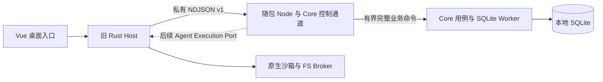

# Gugu Core 迁移 Node.js / TypeScript 方案

> **历史归档（2026-11-12）**：当前架构、完成状态和任务统一见 [当前任务清单](../../Gugu-2.0-迁移任务清单.md)与[架构说明](../../Gugu-2.0-架构说明.md)。
> 本文保留原时点的设计/实现/验证，不维护实时状态；正文中的旧技术路线和待办不能作为当前实施依据。

> 状态：待评审的迁移方案，尚未实施。
> 日期：2026-11-11。
> 实现基线：PR #116，提交 `020ed061`；已有 Core 仍是 Python。本方案不把之前的 Python 验证结果算作 Node 验收。
> 产品约束：桌面 macOS/Windows 单用户；Linux/NAS/SaaS 保留多用户；SaaS 长期负责数据与云同步，首版 FS 兼容保留；前端暂留 `frontend/`。

## 1. 建议与交付范围

建议把顶层 `gugu-core` 改为 **TypeScript 编写、Node.js 承载的共享领域与数据运行时**。先迁移已经实现的项目、联系人、数据事务、SQLite/PostgreSQL 适配和桌面管道 Host，再逐域迁移 Agent、会话与调度。

桌面继续采用 旧 Rust Host 与 Vue，Rust 负责窗口、可信进程生命周期、目录授权和原生执行 Broker。Core 使用随应用分发的 Node 进程；前端只导入协议类型，通过业务 IPC 调用 Core。Node 化不改变 FS、沙箱、登录和同步的产品边界。

首个可交付结果必须同时满足：

- 顶层 `@gugu/core` 独立安装、构建和测试，不依赖 Python、FastAPI 或 SaaS 源码。
- 现有项目/联系人行为在两种数据库上通过契约测试，数据身份、版本、UTC、事务和所有者隔离保留。
- 桌面数据工作台由 Node Core 驱动，保留现有 Vue 入口与受限 IPC，不要求用户安装 Node/Python。
- Web 在接入 Node 写路径前完成完整业务事务的迁移；没有把 SQLAlchemy Session 当作可跨进程传递的对象。

完整产品去除 Python 是后续里程碑：现有 Agent 与 Python/Cython RAG 尚未迁出。只改 Core 语言不能据此宣称完整桌面产品已经无 Python 依赖。

## 2. 当前实现的实际边界

| 当前代码 | 已有职责 | 迁移处理 |
| --- | --- | --- |
| `gugu-core/src/gugu_core/domain/` | 项目字段、阶段/待办规则，项目与联系人快照 | 迁入 TS `domain/`，不导入 SQL、窗口或宿主配置 |
| `application/projects.py`、`clients.py` | 用例、Repository 接口、冲突/不存在结果 | 迁入 TS `application/`，以值对象和 Promise 返回结果 |
| `data/config.py`、`unit_of_work.py` | 连接工厂、事务、借用 Web Session 的装配 | 迁为 Node 数据运行时；取消跨语言借用 Session 的假设 |
| `data/models.py`、`projects.py`、`clients.py` | 共享列、SQL 查询、所有者过滤、版本 CAS | 迁为类型化行映射与 SQL Adapter，保留实际列和约束 |
| `data/runtime.py`、`migrations.py` | 本地唯一身份、schema v2、v1 备份升级 | 迁为显式 Node API/CLI，先兼容已有文件库 |
| `gugu-desktop/python/gugu_desktop_host/` | 6 个业务方法、NDJSON v1、启动与 EOF 生命周期 | 由 Node 入口接替；不是继续用 Node 包装 Python Core |
| `gugu-desktop/native-host/src/core_host.rs` | 启动 Python、白名单、序号、64 KiB 帧与超时 | 改为启动随包 Node 和编译后入口，保留限制与错误边界 |
| `backend/app/core/projects.py`、`services/core_data.py` | 以当前请求 Session 装配 Python Core | 暂留兼容实现；按完整业务命令切换 |
| `backend/app/api/v1/projects.py`、`agent/tools/projects.py` | 幂等、撤销、文件联动、提交后事件等宿主编排 | 逐入口盘点并迁移，不能只替换 Repository |
| `backend/agent/`、现有 Cython RAG | 尚未抽入本轮 Core 的运行链路 | 独立阶段迁移，现有实现继续作为验收基线 |

例如 Web 项目创建目前把项目行与 `UndoService.record_forward()` 放在同一事务；改名还涉及文件目录和文件索引。当前 `bind_services()` 能借用 Python Session，这个便利在跨进程 Node 调用中不再成立。

## 3. 目标结构与依赖方向

```text
frontend/                         现有 Vue 与桌面入口，位置不变
  src/desktop/

gugu-core/                        @gugu/core，纯 TS 源码、Node 运行时
  package.json
  src/
    contracts/                   业务 DTO、IPC schema、稳定错误码
    domain/                      纯规则和快照，不依赖 Node/SQL/Host
    application/                 用例、事务需求、Repository/平台端口
    data/
      sqlite/                    行编码、SQL、迁移与备份
      postgres/                  行编码、SQL、连接池
      unit-of-work.ts
    runtime/
      local-worker.ts            本地命令队列与 SQLite Worker
      stdio.ts                   受限桌面协议装配入口
    agent/                       后续阶段迁入
  tests/                         新的 Core 契约与数据集成测试

gugu-desktop/                     旧 Rust Host、原生 Broker、安装制品
  native-host/（历史目录）

backend/                         迁移期 Web/NAS 宿主、鉴权与兼容 Adapter
compat/core-python/              迁移期冻结的 Python Core 包，达标后删除
gugu-saas/                       后续云宿主，可单独迁入私有仓库
```

这是目标布局，不在方案提交中搬目录或生成占位产品。实施时先把旧 Python 包移入显式兼容目录，保持分发名与 `gugu_core` 导入不变，调整依赖安装路径；顶层 `gugu-core/src` 留给 TS。兼容包只维护现有宿主必需的映射/规则及安全修复，不承接新功能；对应写域切换后删除旧路径。

依赖方向：`Host → application → domain`；SQL Adapter 实现 application 端口，组合入口负责装配。Core 不导入 Web、Desktop 或 SaaS；领域不导入 Node API。浏览器只允许导入 `@gugu/core/contracts` 的浏览器安全导出，不把数据库驱动和 Host 入口打入 Vue。

Core 可供桌面、NAS 和未来私有 SaaS 使用同一版本的包。云端账号、租户、计费和部署留在 SaaS Host；现有 Linux/NAS 多用户不会变成桌面单用户模型。Mobile 若复用纯 TS 领域，仍须另行选择可用宿主与数据 Adapter，不能据此承诺移动端能运行桌面 Node 制品。

发布导出至少区分 contracts、domain 和 Node 运行时入口；对 SQLite/PG 驱动显式选择并延迟加载。浏览器构建不得解析 Node/native 模块，PG-only Host 不应因未安装 SQLite 扩展而无法启动；选择的后端缺少驱动时明确报错，不换库运行。

## 4. 技术栈建议

| 部分 | 建议 | 原因与约束 |
| --- | --- | --- |
| 运行时 | Node.js 26 LTS，实现时固定经过验证的补丁版本 | 统一 Core/桌面验证环境；之前 MXC 使用过 26.13.0，但这不等于完整 Node Core 已验证 |
| 语言 | TypeScript strict、ESM、NodeNext；发布编译后 JS 与声明 | 独立锁定 Core 编译器与 Node 类型版本，不强制前端同时升级；生产不依赖 ts-node/tsx |
| 工作区 | 现有 pnpm workspace | 加入 Core 与桌面 JS 包，统一 lockfile；桌面现有 npm lock 的切换单独核验 |
| 边界校验 | Zod 4 的 JSON 可表示 schema，派生 TS 类型与 JSON Schema | 业务规则仍在 domain；生成物不能替代运行时校验 |
| SQL | Kysely + 明确的双后端 Adapter | 保留显式 SQL 与事务，避免在初次迁移中同时引入新的实体生命周期 |
| SQLite | `better-sqlite3`，连接与用例放专属 Worker | 同步驱动不阻塞 Core 控制通道；原生模块须随平台制品交付 |
| PostgreSQL | `pg`，每个事务租用一个连接 | 显式连接预算、错误分类与连接回收，不跨请求共享事务上下文 |
| 测试 | 现有 Vitest/Playwright 基础设施 + 独立 Core 项目 | 复用仓库治理，保留真实 PostgreSQL 与两平台桌面验收 |
| 平台能力 | 现有 Rust Broker，Windows MXC，macOS Adapter 单独验证 | Node 语言不取代 OS 执行隔离 |

2026-11-11 核对的官方资料显示 Node 26 已进入 LTS；26.13.0 是该线进入 LTS 的版本。核心实现使用固定版本及校验和，后续安全升级按制品矩阵重验。[Node 26.13.0](https://nodejs.org/en/blog/release/v26.13.0)、[官方支持周期](https://github.com/nodejs/Release/blob/main/schedule.json)。

`node:sqlite` 在所核对的 26.13.0 文档中仍标为 Release candidate，其 `DatabaseSync` API 同步执行。因此首轮选 `better-sqlite3`；内置驱动可在独立兼容实验后替换，不通过运行时自动切换驱动掩盖错误。Kysely 的 SQLite/PG 方言并不自动统一两库类型和迁移，这些仍由 Core 维护。[Node SQLite 文档](https://github.com/nodejs/node/blob/v26.13.0/doc/api/sqlite.md)、[Kysely 方言](https://kysely.dev/docs/dialects)、[better-sqlite3](https://github.com/WiseLibs/better-sqlite3)。

不因选用 Node 而引入 Agent 框架重写；现有业务状态机与协议是迁移依据。也不把包声明为纯 JS 制品：SQLite 原生扩展及平台沙箱仍有构建、签名和版本维护成本。

协议 schema 只使用可无损表达为 JSON 的结构；Zod 派生 JSON Schema 时区分输入和输出，不用“不可表示则变成 any”绕开约束。日期、Unicode 长度和状态相关规则仍在领域层验证，跨语言样本要证明生成契约和实际校验一致。[Zod JSON Schema](https://zod.dev/json-schema)。

## 5. TS 数据运行时与行为兼容

### 5.1 用例与事务

下面是概念接口，不是本轮已实现的 API：

```ts
interface DataContext {
  readonly ownerId: OwnerId
}

interface DataRuntime {
  transaction<T>(
    context: DataContext,
    work: (data: DataServices) => Promise<T>,
    options?: { signal?: AbortSignal },
  ): Promise<T>
  close(): Promise<void>
}
```

该事务回调只在 Node 内部的同一线程用例层执行，不作为 IPC 参数。桌面控制进程发送完整业务命令给 Worker，由 Worker 内的 application 组合多个 Repository；不能把 JS 函数、连接或事务对象跨 Worker 传递。

`transaction()` 负责提交/回滚，Repository 不隐式提交。跨项目/联系人写入、异常回滚、取消和关闭后拒绝复用沿用现有契约。SQL 参数化，列名与排序只从代码白名单选择。PG 同一事务必须使用同一连接，不能混用 `pool.query()`；连接池限制按部署总进程数和迁移期两个运行时一起预算。[node-postgres 事务要求](https://node-postgres.com/features/transactions)。

### 5.2 SQLite Worker 与取消

一个本地 Core 数据运行时拥有一个 SQLite Worker 和有界命令队列；队列串行处理完整事务。不能把每条 SQL 各发一次 Worker 消息，或在多个消息回调中交错同一事务。不要把 async 回调传给 `better-sqlite3` 的同步事务封装；如使用 Kysely 异步事务 API，必须验证连接独占和消息调度。

控制通道负责帧解码、超时与进程状态，DB Worker 负责 SQL/提交。设置有限 busy timeout、队列长度和请求截止时间。尚未开始的任务可以取消；执行中通过可跨线程观察的取消标志在 SQL 边界及提交前检查。同步 SQL 执行中不能声称收到一条取消消息就已经回滚。

取消确认必须基于事务终态：已提交就返回已提交结果；失去通信或强制终止时可能处于“结果未知”。保留“不自动重试写操作”，先重读权威状态；未来有持久幂等记录的命令才能安全重试。不得因超时重新启动旧 Python 写路径。

### 5.3 需要逐项冻结的语义

| 边界 | TS 实现要求 |
| --- | --- |
| 身份 | `DataContext.ownerId` 来自宿主鉴权或本地元数据；每条读写都限定所有者；不把 TypeScript 品牌类型当鉴权 |
| 项目更新 | 单条 UPDATE 比较 `id + owner + version + 非墓碑`；成功版本加一；过期版本拒绝，不无条件覆盖 |
| 完成时间 | 首次变为 done 时设置；保持 done 时保留原值；离开 done 时清空，与现有 SQL 语义一致 |
| 联系人 | 保留现有无版本字段的资料更新语义，不宣称它已获得项目的 CAS 保证 |
| 列与默认值 | `client ↔ contact_name`、状态、颜色、进度、版本、nullable、软删和幂等唯一约束逐项映射；SQLAlchemy 的 Python 默认值须显式补入 Node 写入 |
| UUID | PG uuid 与 SQLite 既有无连字符文本编码在 Adapter 归一，保留原有 owner；不生成新身份或改写全部外键 |
| 时间 | UTC 字符串/值对象保留旧数据微秒精度；PG 不直接把所有 timestamptz 解析成会截断精度的 JS Date；SQLite 旧 naive 文本按 UTC 读取 |
| 日期 | `YYYY-MM-DD` 做真实日历校验与先后校验，不依靠 Date 自动修正非法日期或使用宿主时区 |
| ID 与版本 | 内部可用 bigint；v1 数值输出必须在安全整数范围内，越界明确失败；转字符串需新协议，不静默丢失精度 |
| JSON 更新 | 区分缺字段、null、空串、false、0；禁止用真假值判断是否更新；stages_json 仍保留物理存储约定 |
| 阶段/待办 | 重排/改名保留稳定 key、待办 id 与完成状态；重复 key、重名定位歧义、错误 current_stage 拒绝 |
| 文本 | 长度按现有 Python Unicode 码点语义校验，不能直接用 JS UTF-16 `.length`；联系人名称不新增隐式 trim/大小写转换 |
| 查询 | 保留归档/墓碑过滤与稳定排序；ILIKE/LIKE 差异用后端契约验证，避免改变联系人查找范围 |
| 幂等 | 延续原有 payload 指纹规则与唯一约束；不能用普通 JSON.stringify 代替 Python 的排序键 canonical JSON 后直接比较旧指纹 |

时间 codec 必须同时覆盖 `data/types.py` 的 UTC 规则和现有协议格式；v1 不随内部命名改成新日期输出。内部可用 camelCase，但数据库列、既有 Web API 别名和桌面 v1 字段分别由唯一 codec 映射。

现有 `backend/app/services/idempotency.py` 使用排序键、紧凑 JSON、UTF-8 SHA-256；跨语言要用包含嵌套对象、中文和数字的向量对照。排序算法和数字序列化不能只凭“JSON 等价”判断；若无法保持旧值，使用显式带版本的策略并读取旧幂等记录，不能制造重复创建。

领域规则中的实现瑕疵要单独记录。例如 Python 的 bool 也是 int，可能影响进度校验；应区分既定业务契约与旧实现意外接受的输入，先批准并记录预期变化，再修复。正常化迁移不能偷偷放宽校验，也不能为逐字一致而长期固化缺陷。

### 5.4 旧库打开、升级与回滚

第一阶段直接兼容现有 SQLite schema v2，语言变化本身不要求升库版本；校验元数据、列、索引、外键、唯一约束和 ID 分配。版本 1 继续显式升级：锁定写入、从一致性快照生成时间戳备份、事务性建表与推进版本、失败回滚。不能在 WAL 活跃时复制单个 db 文件作为备份。

本地迁移实现归 Node Core；Web 迁移期间仍由 Alembic 作为现有 schema 的唯一 DDL 入口，Node 不在启动时 create/sync 表。需要新增命令/outbox 表时，由该阶段显式安排本地新版本及 Web Alembic 迁移，不能把两套 migration runner 指向同一数据库。

每次实际升级先停相关写入，保留带时间戳备份并验证。Node 写出的 v2 数据要经旧 Python 兼容包重读；未证明双向编码兼容前，不能把切回旧进程当作回滚。若已引入不兼容 schema，则停止新版并恢复备份与匹配代码，不能让旧代码继续写新版库。

数据后端内部打开数据库、锁和备份允许使用 Node 文件 API；数据库路径来自可信 Host。这些操作不等于 Core 获得用户工作区 FS。用户 `.env`、`config.override.json` 不作为迁移输入输出，也不改变其余 LLM/数据库配置。

## 6. 桌面 Host 与原生能力



首批保留 NDJSON v1 的 6 个方法：`core.info`、项目 list/create/rename、联系人 list/create。错误码、序号、启动 ready、EOF、64 KiB 输出上限、现有请求长度限制及 15 秒通信超时保持兼容；字节长度按 UTF-8 计算，不用 JS 字符串长度代替。超长帧在累积过程中限流，stdout 只输出协议，日志与诊断走独立受控通道。

业务方法不接收 owner/user 覆盖、数据库路径、SQL 或任意命令。启动时核对宿主/Core/协议/schema 兼容范围；不匹配明确拒绝。v1 大列表仍有结果长度边界，分页另定义版本化协议，不能静默截断成成功。

Rust 从应用资源装配 Node 与 JS 入口，不通过 Shell 拼命令。发布版使用随包解释器，不依赖 PATH，也不沿用当前 `GUGU_DESKTOP_PYTHON`。开发版可显式指定 Node，发布版不因环境变量缺省而下载运行时。Node 与 native addon 及 Worker JS 必须逐目标架构交付；安装包签名、资源完整性、只读执行区、数据可写区和版本清单一起验收。随包运行时分发要求。

首批采用“官方 Node 二进制 + 编译 JS + 明确的运行依赖”装配，不直接把开发 node_modules 全量复制到安装包。SEA 单文件作为后续制品实验，原生扩展、Worker 资源和动态加载逐项验证后再决定，不能只因能生成单文件就宣称可发布。[Node SEA 文档](https://github.com/nodejs/node/blob/v26.13.0/doc/api/single-executable-applications.md)。

平台矩阵首先覆盖 Windows x64、macOS arm64/x64；Windows arm64、Linux x64/arm64 按产品支持范围单独验收。Linux 服务保持多用户。运行时升级需核验最低 OS、系统库和 native addon ABI；Node 26 的 Linux 制品还需检查 libatomic 等实际系统依赖，不从旧 Node 镜像兼容性推断。

### 6.1 MXC 结论继续有效，但不能扩大解释

可信 Node Core 需要访问自己的数据库，它不是放进 MXC 的待执行工具。Agent 启动的 Shell、MCP stdio 或脚本才经 Execution Port 接受受限执行。原生 Broker 留在各端，Core 不直接调用任意 child_process/fs API 绕过授权。

之前 Windows MXC 六项验证通过，但严格禁止 UI 时 Node 负载初始化失败。此次迁移不以放宽 UI 默认策略解决它，也不把 Core 能启动解释成沙箱中的 Node 工具能启动。完整 Node/MCP/PTY 负载仍按 [MXC 验证记录](Gugu-Desktop与MXC验证.md) 补测；macOS Adapter 单独验收。

Node Permission Model 可作为误用防护，不能替代 OS 沙箱；官方明确它不提供抵御恶意代码的安全保证。因此不以 `--permission` 开关作为不可信工具执行的隔离证据。[Node Permission Model](https://github.com/nodejs/node/blob/v26.13.0/doc/api/permissions.md)。

后续 Agent 调用 Broker 需要独立设计版本化的双向能力协议，携带 Run/任务归属并由 Broker 复核范围、确认门和进程配额。当前 v1 只是业务请求/响应，不能把 stdout 中的一段模型输出直接解释为执行命令。

## 7. Web/NAS 接入：以完整业务事务切换

### 7.1 不能保留的跨语言假设

Python 的 AsyncSession、ORM 对象、嵌套事务和锁都不能经 RPC 借给 Node。即使两端访问同一 PostgreSQL，它们也是不同连接、不同事务。

以下切法不满足当前一致性要求：先让 Node 提交项目更新，再让 Python 写撤销记录，最后把整个请求报告成功。第二步失败时会留下没有对应撤销记录的业务改动；反向执行也有同类问题。

因此第一步允许桌面先使用 Node，Web 暂用显式的 Python 兼容包；不为立刻显示“Web 已调用 Node”牺牲当前事务。

### 7.2 切换单元与写入真源

Web 写路径切换单元是完整业务命令，而非 Repository 方法。以项目创建为例，目标为 Node 在同一个 PG 事务内完成：可信所有者范围校验、幂等唯一约束与重复请求读取、项目写入、撤销记录、必要的可靠事件记录，然后提交并返回结果。旧 `UndoService` 的快照格式与撤销/重做消费者也要一起适配和测试。

一个数据空间内的同一写域只启用一种写实现。部署切换前停止并排空相关请求；切换后 Web API、Agent 工具、定时任务及撤销/恢复入口都走选定实现。不能按每个请求随机路由两个版本，不能 Node 写失败后自动调用 Python 再写，也不向两套真库双写。影子验证只允许合成副本或没有副作用的读取。

已切换实体不得再让 Python ORM 以旧 identity map 隐式 flush；Python 兼容层改读命令结果/快照，必要查询使用新事务明确重读。未迁移领域继续自己的既有路径；跨域命令未准备好时维持整条旧路径，不拆掉原子边界。

### 7.3 文件与通知联动

文件系统本来就不能参加普通数据库事务。项目改名、软删、恢复涉及目录、文件索引、日历和任务，先完整盘点再迁移。它们的切换前置是持久操作状态、可幂等的平台任务、明确补偿/恢复和现有撤销契约；不能用两个 commit 假装文件与 SQL 一起回滚。

需要可靠投递时把轻量 outbox 与业务状态同事务写入，提交后由 Host/Broker 执行，前端读取权威状态；不在 outbox 保存聊天正文或凭据。若这会改变现有“请求成功即已完成改名”的用户契约，须在独立设计中明确新状态和 UI，再一起交付；在此之前相关命令保留原写路径。SaaS 目标不注册本机用户 FS，文件任务需显式发往授权设备。

### 7.4 宿主通信与鉴权

Web/NAS 由 Host 负责用户鉴权，再把可信 `DataContext` 交给 Core。内部可使用进程私有管道或受限 UDS/named pipe；若跨进程服务化，应验证调用方、限制本机访问和方法范围，禁止公开一个可随意填 ownerId 的通用 Core HTTP 入口。每个请求独立绑定上下文，不把“当前用户”保存成可被并发覆盖的全局变量。

TS 实现与 `get_owned()` 等价的有归属读取，不存在与不属于当前用户给同类结果；所有更新/删除仍在 SQL 条件中限制 owner。Web 旧路径继续使用现有 `get_owned()`。对象 UUID、连接身份或可信管道任一项都不能单独代替业务授权。

迁移期保留 Web HTTP/SSE、请求别名、错误状态和鉴权流程，由 Adapter 映射 Core DTO；不把浏览器切为访问数据库或内部管道。云服务拆为私有仓库是 Host 的后续组织调整，不成为 Core 编译依赖。

## 8. Agent 与计算任务的后续路线

数据切片完成后，再按以下依赖顺序迁移：

1. 会话/消息、Run/Job、确认交互与状态存储，确定顺序、版本和重启恢复契约。
2. Provider Port、流式事件与工具调度；用合成 Provider 验证取消、确认、超时、输出背压和最终提交。
3. Canonical 历史、Provider 原生 wire/snapshot、压缩与反思；覆盖原生 thinking/signature、缓存前缀与用量归一化，不把所有协议降成一份有损消息列表。
4. 调度、长期记忆和检索；数据/协调状态进入相应 Core Adapter，Host 继续负责进程承载和平台能力。
5. Web/IM/Worker 各入口按完整用例接入，再删除对应 Python 路径。

Python/Cython RAG 先通过版本化的检索/索引任务端口提供计算服务，Node Core 编排，计算进程不获得宿主全局配置或不相关文件权限。调用采用批量/流式边界，不能每个 token 或每个小对象跨语言往返。是否完全改写 RAG 另设索引兼容、召回质量、冷启动、CPU/内存和平台制品验收，不和项目/联系人移植捆绑。

当前 `gugu-interaction-runtime` 是交互 Runtime，不能作为 Agent Runtime 的直接替代品。Node Agent 的代码权限判定、destructive confirm、URL/重定向校验、日志指纹和错误脱敏必须实现为代码边界，不能改成依赖提示词。

## 9. 实施顺序与每阶段完成条件

| 阶段 | 交付 | 开始条件 / 完成条件 |
| --- | --- | --- |
| N0 契约与基线 | 样本集、数据格式、技术版本锁定、行为差异清单 | 样本只用合成数据；冻结公开错误类别、精度/缺省值、事务/权限边界与性能预算 |
| N1 TS Core 数据切片 | 独立包、项目/联系人、两库 Adapter、UoW、显式本地迁移 | 同一契约在 Python 与 TS 上运行；真实 PG 与文件 SQLite 通过；旧 v2 库 Node 读写后 Python 可重读 |
| N2 Node 桌面接入 | Rust 启动 Node、Worker、v1 IPC、各目标制品 | N1 通过；两平台真实窗口持久化/取消/重启、离线安装及资源完整性验收；桌面数据链路不依赖 Python |
| N3 Web 完整命令 | 鉴权 Adapter、幂等/撤销/事务、必要 outbox、统一写入口 | 先盘点 API/工具/任务/撤销所有入口；跨域和 FS 契约未准备好则不切；并发、断线和故障注入通过 |
| N4 Agent 与会话 | TS 状态机、Provider/工具 Port、历史与协调 | 数据和交互持久化就绪；合成与必要受控真实协议验证，保留安全和缓存边界 |
| N5 收敛与移除兼容包 | 清理 Python Core、旧安装/镜像路径和重复依赖 | 无生产调用方再导入旧 Core；旧包移除不影响尚未迁移的独立计算服务 |

N1、N2 是把当前已做的 Core 转成 Node/TS 的第一组实施 PR；N3 是 Web 真正共享 Node 写实现的门槛；N4/N5 才能据实际进度讨论更广泛的 Node 统一。每阶段先完成可验收切片，再推送和提交对应 PR，不把规划项填成完成。

实施 PR 目标继续为 `v2.0`。前端不挪目录，旧 PR #116 记录的是 Python 方案的基线与验证。本方案经评审后只覆盖语言/承载决策；原架构的产品分工和权限边界继续有效。

## 10. 测试、CI 与切换门槛

### 10.1 跨语言契约

把现有行为测试提炼为与实现无关的合成输入/期望结果：固定 Clock、owner UUID、错误码、字段值和持久化终态。Python 与 TS 分别跑相同语料；只归一化显式允许差异，不删除对时间、顺序、版本或身份的断言。独立期望结果来自业务契约与人工审查，不只把旧程序输出当唯一正确答案。

重点覆盖：阶段/待办保留、Unicode/非法日期、null 与缺字段、精确时间、所有者隔离、CAS 并发胜者、幂等重复/冲突、跨域回滚、取消和关闭后访问。性质测试可覆盖规范化幂等；模型序列覆盖创建→改名→完成→撤销/恢复的组合，不替代基本示例和越权测试。

新 TS Core 测试归独立 `gugu-core/tests/`，实施时同步调整仓库测试发现、元数据和依赖边界治理；原 Python 回归暂留 `backend/tests/core/`。每条新增测试登记其防止的回归，不能用扫描 TS 源码是否包含某字符串代替事务和权限行为测试。

### 10.2 数据与进程矩阵

- SQLite：Python v2 → Node 读写 → 旧 Python 重读；v1 显式迁移、WAL 下备份、DDL/提交失败恢复、坏库拒绝。
- PostgreSQL：临时 schema、现有用户外键、双用户数据、CAS/幂等并发、连接耗尽与回收、事务与撤销同进退。
- 进程：UTF-8 分块/超长帧、背压、版本不符、EOF、崩溃、取消与提交竞态、丢失响应后的重读，不自动重放写入。
- 桌面：macOS/Windows 真实 旧桌面壳；首次启动、现有库、退出/重启、单实例与多窗口；安装后离线运行，无现场编译与依赖下载。
- 沙箱：正向启动控制、授权/越界 FS、网络拒绝、Node/MCP 负载、输出限额、超时、取消与进程树回收；Core 启动测试不能替代该矩阵。

### 10.3 CI 与制品

实施时在现有 workflow 内增加 Core typecheck/build/契约测试及必要目标平台 job。保留 Runtime integration 的前后端/Runtime/LoopScope/E2E，以及 Docker release 的构建、内置运行时验证和安全扫描；迁移期间双语言测试都要运行。

Node Core 首批采用专用 Node 26 job/运行时层，不仅修改根 `engines` 就当升级完成。Docker 过渡阶段可同时有 Python 与 Node，但须证明 Core 包及运行依赖都随镜像和应用更新制品交付；不能只更新 `/app` 的 JS 却把旧 Node/native addon 留在解释器层。用版本化运行时契约拒绝不匹配的热更新，必要时走完整镜像升级。

记录包体、冷启动、常驻内存、IPC 队列等待、两库读写 P50/P95、取消与恢复用时。N0 在相同环境、相同合成数据规模下冻结数值预算，再开始切换；不能临到验收才调整预算以解释退化。目标是减少运行时维护和共享业务实现，性能和包体收益必须测量。

方案提交只推文档；本方案没有新增或触发 CI。Node 实现开始后，手动 CI 仍遵守仓库授权规则，不能沿用 Python 版本的绿灯作为新提交验收。

## 11. 主要风险与决策门槛

| 风险 | 处理与不能跳过的门槛 |
| --- | --- |
| 跨语言事务拆分 | N3 完整命令与关联撤销/事件同事务准备好才切；不增加跨语言两阶段提交协议来模拟 Session |
| SQLite native addon 与 OS 矩阵 | 固定 Node/扩展版本，逐架构构建、签名、离线安装；缺少制品的目标不宣称支持 |
| Worker 把 async 伪装成并行安全 | 有界队列、完整用例、独占连接、取消终态和故障测试 |
| 数据编码/幂等指纹漂移 | 双向数据库读写、微秒/Unicode/JSON 向量、版本化变更；拒绝静默重写 |
| Python/TS 长期双轨 | 兼容包冻结，逐写域清空调用方后移除，新增功能只进入目标实现 |
| Node 与原生沙箱混淆 | 执行仍走 OS Broker；MXC 严格 UI 兼容性单独解决，不放宽默认隔离 |
| RAG/Provider 重写扩大范围 | 数据 Core 先交付；计算服务与协议迁移各自验收，质量/缓存语义不因语言统一而丢失 |
| 应用包与运行时版本错配 | Node/JS/native addon/协议/schema 组成兼容清单，升级和回滚一起验证 |

## 12. 与已有文档的关系

- [职责划分方案](Gugu-Core与桌面端职责划分方案.md)：产品边界和 Core/Broker/入口关系继续适用；其中 Python + SQLAlchemy 的技术路线由本方案提议替换，待实施验收后更新完成状态。
- [顶层包与数据统一层](Gugu-Core顶层包与数据统一层.md)：描述当前 Python 实现事实，作为行为和数据基线保留。
- [桌面与 MXC 验证](Gugu-Desktop与MXC验证.md)：保留已有实测证据和平台缺口，Node 迁移后需要重新验证相关路径。
- [项目数据切片实现说明](Gugu-Core项目数据切片实现说明.md)：保留历史实现说明，不把尚未完成的 Node 方案反写成已实现。

建议先批准 N0–N2 的具体路线，交付 Node Core 与桌面数据闭环；N3 的 Web 事务切换方案是下一项重点评审。选择 Node 是共享运行时的方向决定，不自动证明全后端重写、RAG 重写或两平台发布已经完成。
