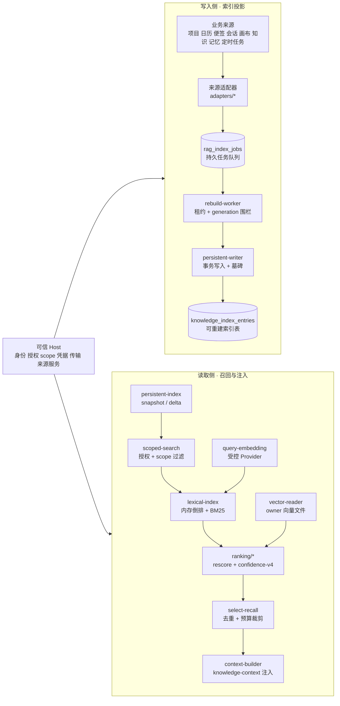
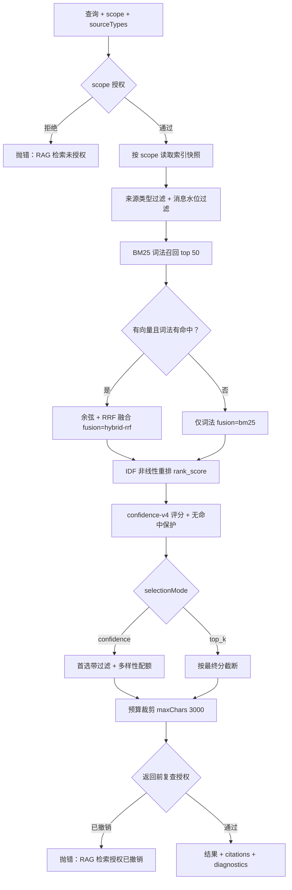

# Agent RAG

gugu 2.0 的检索层。纯 Node / TypeScript 实现，不保留 Python 运行时依赖。

一句话职责：**把 8 类业务来源投影成可重建的词法索引，在可信 owner scope 下完成「授权 → 召回 → 融合 → 排序 → 预算裁剪 → 上下文注入」的统一检索。**

三条边界，改动前先确认：

| 边界 | 说明 |
| --- | --- |
| 只检索，不写业务 | 索引是派生投影；项目、日历、便签等写入一律走 Host 的领域服务，RAG 不反向修改业务数据 |
| 不持有身份与授权 | owner、scope、授权快照、来源服务、凭据、传输全部由可信 Host 注入；scope 不能由工具入参或模型输出决定 |
| 索引可重建 | `knowledge_index_entries` 是投影而非真源；真源是业务库与授权 FS，任何时候都能按来源整表重灌 |

## 目录

- [整体架构](#整体架构)
- [检索算法](#检索算法)
- [已落地的优化](#已落地的优化)
- [适配](#适配)
- [安全与隔离](#安全与隔离)
- [可观测性](#可观测性)
- [已知限制与未决](#已知限制与未决)
- [相关文档](#相关文档)

## 整体架构

### 架构图

两级存储：**PostgreSQL 的 `knowledge_index_entries` 是持久投影**（可重建），**进程内倒排索引是查询期缓存**（按 owner + revision 复用）。查询永远从持久投影出发，内存索引只是加速层。

### 模块职责

| 文件 / 目录 | 职责 | 不负责 |
| --- | --- | --- |
| `adapters/` | 把各来源 canonical record 投影成 `RagDocument`（分块、版本、scope、metadata） | 来源数据的读取与鉴权 |
| `index-builder.ts` | 来源适配器的唯一组合入口 | 自行拼接来源文本 |
| `*-source.ts` | 绑定 Core 领域读取端口，按 owner 读取来源记录 | 授权判定、索引写入 |
| `persistent-index.ts` | 读取持久投影：按 scope 快照、增量 delta | 写入 |
| `persistent-writer.ts` | 事务内写入/更新/墓碑化投影，水位单调推进 | 来源读取 |
| `rebuild-worker.ts` | 领取持久任务，围栏校验后代写投影 | 索引格式、检索 |
| `lexical-index.ts` | 内存倒排、BM25 召回、向量重排、增量对齐 | 授权、预算裁剪 |
| `ranking/` | 分词后的全部评分算法：BM25、IDF 重排、confidence、融合、选择 | 来源读取、SQL |
| `scoped-search.ts` | 检索编排：授权 → 快照 → 过滤 → 召回 → 融合 → 排序 → 复查授权 | 评分算法实现 |
| `context-builder.ts` | 把命中投影成可回放的 `knowledge-context` 块并注入 Run | 召回实现 |
| `tokenizer.ts` / `node-jieba.ts` | 中文分词与词项规范化；Jieba 实例由可信 Host 注入 | 索引结构 |
| `query-embedding.ts` | 受控 Provider 的查询向量生成与短缓存 | 文档向量（见 `vector-reader.ts`） |
| `memory-*.ts` | 记忆来源投影、scope 状态、记忆检索策略 | 记忆内容生成 |

### 写入链路（索引投影）

1. 业务事务内排入任务：`enqueueAgentRagRebuildInTransaction` 写 `rag_index_jobs`（按 owner + 来源唯一），`generation` 自增以围栏在途 Worker。
2. Worker 领取：`FOR UPDATE SKIP LOCKED` 取一条 `queued/retrying` 或租约过期的 `running` 任务，置 600 秒租约。
3. 读取来源：`sources[source_type](owner, sourceId)` 拉取当前来源的完整文档集。
4. 围栏写入：`persistent-writer` 在同一事务内校验 generation + 租约，替换该来源投影，未出现在新集合里的旧行写 `deleted_at` 墓碑。
5. 收据：任务标记 `ready` / `retrying`，失败按 `5 × 2^attempts`（上限 300 秒）指数退避。

### 读取链路（召回与注入）

`selectionMode` 区分两类调用方：

- `top_k`（主动检索，如 `search_memory`）：只按最终分截断，不做二次相关性筛选。
- `confidence`（被动注入，如自动 RAG 上下文）：在分数之外叠加来源配额、父文档配额与相似度去重，避免自动注入被同源内容占满。

## 检索算法

所有公式与常量集中在 `ranking/`，`scoped-search.ts` 只负责编排。

### 分词与词项规范化

`tokenizer.ts` 的处理顺序：

1. 小写化后用 `/[A-Za-z0-9_]+|[\u4e00-\u9fff]+/u` 抽出原始 token。
2. 中文段交给 Jieba `cut(text, false)`（**HMM=false**，与 1.7.7 一致），只保留含中文的词；纯 ASCII token 原样保留为完整实体。
3. **字母数字压缩**：在 `a 1` / `1 a` 这类相邻形态上去掉空格后再抽一次 token，补充原始结果里没有的组合。
4. **月份别名归一**：`2026-11`、`11月`、`十一月`、`November` 统一映射为 `month_11`；`March` / `May` 只在有日期或时间介词语境时识别；**不从月份推断年份**。

分词器必须由可信 Host 注入（`configureRagJieba`），未注入时直接抛错拒绝检索，避免静默降级成粗粒度切词。

### BM25 词法打分

常量 `K1 = 1.2`、`B = 0.75`（`ranking/bm25.ts`）：

$$
\mathrm{score}(d,q)=\sum_{t\in q}\mathrm{idf}(t)\cdot\frac{tf(t,d)\,(k_1+1)}{tf(t,d)+k_1\left(1-b+b\cdot\frac{|d|}{avgdl}\right)}
$$

$$
\mathrm{idf}(t)=\ln\left(1+\frac{N-df(t)+0.5}{df(t)+0.5}\right)
$$

`N`、`df`、`avgdl` 来自**完整索引统计**（`CorpusStatistics`），不是当前候选池；生产排序禁止从候选池估算 IDF，否则分数会随候选集合漂移。

### IDF 非线性重排

`ranking/idf-rescore.ts` 在 BM25 之上再算一层"查询词权重 × 非线性贡献"：

$$
w(t)=\mathrm{clamp}\left(\left(\frac{\mathrm{idf}(t)}{\overline{\mathrm{idf}}}\right)^{1},\;0.25,\;4\right),\qquad
\mathrm{rank\_score}(d)=\sum_{t\in q}\left(\mathrm{bm25}(t,d)\cdot w(t)\right)^{1.5}
$$

- $\overline{\mathrm{idf}}$ 是查询词 IDF 的平均值，用于判断某个词相对查询整体有多稀有。
- 指数 `1.5` 放大高 IDF 词的贡献，抑制长尾词拉平排序。
- 每个命中词都会输出 `term / idf / query_weight / term_frequency / weighted / nonlinear`，可直接作为排序可解释性证据。

### confidence-v4 评分

生产默认 `confidence-v4`，`confidence-v1` 仅作短期回滚开关（`UnifiedRecallOptions.scoringVersion`）。

v4 的词法归一化是**跨来源统一归一化**（v1 是来源内归一化）：

$$
\mathrm{lexicalNorm}(d)=\min\left(1,\frac{\mathrm{rank\_score}(d)}{\max_{d'\in pool}\mathrm{rank\_score}(d')}\right)
$$

$$
\mathrm{semanticNorm}(d)=\frac{\cos(d,q)}{\max_{d'\in pool}\cos(d',q)}
$$

$$
\mathrm{fusedNorm}(d)=
\begin{cases}
0.45\cdot\mathrm{lexicalNorm}(d)+0.55\cdot\mathrm{semanticNorm}(d) & \text{池内存在语义候选}\\
\mathrm{lexicalNorm}(d) & \text{否则（退纯词法）}
\end{cases}
$$

$$
\mathrm{confidence}(d)=\left(0.75\cdot\mathrm{fusedNorm}(d)+0.25\cdot\mathrm{queryMatch}(d)\right)\cdot\mathrm{sourceQuality}(d)
$$

`queryMatch` 的口径：去掉纯数字/标点的有效查询词集合，若去空白小写后的整串是文档的子串则记 1，否则记「命中的查询词数 / 查询词总数」。

`sourceQuality`（v4）：

| 来源 | knowledge | file | memory | project | journal | note | calendar | canvas | conversation | 未知 |
| --- | --- | --- | --- | --- | --- | --- | --- | --- | --- | --- |
| 权重 | 1.0 | 0.8 | 0.8 | 0.8 | 0.8 | 0.8 | 0.8 | 0.6 | 0.6 | 0.6 |

阈值与保护：

- 首选带 `preferred = 0.55`，低分带 `low = 0.35`。
- **无命中硬保护**：`queryMatch ≤ 0` 的候选，其 confidence 被压到 `0.35 - 0.01`，不允许仅凭来源质量进入首选集。
- 乘法公式天然有界，上界即来源质量上限（knowledge 为 1.0），无需额外硬截断。

最终排序的并列决胜顺序：`confidence → rank_score → fused_score → 来源优先级 → updated_at → document_version → id`。来源优先级为 `memory 0 < project 10 < calendar/journal 30 < scheduled_task 35 < canvas 40 < conversation 50`。

### 向量融合（RRF）

`ranking/hybrid.ts` 只对**已经进入词法候选的文档**重排，不扩展授权范围与召回面：

$$
\mathrm{fused}(d)=w_{lex}\frac{k+1}{k+\mathrm{rank}_{lex}(d)}+w_{vec}\frac{k+1}{k+\mathrm{rank}_{vec}(d)},\qquad w_{lex}=0.45,\;w_{vec}=0.55,\;k=60
$$

向量维度与查询向量不一致时，该候选的语义分记 0 并退化为词法排序。

### 预算裁剪与引用合并

`ranking/select-recall.ts` 在排序之后做最后一道收口：

- 上限：`limit ≤ 50`（默认 5）、`maxChars` 默认 3000、`maxPerSource` 默认 3、`maxPerParent` 默认 3。
- 去重：正文去空白后取 SHA-256，命中即跳过。
- 多样性：同来源、同父文档配额，以及 Jaccard 相似度 ≥ 0.85 视为同义重复。`selectionMode=top_k` 时这三项配额关闭。
- 预算不足时截断 `context_text`，不截断 `text`。
- 正文相同的多个来源合并为一条结果，`citations` 数组保留全部来源。

### 参数速查

| 参数 | 值 | 位置 |
| --- | --- | --- |
| BM25 `K1` / `B` | 1.2 / 0.75 | `ranking/bm25.ts` |
| IDF 重排幂次 | 1.5 | `ranking/idf-rescore.ts` |
| query weight 截断 | [0.25, 4] | `ranking/idf-rescore.ts` |
| v4 词法/匹配权重 | 0.75 / 0.25 | `ranking/confidence.ts` |
| v4 语义融合权重 | 0.45 词法 / 0.55 语义 | `ranking/rank-candidates.ts` |
| 首选带 / 低分带 | 0.55 / 0.35 | `ranking/confidence.ts` |
| RRF `w_lex` / `w_vec` / `k` | 0.45 / 0.55 / 60 | `ranking/hybrid.ts` |
| 词法召回上限 | 50 | `scoped-search.ts` |
| 输出字符预算 | 3000 | `scoped-search.ts` |
| embedding 缓存 | TTL 5 分钟 / 64 项 | `query-embedding.ts` |
| 向量文件缓存 | 无 TTL / LRU 8 项 | `vector-reader.ts` |
| 索引任务租约 | 600 秒 | `rebuild-worker.ts` |

## 已落地的优化

按"解决了什么性能问题"组织，全部有对应实现位置。

### 索引构建与写入

| 优化 | 做法 | 收益 |
| --- | --- | --- |
| 增量写入去 O(n²) | `patchInMemory` 改为"标记—清扫"：先处理账目并收集脏词项，再按词项一次性重建 posting | 20237 条全量重灌从 71s 降到线性；此前逐条 remove/add 会顶爆 30s 构建预算（2026-09-13 devserver 事故） |
| 按词项预聚合 | 新增侧先按词项收集 `[docId, count]`，避免重建时对每个脏词项扫全表 | 消除 `dirtyTerms × n` 的残留复杂度 |
| 词法指纹跳过未变文档 | 来源级重建会整表重写行（`indexed_at` 推新），install 阶段比对内容指纹跳过正文未变的文档 | 冷加载尖峰根因（2026-09-14）；分词成本从"全表"压到"真实变更" |
| 语料缓存 | `createRagLexicalCorpusCache`：每个数据库至多缓存 4 个 owner 与 scope 组合，合计至多 5 万文档；超限语料按查询构建 | 避免多 owner 常驻内存；跨轮复用倒排结构 |
| 单 owner 串行写入 | PostgreSQL `pg_advisory_xact_lock(hashtextextended(owner))` + `indexed_at` 单调递增水位 | 同 owner 并发写入不互相覆盖；增量游标不倒退 |
| 增量读取 | `delta()` 按 `(indexed_at, id)` 游标分页，单页 ≤ 2000 | 索引刷新不必整表重读 |
| 任务围栏 | `generation` + 600 秒租约，事务内校验后才写投影 | 在途 Worker 不会把新 generation 的结果覆盖掉；失败按 `5×2^attempts`（上限 300s）退避 |

### 查询路径

| 优化 | 做法 | 收益 |
| --- | --- | --- |
| 词法优先的混合召回 | 向量只对 BM25 已命中的候选重排，不做全库 KNN | 语义成本从 O(语料) 降到 O(候选≤50) |
| 完整索引 IDF | `CorpusStatistics` 取自完整索引统计，禁止用候选池估算 | 分数不随候选集合漂移，跨轮可比 |
| embedding 短缓存 | key = provider/model/dimensions/url/format/凭据摘要/allowLocal/query 的 SHA-256；TTL 5 分钟、64 项 LRU；只缓存成功向量，返回副本 | 相同查询不重复打 Provider；凭据或端点变更自动失效 |
| 向量文件缓存 | 内容 SHA-256 失效、无 TTL、LRU 8 项、key 含 owner 命名空间 | 避免重复解析大 JSON；不同 owner 不共享驻留文件 |
| 滑动 TTL + LRU | `TtlCache`：滑动窗口过期、按插入序淘汰、惰性过期无后台定时器 | 活跃条目不因固定 TTL 被淘汰 |
| 索引 revision 缓存 | `RagIndexCacheService` 按 scope + revision 命中即跳过重建 | 同 revision 不重复构建索引 |
| 单 scope 绑定 | `TsRagService` 拒绝跨 scope 复用同一 engine 索引 | 缓存不会把多租户索引混成一份 |
| 并发串行化 | `TsRagService` 用 pending promise 队列串行化跨 revision 调用 | 可变索引不被并发写坏 |
| 双阶段授权 | 读取前逐 scope 授权，返回结果前再复查一次 | 检索过程中撤权立即生效 |
| 记忆先隐藏后重建 | 删除 / 失效时先写 `deleted_at` 墓碑并推进 settled generation | 不留"旧内容仍可检索"的窗口 |

## 适配

### 来源与投影

8 类可重建来源，`file` 按 2.0 决策退役（正文走授权 FS 直读，不进索引表）。

| 来源 | 实现 | 读取边界 | 投影特征 |
| --- | --- | --- | --- |
| project | `project-source.ts` | Core 项目服务，owner 限定 | 结构化多行：项目 / 联系人 / 状态 / 优先级 / 进度 / 当前阶段 / 起止日期 / 阶段名 |
| calendar | `calendar-source.ts` + `adapters/calendar.ts` | Core 日历读取端口，owner 限定 | 三行头部「活动 / 日期 / 时间」+ 描述，空描述整行省略 |
| note | `note-source.ts` + `adapters/note.ts` | Mind 便签读取服务 | 标题 + `content_plain`（缺失时回落 `content_md`），空标题回落「便签」 |
| scheduled_task | `scheduled-task-source.ts` + `adapters/scheduled-tasks.ts` | 定时任务共享读取服务 | 固定四行：任务 / 计划 / 状态 / payload（空 payload 保留换行） |
| conversation | `conversation-index-source.ts`（重建）、`conversation-source.ts`（检索） | 持久重建按 owner 读摘要与消息，保留 baseline、角色、群 scope 与相邻上下文 | 排序用 `ranking_text`（正文），展示用 `context_text`（前文 + 当前 + 后文） |
| canvas | `canvas-source.ts` + `adapters/canvas.ts` | Mind `listForRag`，按稳定 ID 分页 | 存活画布 / 项 / 节点约束 |
| knowledge | `knowledge-source.ts` | Host 注入的 owner 授权 FS 读取 Markdown 主数据；DB 只存索引投影 | 复用 `AgentKnowledgeReadStore`，与 Python 一致的 summary / keywords / scope / metadata |
| memory | `memory-loader.ts`、`memory-source.ts`、`memory-scope-state.ts` | Host 以 owner 限定枚举 `memory_reflection_cursors`；Core 从 owner-bound FS 读索引 / legacy / group / member 文件 | 完整 owner/scope 状态与 tombstone 由 SQL reader 复核 |

`journal` 只存在于 ranker 的来源质量常量里，是保留的历史排序类别，1.7.7 没有对应来源生产者。**不要因为 ranker 认识某个类型就认为来源已接入。**

### 分块与版本

`adapters/base.ts` 的统一口径：

- **分块**：段落 → 句 → 块，单块 1000 字符、重叠 150 字符；长度按 Unicode 码点计数（对齐 Python `len`/slice 口径），含 emoji 等非 BMP 字符时边界不漂移。
- **文档键**：`parent_id = document_id = "{source_type}:{source_id}"`；wire id = `"{source_type}:{parent_id}:{chunk_index}"`。
- **正文投影**：`text = title + summary + chunk 正文`（参与索引与排序），`content` 只保留 chunk 正文（参与引用与 hash），`context_text` 是有限上下文（只展示，不参与排序）。
- **summary 去自重复**：summary 本身是正文前缀时（如 memory 的截断拷贝）不拼进 `text`，否则会自我重复命中。
- **版本号**：`document_version = sha256("\x1f".join([*version_parts, text]))[:16]`，`version_parts` 由各来源自定义（如 project 用 `[id, version]`）。

### 分词适配

- 中文分词依赖 `@node-rs/jieba@2.0.1` 包内词典，**固定 `HMM=false`**；实例由可信 Host 通过 `configureRagJieba` 注入，未注入直接拒绝检索。
- 旧 Python 侧用 `rjieba`，两边共享 tokenizer golden 与代表性语料，但**未做全量逐 token 等价量化**（OOV、Unicode 输入的边界仍未覆盖）。
- 月份别名归一：`2026-11` / `11月` / `十一月` / `November` → `month_11`；不推断年份。

### 与旧实现的对应关系

迁移基线是 Git tag `v1.7.7`（commit `14c544f1faf1193e8a073844af4a5d7a4872045c`）下的 `backend/ts/workers/rag`，许可证 Apache-2.0。旧目录 25 个 TS 文件中，24 个模块映射到本目录；`index.ts` 是旧 sidecar 的 stdin/stdout 协议与组合根，由 Core Worker contracts + Host 生命周期组合替代。

两处有意的口径替换：

| 旧实现 | 2.0 现状 |
| --- | --- |
| `QueryEmbeddingSettings.pinned_ip` | 可信 Host 的统一 Node Provider transport：DNS 校验 + 连接 pinning |
| embedding 结果 `http_status` | Core 风格的 `httpStatus` |

旧 Worker 依赖 `ali-oss@6.23.0` 未迁入，因为 Host storage 走授权 FS 端口。

## 安全与隔离

| 面 | 规则 |
| --- | --- |
| owner | 所有索引查询带 `owner_user_id`；owner 由 `dataContext(rawOwner).ownerId` 归一（SQLite 去连字符）。工具入参里的 owner 无效 |
| scope | 支持 `owner` / `project` / `group` / `member`；scope 必须来自 Host 已验证的授权快照，**不能由模型参数或工具入参决定** |
| 授权时机 | 读取索引前逐 scope 授权 → 返回结果前再复查一次；期间撤权立即抛错 |
| 失败语义 | 未授权、越权、scope 不完整一律抛错，不返回部分结果；**取消不会伪装成词法成功** |
| 索引写入 | `persistent-writer` 拒收 `file` 来源，防止绕过"授权 FS 是唯一真源"把文件正文复制进 DB |
| 记忆删除 | 先墓碑化旧投影、推进 settled generation、清除旧租约，再删源文件 |
| 元数据损坏 | 读取时返回固定文案「RAG 索引元数据无效」，不传播含原始内容的 JSON 异常 |
| 路径 | Host 本地 FS reader 拒绝路径越界与符号链接；owner 向量文件只允许旧版三个固定路径并限制大小 |
| Provider | embedding 走可信 Host transport；BYOK 在凭据查询、解密完成、发送请求前三处逐次检查 |
| 本地 Provider | Local / Ollama 需 Host 能力上限 **与** 单请求可信标记双门放行，云端 Provider 指向本机地址在发请求前拒绝 |
| 缓存隔离 | 向量文件缓存 key 含 owner 命名空间；embedding 缓存 key 含 owner 与凭据摘要，跨 owner 不共享 |
| 降级而非失败 | embedding 不可用时保留已授权范围内的词法结果，并写明 `fallback_reason` |

## 可观测性

### 分阶段耗时

`stage_ms` 逐段记录：`scope_snapshot_ms` → `document_filter_ms` → `lexical_retrieval_ms` → `document_vectors_ms` → `query_embedding_ms` → `vector_fusion_ms` → `ranking_ms` → `authorization_recheck_ms`。`context-builder` 另记 `context_binding_ms` / `vector_setup_ms` / `vector_close_ms`。

### 融合与降级

- `fusion`：`bm25`（纯词法）/ `hybrid-rrf`（命中向量）。
- `fallback_reason`：`no_lexical_hits` / `no_documents_for_embedding` / `no_matching_document_vectors` / `embedding_failed` / `embedding_empty` / `embedding_disabled` / `lexical_only` / `embedding_cache_unavailable`。

### 排序可解释性

每条结果输出：`confidence`、`source_quality`、`query_match`、`normalized_score`、`fused_score`、`semantic_norm`、`rank_score`、`query_idf_baseline`，以及逐词的 `rank_contributions`（`term` / `idf` / `query_weight` / `term_frequency` / `weighted` / `nonlinear`）。可以直接回答"为什么这条排在前面"。

### 候选统计

`candidate_count` / `eligible_count` / `accepted_count`，以及 `rejected_duplicate` / `rejected_parent` / `rejected_source` / `rejected_similarity` / `rejected_low_score` / `rejected_not_preferred`，配合 `source_diagnostics` 的分来源计数与 `top_confidence` / `threshold` / `preferred_threshold`。

### 回放

注入块带 `content_hash` 与逐条 `content_hashes`；下一轮检索通过 `excludeContentHashes` 排除历史已注入内容，保证同一 Run 可回放且不重复注入。索引 revision 形如 `ts-jieba-words-v3:rag-projection-v5:{source}:{stamp}`，多 scope 以 `|` 连接。

## 已知限制与未决

| 主题 | 状态 |
| --- | --- |
| 生产 PostgreSQL | 迁移、Redis dispatch/recovery、外部 embedding / 聊天 Provider、目标环境重启恢复均**尚未完成生产验收**；本地回归以隔离 SQLite / 临时 FS 为主 |
| IM group / member scope | 实时反思与在线检索依赖各平台可信 Host 能力，Web 不伪造群身份或授权。scope 枚举只限定"待重建哪些数据"，**不授予检索权** |
| 全语料 KNN / HNSW | 未评估。当前是"BM25 候选 + 候选集精确余弦"，语义内容若没进 BM25 候选就没有机会被向量召回（见 PRD-RAG-11） |
| 阈值 | `0.55 / 0.35` 在 v4 尺度下首选覆盖率偏低，候选方案 `0.50/0.30`、`0.45/0.30` 待按线上首选率数据拍板 |
| `semantic_norm` 归一化 | 校准方式待 shadow 数据决定 |
| `source_quality` | 静态常量，不按用户或索引类型动态配置 |
| 跨语言 tokenizer 等价 | 共享 golden 与代表性语料通过，**不代表**所有 OOV / Unicode 输入逐 token 相同 |
| 词法质量语料 | 5 个有效 query 达到 Recall@3=1、MRR=1，无关 query 为空；只覆盖代表性召回与 scope 裁剪，不代表全库排序或向量质量等价 |
| 记忆检索策略 | `auto` / `bm25` / `embedding` 三档；`auto` 在向量不可用时退词法并标注原因 |

## 相关文档

| 文档 | 用途 |
| --- | --- |
| `docs/prds/【已完成】PRD-TS-RAG-0.4.0-算法设计.md` | confidence-v4 与 IDF 非线性重排的完整推导、阈值与开放项 |
| `docs/prds/PRD-RAG-11-全量KNN与HNSW检索评估.md` | 全语料精确 KNN 与 HNSW 的评估计划（尚未执行） |
| `docs/prds/【已完成】PRD-RAG-2-持久化检索索引与搜索加速.md` | 持久索引与增量同步的设计来源 |
| `docs/prds/【已完成】PRD-RAG-4-召回评分过滤与质量控制.md` | 召回评分与过滤策略 |
| `docs/prds/【已完成】PRD-RAG-9-增量索引重建与来源级同步.md` | 来源级增量重建 |
| `docs/prds/【已归档】PRD-RAG-11-Cython等效模块与TS-RAG迁移.md` | 从 Python/Cython 迁到 TS 的原始边界 |
| `docs/testing/node-agent-tools-parity.md` | 与旧实现的行为差异记录（行为或安全差异必须写在这里） |
| `docs/testing/fixtures/rag-relevance-corpus.json` | 与旧 Cython 共享的词法质量语料 |
| `docs/testing/fixtures/rag-conversation-projection.json` | 会话来源投影的逐字段基准 |

## 与旧栈的关系

本目录是 2.0 的 Node-only 实现。**旧 Gugu-web 仓库的 Python/Cython 轨道是另一件事**：按 2026-11-26 的核查记录，`main` 分支默认仍是 `search.rag_backend=typescript`，Cython 仅在开发环境显式启用，PR #112「RAG 迁移到 Cython」仍处于 open、未合并状态。

也就是说 Python/Cython 的生产切换并未真正完成，两套实现目前并存但职责已分清：

| | 旧 Gugu-web（Python/Cython） | 本目录（Node/TS） |
| --- | --- | --- |
| 定位 | 存量系统，切换未完成 | 2.0 唯一运行目标 |
| 依赖 | `rjieba`、Python 运行时 | `@node-rs/jieba@2.0.1`，无 Python 运行时依赖 |
| 关系 | 行为基准与对照来源 | 不引用、不桥接、不回退 |

测试位于 `packages/core/tests/agent/rag/`：`ranking` / `tokenizer` / `scoped-search` / `context-builder` / `source-adapters` / `memory-search` / `memory-loader` / `query-embedding` / `service-cache` / `ttl-cache`。
